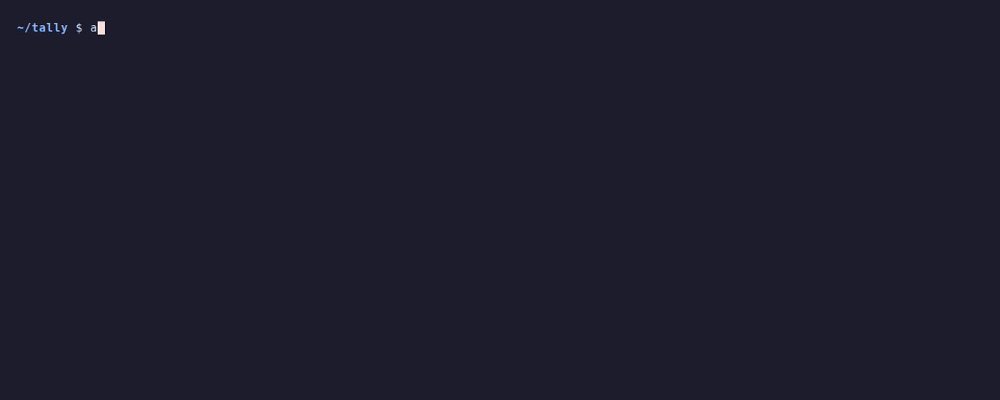

# agent

Run many coding agents at once from one small Rust daemon. Each agent is a named **bot** with a durable SQLite conversation: continue it later, fork it from any earlier checkpoint, steer it mid-turn, or follow it live as JSON Lines.

Agent is built for **programs first**—scripts, CI jobs, apps, and other bots drive it through a JSON CLI or Unix socket protocol, while `--pretty` gives people a readable view of the same events. For a full terminal workspace that supervises parallel tasks for you, see [Sonny](#sonny).

[Quickstart](#quickstart) · [CLI reference](docs/CLI.md) · [Sonny](sonny/README.md) · [Documentation](docs/README.md)

## Why Agent

- **One tiny daemon, many active bots.** Every bot shares one single-threaded async runtime and SQLite WAL store. Idle and waiting bots cost ~1 KiB (a store row and registry entry, not a process).
- **Software-first protocol.** CLI commands output JSON / JSON Lines by default with stable exit codes, idempotent `--request-id` keys, and structured errors with hints. Persistent clients can speak the Unix-socket protocol directly, use the [`client/`](client) Rust crate, and register custom **declared tools** or **companions**.
- **Durable, branchable conversations.** Chats survive daemon restarts, upgrades, and crashes. Fork from any historical checkpoint without duplicating workspaces or replaying side effects. Very long histories compact while keeping the full transcript intact and searchable via `history`.
- **Fleet-ready reliability.** Per-provider, per-model rate-limit pacing learned from provider headers, automatic call-boundary retries, and **held turns** (pauses turns when credentials expire or quotas hit, resuming once fixed instead of failing). Run OpenAI, Anthropic, OpenRouter, ChatGPT plans, and Amazon Bedrock side by side.
- **Composable isolation & native delegation.** OS-level sandboxes (Seatbelt on macOS, bubblewrap on Linux), approval gates, Starlark command rules, and an audit trail. Bots delegate natively with `spawn_agent`, `send_message`, and `wait` without holding execution capacity while waiting.

```sh
agent run --pretty --new --bot lead -- "Fix the failing test, and have a helper check the README"
```

<p align="center">
  
</p>

<p align="center"><sub><code>lead</code> hands the README check to a second bot, runs the tests, collects the helper's answer, then fixes the bug.
The model's words are scripted for this recording; the daemon, the bots, and every tool call are real.
<a href="docs/demo/">Record it yourself</a>.</sub></p>

## Install

Agent runs on macOS and Linux.

**Homebrew:**

```sh
brew install lydakis/agent/agent
```

**From source** (uses the Rust toolchain pinned in [rust-toolchain.toml](rust-toolchain.toml)):

```sh
git clone https://github.com/lydakis/agent
cd agent
cargo install --locked --path .
```

Make sure `~/.cargo/bin` is on your `PATH`. For Sonny, static Linux releases, or nightly builds, see [Sonny's installation guide](sonny/README.md#install).

## Quickstart

### 1. Pick a provider and model

Export credentials and defaults (or save `provider` and `model` in `~/.agent/config.toml`; environment variables take precedence):

```sh
export ANTHROPIC_API_KEY=...  # your key
export AGENT_PROVIDER=anthropic
export AGENT_MODEL=anthropic/claude-opus-5-5
```

| Provider | Authentication | Model format |
| --- | --- | --- |
| OpenAI | `OPENAI_API_KEY` | `openai/MODEL` |
| Anthropic | `ANTHROPIC_API_KEY` | `anthropic/MODEL` |
| OpenRouter | `OPENROUTER_API_KEY` | `openrouter/VENDOR/MODEL` |
| ChatGPT | `agent login chatgpt` | `chatgpt/MODEL` |
| Amazon Bedrock | AWS credentials or Bedrock API key | Endpoint-dependent; see [Bedrock setup](docs/RUST_PROTOTYPE.md#providers-and-models) |

Run `agent models --discover` to refresh available models (also runs at daemon startup). Customize or hide entries in `~/.agent/models` (`-PROVIDER/MODEL` hides one). Each bot keeps its own model, so multiple providers can run side by side. See [providers and models](docs/RUST_PROTOTYPE.md#providers-and-models) for custom gateways and Bedrock profiles.

### 2. Start and continue a bot

From your project directory, create a named bot:

```sh
agent run --pretty --new --bot scout -- "What does this repository do?"
```

The first command starts the daemon automatically. State lives in `~/.agent/state.sqlite` and survives restarts. Omit `--new` to continue the conversation, and omit `--pretty` for JSON Lines:

```sh
agent run --pretty --bot scout -- "Which parts are tested?"
```

A bot keeps its model, instructions, and tools across turns. Passing `--model` on a later turn overrides only that turn; use the socket protocol's [`configure`](docs/RUST_PROTOTYPE.md#software-protocol) to change persistent settings.

> **Permissions note:** CLI bots run tools with your permissions unless you pass `--sandbox` (`read-only` or `workspace-write`). [Sonny](#sonny) sandboxes agents by default.

### 3. Detach, follow, steer, or stop

Press **Ctrl-C** at any time—the turn keeps running in the daemon. Reattach later to replay what you missed and follow to completion:

```sh
agent follow --pretty --bot scout
```

Run in the background and wait from a script (using `jq`):

```sh
handle=$(agent run --detach --bot scout -- "Run the test suite and summarize failures" | jq -r .handle)
agent wait "$handle"
```

Steer a running turn, queue follow-up work, or stop it:

```sh
agent run --bot scout --delivery steer -- "Skip the integration tests"
agent run --bot scout --delivery queue -- "Then update the changelog"
agent interrupt --bot scout
```

Messaging a busy bot defaults to `steer` (or `queue` when changing `--workspace` or setting `--turn-budget-tokens`; configurable via `AGENT_DELIVERY`). Use `agent ls --pretty` to see every bot's state and `agent follow --all` to stream all bots at once.

### 4. Fork from any checkpoint

Explore an alternative without disturbing the original conversation:

```sh
agent fork --source scout --bot scout-b
agent run --pretty --bot scout-b -- "Try a streaming parser instead"
```

Pass `--checkpoint ID` (reported by `agent wait scout/N`) to branch from an earlier turn. Both branches continue independently without copying files or replaying past tool side effects.

### 5. Let bots delegate and follow project policy

Bots can coordinate peers natively using built-in tools: `spawn_agent`, `send_message`, `wait`, `list_agents`, and `close_agent`. A waiting bot parks durably and holds zero execution capacity.

Pass `--agents` when creating a bot to compose your project's `AGENTS.md` files (from workspace up to root plus `~/.agents/AGENTS.md`), skill indexes (`.agents/skills/`), profile indexes (`.agents/agents/`), and memory indexes (`~/.agents/memory`). Pass `--profile ROLE` to start a bot in a specific role. See [client policy](docs/CLIENT.md).

## Use it from a program

- **JSON by default:** `run` and `follow` stream one JSON event per line (text, thinking, tool calls/results, usage, state changes); snapshot commands print one JSON object or array.
- **Stable exit codes:** `0` success, `1` failed/incomplete/timeout, `2` invalid usage, `75` store/socket already owned by another daemon (`agent sandbox` exits with its command's status, or `125` on sandbox failure).
- **Socket protocol & declared tools:** Programs wanting a persistent connection or custom tools answered by their own process speak JSON Lines over the daemon's Unix socket (or use the [`client/`](client) Rust crate).
- **Working example:** [`examples/triage`](examples/triage) is a ~110-line zero-dependency Python service that forks a template bot per issue and serves custom tools (`search_issues`, `set_triage`) over the socket.

See the [CLI contract](docs/CLI.md) and [socket protocol](docs/RUST_PROTOTYPE.md#software-protocol) for details.

## Sonny

[Sonny](sonny/README.md) is the terminal workspace built on Agent for supervising **several tasks in parallel**. Open `sonny` in a project folder and talk to that project's **lead**: it spins up isolated tasks in their own git worktrees, follows them via the [Lookout](docs/LOOKOUT.md), and brings you only decisions and approvals that need you.

```sh
brew install lydakis/agent/sonny
sonny  # from your project folder
```

What Sonny adds on top of Agent:

- **Calm terminal UI:** words-only default view, structured decision cards (`ask`), live margin notes, `/side` mid-turn forks, `/zen` focus mode, `/projects`, and `/sky` fleet visualization.
- **Safe autonomy (`Auto`):** workspace sandboxing by default with a model reviewer for escalations, plus `/pause` to halt all agents at once.
- **Persistent capabilities:** [shared memory, skills, automations, commons & boards, code-mode MCP (`exec`), JS workflows, browser/desktop tools, and `sonny link`](docs/SONNY.md) for using your laptop's signed-in browser or MCP servers from a remote devbox.
- **Works where you work:** standalone terminal, multiplexer layouts (Rex, Herdr, cmux), or inside T3 Code and other ACP clients (`sonny acp`).

### When to use Sonny

Use Sonny when you want to hand off several threads of work and respond only when they need you. For one task you want to watch step by step, Claude Code or Codex may be a simpler fit (a recommendation from use, not a measured comparison).

Start with the [Sonny quickstart](sonny/README.md) or browse the [Sonny reference](sonny/REFERENCE.md).

## How fast is it?

Performance is the core focus of Agent, and every claim links to its measurement. See [current evidence](docs/EVIDENCE.md) for the complete record of runtime efficiency, task evaluations, and operational behavior.

**Live fleet checks (2026-09-15 to 2026-09-16):** One daemon ran 1,024 overlapping bot turns on real providers, sustained 64 bots for five minutes without drift, and pushed 10,000 bots through one API key at the provider's own rate with zero failures ([record](docs/LIVE_FLEET.md)). Overlap includes queued work, not necessarily simultaneous provider streams; these were short-context turns showing a lightweight runtime, not coding-agent capacity at that scale.

**Five-harness synthetic screen (2026-11-12):** 32 concurrent agents, each running three turns that add 64 KiB of text and stream back 5 KiB ([full screen](docs/HARNESS_MEASUREMENTS.md), 4-vCPU Linux VM, medians of three runs; Agent at main `987a276`, other harnesses at releases pinned since 2026-11-01):

| Harness | Peak memory | CPU time | Turn p99 |
| --- | ---: | ---: | ---: |
| Agent | 27 MiB | 0.2 s | 0.58 s |
| Pi 1.4.0 | 156 MiB | 1.1 s | 0.67 s |
| Codex 0.166.0 | 315 MiB | 6.8 s | 1.2 s |
| opencode 1.19.5 | 854 MiB | 9.4 s | 2.5 s |
| Claude Code 2.1.316 | 5,226 MiB | 23.8 s | 1.7 s |

*Read this as an exploratory screen, not a ranking.* The harnesses do different amounts of work: Agent commits every turn to SQLite, opencode keeps its own store, and the others hold conversations in memory; no tools were called. Claude Code runs one process per agent (memory summed across processes). Turn time includes 0.5 s of scripted streaming. Every harness reached all 32 concurrent streams. On this shared VM, other harnesses' numbers drift by up to ~20% between screens, so compare within one screen only.

Use the [benchmark guide](docs/BENCHMARKS.md) to reproduce these runs against the same synthetic provider.

## Safety and status

- **Experimental:** Agent is an experiment with no users yet. Protocols, CLI defaults, and store formats may change between revisions (stores migrate forward automatically).
- **Providers & scope:** Supports OpenAI Responses and Anthropic Messages APIs (including ChatGPT plans, OpenRouter, and Bedrock) with streamed thinking, usage, and prompt-cache accounting. Long conversations compact while preserving full history. Cross-provider handoff is not implemented. The daemon has no built-in MCP client (Sonny provides MCP through `exec`).
- **Clear boundaries:** Agent runs bots; it does not manage git branches, workspaces, or remote machines—those stay with the caller (see [Errand](https://github.com/lydakis/errand) for remote execution).
- **Sandboxing:** CLI bots run unconfined unless created with `--sandbox read-only` or `--sandbox workspace-write` (bubblewrap on Linux, Seatbelt on macOS, ported from Codex). Calls leaving the sandbox go to the bot's approval gate, or are refused without one. See [sandbox](docs/RUST_PROTOTYPE.md#sandbox) and [SECURITY.md](SECURITY.md).

## When you need more

Browse the full [documentation index](docs/README.md), or jump straight in:

- **Commands, flags & exit codes:** `agent --help`, `agent COMMAND --help`, or the [CLI contract](docs/CLI.md)
- **Project rules, skills & profiles:** [Client policy](docs/CLIENT.md)
- **Daemon internals & socket protocol:** [Runtime reference](docs/RUST_PROTOTYPE.md)
- **Why it's built this way:** [Design brief](docs/DESIGN.md) and [runtime investigation](docs/RUNTIMES.md)
- **Long conversations & storage:** [Long histories](docs/LONG_HISTORY.md) and [storage growth](docs/STORAGE_GROWTH.md)
- **What's measured & what's next:** [Current evidence](docs/EVIDENCE.md) and [investigation queue](docs/NEXT.md)

## License

Licensed under either of [Apache License 2.0](LICENSE-APACHE) or [MIT license](LICENSE-MIT), at your option.

Unless you explicitly state otherwise, any contribution you intentionally submit for inclusion in this project, as defined in the Apache-2.0 license, shall be dual licensed as above, without any additional terms or conditions.
