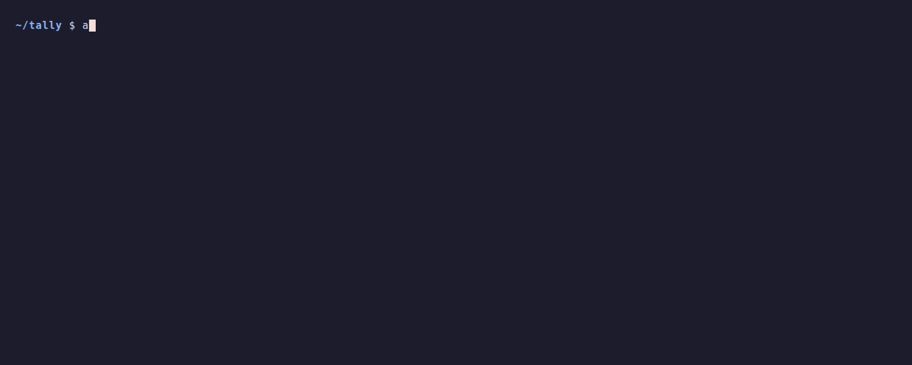

# agent

Run many coding agents at once from one small daemon. Each agent is a named
**bot** with a durable conversation: continue it later, fork it from any
earlier point, steer it mid-turn, or follow it live as a stream of JSON
events. Bots delegate by running the same `agent` command you do.

Agent is built for programs first. A script, a CI job, an app, or another bot
drives it through a CLI whose default output is JSON Lines, or through the
daemon's socket protocol. `--pretty` gives people a readable view of the same
events. For a terminal client that coordinates tasks for you, see [Sonny](#sonny).

[Quickstart](#quickstart) · [CLI reference](docs/CLI.md) · [Documentation](docs/README.md)

```sh
agent run --pretty --new --bot lead -- "Fix the failing test, and have a helper check the README"
```

<p align="center">
  
</p>

<p align="center"><sub><code>lead</code> hands the README check to a second bot, runs the tests, collects the helper's answer, then fixes the bug.
The model's words are scripted for this recording; the daemon, the bots, and every tool call are real.
<a href="docs/demo/">Record it yourself</a>.</sub></p>

## Install

Agent runs on macOS and Linux. With [Homebrew](https://brew.sh):

```sh
brew install lydakis/agent/agent
```

Or build from source with [Rust](https://rustup.rs). Rustup uses the
version pinned in [rust-toolchain.toml](rust-toolchain.toml):

```sh
git clone https://github.com/lydakis/agent
cd agent
cargo install --locked --path .
```

Cargo installs `agent` in `~/.cargo/bin`; make sure that directory is on your
`PATH`. For Sonny, Linux release binaries, or nightly builds, see
[Sonny's installation guide](sonny/README.md#install).

## Quickstart

Choose a provider and a model. For example, with an Anthropic API key:

```sh
export ANTHROPIC_API_KEY=...  # your key
export AGENT_PROVIDER=anthropic
export AGENT_MODEL=anthropic/claude-opus-5-5
```

From your project directory, start a named bot:

```sh
agent run --pretty --new --bot scout -- "What does this repository do?"
```

The first command starts the daemon in the background. Conversations live in
`~/.agent/state.sqlite` and survive daemon and machine restarts. `--new`
creates the named bot; leave it out to continue that conversation.
`--pretty` renders events for people; omit it for JSON Lines.

The CLI runs tools with your permissions unless you select a
[sandbox](docs/RUST_PROTOTYPE.md#sandbox). Sonny sandboxes agents by default.

### Other providers and models

| Provider | Authentication | Model name |
| --- | --- | --- |
| OpenAI | `OPENAI_API_KEY` | `openai/MODEL` |
| Anthropic | `ANTHROPIC_API_KEY` | `anthropic/MODEL` |
| OpenRouter | `OPENROUTER_API_KEY` | `openrouter/VENDOR/MODEL` |
| ChatGPT | `agent login chatgpt` | `chatgpt/MODEL` |
| Amazon Bedrock | AWS credentials or a Bedrock API key | Depends on the endpoint; see [Bedrock setup](docs/RUST_PROTOTYPE.md#providers-and-models) |

Set `AGENT_PROVIDER` to the provider you use and `AGENT_MODEL` to its model.
To save defaults instead, put `provider` and `model` in
`~/.agent/config.toml`; environment variables take precedence.

`agent models --discover` refreshes the available models. Discovery also runs
at daemon startup. Add choices or notes in `~/.agent/models`, or hide a model
with a `-PROVIDER/MODEL` line. Each bot keeps its own model, so different
providers can run side by side. See [providers and models](docs/RUST_PROTOTYPE.md#providers-and-models)
for endpoint configuration, Bedrock profiles, and custom gateways.

### Continue a bot

Name the bot again to give it its next turn in the same conversation:

```sh
agent run --pretty --bot scout -- "Which parts are tested?"
```

A bot keeps its model, instructions, and tools until a client changes them.
`--model` on a later turn overrides the model for that turn only. The socket
protocol's [`configure`](docs/RUST_PROTOTYPE.md#software-protocol) changes
persistent settings between turns.

### Leave it running and come back

Press **Ctrl-C** at any time; the turn keeps running in the daemon. Reattach
to replay what you missed and follow it to the end:

```sh
agent follow --pretty --bot scout
```

To start without waiting, use `--detach`. It prints a JSON handle that a script
can wait on (this example uses `jq`):

```sh
handle=$(agent run --detach --bot scout -- "Run the test suite and summarize the failures" | jq -r .handle)
agent wait "$handle"
```

`agent ls --pretty` lists every bot and what it's doing. `agent follow --all`
streams events from all of them.

### Steer or stop a running bot

Send more instructions into the turn that's already running:

```sh
agent run --bot scout --delivery steer -- "Skip the integration tests"
```

Stop it with `agent interrupt --bot scout`. By default, a message to a busy
bot steers its running turn. Use `--delivery queue` to wait behind it or
`--delivery reject` to refuse busy bots. Supplying `--workspace` or
`--turn-budget-tokens` defaults to queue instead; `AGENT_DELIVERY` can also
set the default. Cancel a queued message with
`agent interrupt --bot scout --turn N`.

## Let bots delegate

Bots delegate the way the demo shows: from their shell tool they run
`agent run --detach --new --bot NAME -- TASK`, keep working, and collect the
result with their `wait` tool. The default instructions teach them this. Every
bot is a peer with the same commands; a bot that starts another doesn't own it,
and you can talk to either one directly.

A waiting bot holds no execution capacity: while it waits, it costs a row in
the store and an entry in the daemon's registry, not a process.

To give a bot your project's conventions, add `--agents` when you create it.
Agent then composes its instructions from every `AGENTS.md` and
`.agents/AGENTS.md` from the workspace up to the filesystem root, plus
`~/.agents/AGENTS.md`, indexes of skills in `.agents/skills/` and
profiles in `.agents/agents/`, and the memory indexes in `~/.agents/memory`.
`--profile ROLE`
starts a bot in one of those roles. See [client policy](docs/CLIENT.md).

## Fork from an earlier point

Try an alternative without losing the original conversation:

```sh
agent fork --source scout --bot scout-b
agent run --pretty --bot scout-b -- "Try it with a streaming parser instead"
```

Without `--checkpoint`, the fork starts from the source's latest state. To
branch from an earlier turn, pass the `checkpoint` that
`agent wait scout/N` reports for it. Each branch continues
independently.

## Use it from a program

Output is JSON by default: `run` and `follow` stream one event per line (text,
thinking, tool calls and results, usage, state changes), and the other commands
print one JSON value or nothing. Exit codes are stable: 0 success, 1 failed or
incomplete, 2 invalid usage, and 75 when `agent serve` finds another daemon
already owns the store (`agent sandbox` exits with its command's own status,
or 125 when it fails itself). The [CLI contract](docs/CLI.md) has the details.

Programs that want a persistent connection can speak the daemon's JSONL socket
protocol directly; [`client/`](client) is a Rust client for it. See the
[software protocol](docs/RUST_PROTOTYPE.md#software-protocol).
[examples/triage](examples/triage) is a small service built on both, with
tools of its own that its bots call.

## Sonny

[Sonny](sonny/README.md) is a terminal client for coordinating several tasks.
Open it in a project folder and talk to that project's **lead**. The lead
starts tasks, hears their updates, and brings you questions and decisions.
Tasks can work in separate worktrees and open in Rex, Herdr, or cmux.

```sh
brew install lydakis/agent/sonny
sonny  # from your project's folder
```

First-run setup helps you connect a provider, choose a model, and import MCP
servers. Sonny also gives agents [memory, skills, and automations](docs/SONNY.md).
The [lookout](docs/LOOKOUT.md) brings in task updates and news from configured
sources. `/status` shows the work; `/config` changes settings.

### When to use Sonny

Use Sonny when you want to hand off several things and respond as they need
you. For one task you want to follow closely, Claude Code or Codex may be a
simpler fit. This is a recommendation from use, not a measured comparison.

### Install and first run

See the [Sonny quickstart](sonny/README.md) for installation, setup, everyday
controls, and permissions. Advanced settings and integrations are in the
[Sonny reference](sonny/REFERENCE.md).

## How fast is it?

Performance is the point of the project, and every claim links to its
measurement. [Current evidence](docs/EVIDENCE.md) is the up-to-date summary:
runtime efficiency, task results against Codex and Claude Code, and
operational behavior. In the September 15–16 fleet checks, one daemon ran 1,024
overlapping bot turns on real providers, held 64 for five minutes without
drift, and pushed 10,000 bots through one API key at the provider's own rate
with no failures
([live fleet check](docs/LIVE_FLEET.md)). Overlap includes queued work, not
necessarily simultaneous provider streams. Those were short-context turns: they
show a lightweight runtime, not coding-agent capacity at that scale.

The same synthetic conversation work through five harnesses, 32 agents at once,
each doing three turns that add 64 KiB of text and stream back 5 KiB
([full screen](docs/HARNESS_MEASUREMENTS.md), 2026-11-12, 4-vCPU Linux VM,
medians of three runs; Agent at main `987a276`, every other harness at the
release pinned since 2026-11-01).

| Harness | Peak memory | CPU time | Turn p99 |
| --- | ---: | ---: | ---: |
| Agent | 27 MiB | 0.2 s | 0.58 s |
| Pi 1.4.0 | 156 MiB | 1.1 s | 0.67 s |
| Codex 0.166.0 | 315 MiB | 6.8 s | 1.2 s |
| opencode 1.19.5 | 854 MiB | 9.4 s | 2.5 s |
| Claude Code 2.1.316 | 5,226 MiB | 23.8 s | 1.7 s |

Read this as an exploratory screen, not a ranking. The harnesses do different
amounts of work: Agent commits every turn to SQLite, opencode keeps its own
store, and the others hold conversations in memory; no tools were called.
Claude Code runs one process per agent, and its memory is summed across those
processes. Turn time includes 0.5 s of scripted streaming. Every harness
reached all 32 concurrent streams in this screen. On this shared VM the other
harnesses' numbers drift by up to about 20% between screens with the same
binaries, so compare harnesses within one screen, not across screens.

The [performance tools](docs/BENCHMARKS.md) reproduce these runs against the
same synthetic provider, and the [docs index](docs/README.md) links to the design record and
measurements behind every decision.

## Status

Agent is an experiment with no users yet. It supports the OpenAI Responses and
Anthropic Messages APIs, with streamed thinking, usage, and prompt-cache
accounting; long conversations are compacted while the full history is kept.
The daemon has no MCP client (Sonny reaches MCP servers through its `exec`
tool), and handing a conversation across providers is not implemented.
Protocols, CLI defaults, and the store format may change between revisions;
stores migrate forward automatically.

Agent runs bots; it doesn't create workspaces, manage Git branches, or choose
machines. Those stay with the caller. To run work on another machine, see
[Errand](https://github.com/lydakis/errand).

Bots run their tools with your permissions, directly on your machine, unless
they are made with a `sandbox`: `read-only` or `workspace-write` confine their
commands, writes and edits under bubblewrap on Linux and Seatbelt on macOS,
ported from Codex. A call that would leave the sandbox goes to the bot's
approval gate, and is refused when it has none. A bot made without a sandbox
runs unconfined, as `danger-full-access` does. Sonny sandboxes its leads and
tasks by default. See [sandbox](docs/RUST_PROTOTYPE.md#sandbox).

## When you need more

The [documentation index](docs/README.md) groups guides by task. Start here:

- **Every command and flag:** `agent --help`, `agent COMMAND --help`, or the
  [CLI contract](docs/CLI.md).
- **How the daemon works:** limits, storage, recovery, pacing, and compaction
  in the [runtime reference](docs/RUST_PROTOTYPE.md).
- **Why it's built this way:** the [design brief](docs/DESIGN.md) and the
  [runtime investigation](docs/RUNTIMES.md).
- **Very long conversations:** [long histories](docs/LONG_HISTORY.md) and
  [storage growth](docs/STORAGE_GROWTH.md).
- **What's next:** the [roadmap](docs/NEXT.md).

## License

Licensed under either of [Apache License 2.0](LICENSE-APACHE) or
[MIT license](LICENSE-MIT), at your option.

Unless you explicitly state otherwise, any contribution you intentionally
submit for inclusion in this project, as defined in the Apache-2.0 license,
shall be dual licensed as above, without any additional terms or conditions.
