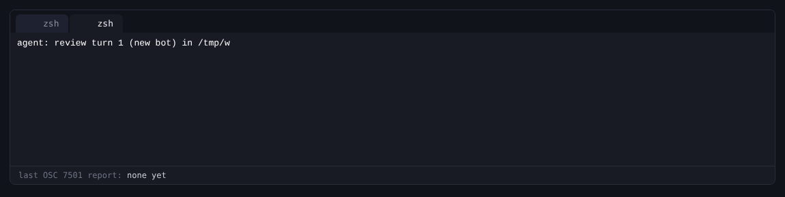

# CLI contract

`agent` is a flat-verb CLI built for programs first: every command outputs JSON by default, uses stable exit codes, and reports structured errors with actionable hints. Add `--pretty` to any client command for a readable terminal view.

[Commands](#commands-at-a-glance) · [Output & exit codes](#output-and-status) · [Running & delivery](#running-and-delivery) · [Creating bots](#creating-bots) · [Inspecting & approvals](#inspecting-waiting-and-approvals) · [Companions](#companions) · [Daemon & environment](#connection-and-startup)

## Commands at a glance

All named bots use the same flat verbs—there is no parent/child command hierarchy.

| Group | Commands |
| --- | --- |
| **Run & converse** | `run`, `fork`, `follow`, `wait`, `interrupt` |
| **Inspect & audit** | `ls`, `inspect`, `turns`, `usage`, `audit`, `ps`, `stop`, `held`, `retry`, `models`, `stats` |
| **Approvals** | `approvals`, `answer` |
| **Lifecycle & daemon** | `rm`, `prune`, `companion`, `start`, `shutdown`, `serve`, `sandbox`, `login` |

Run `agent --help`, `agent COMMAND --help`, or `agent help COMMAND` (`-h` works too). Help writes to stdout and exits `0` without touching a store or daemon.

### General syntax rules

- Put the command first; options may appear before or after positional operands.
- Long flags accept `--flag VALUE` or `--flag=VALUE`.
- `--` ends option parsing (`agent run -- --help` sends the literal prompt `--help`).
- Bot selection uses `--bot NAME` (`--source NAME --bot DEST` for `fork`).
- Prompts and wait handles are positional operands; `-` reads the prompt from stdin.
- **Duration flags require units** (`500ms`, `30s`, `5m`, `1h`, `7d`, or bare `0`; bare numbers are rejected): `--timeout`, `--approval-hold`, `--grace`, `--stall-timeout`, `--idle-exit`, `--attach-wait`, `--since`, `--bucket`, `--older-than`, `--hold`.
- Unknown flags, wrong-command flags, extra operands, and repeated singleton flags exit `2`. (`--provider`, `--image`, `--writable`, `--unix-socket`, `--quote`, `--shell-exclude`, `--env` are repeatable.)

## Output and status

| Command type | Default output | `--pretty` output |
| --- | --- | --- |
| `run`, `follow` | JSON Lines (one event per line) | Rendered stream (text, tool rows, diffs) |
| `ls`, `turns`, `audit` | Compact JSON array | Aligned table / one-line rows |
| Other client commands | Compact JSON object | Indented JSON |
| `serve` | Long-running daemon (no reply) | Rejected |

- `run` subscribes live before submitting so fast turns never miss events; a resent `--request-id` replays from the turn's start.
- Rendered model text and tool output preserve newlines and tabs but escape terminal control sequences so output cannot spoof approval prompts.
- Diagnostics and errors always go to stderr.

### Terminal program status (OSC 7501)

On a TTY, `run --pretty` and `follow --pretty` emit [OSC 7501](https://www.superlogical.com/rex/docs/build/program-status) status updates (`app=agent`, title = bot name): `working`, `blocked` (`kind=permission`, for `manual` gates), `done`, `error`, or `idle`. `follow --all --pretty` reports per-bot records by name and clears deleted bots. Nothing is emitted when stdout is not a TTY.



*(Recorded with `run --pretty` against the offline playground in xterm.js.)*

### Errors and exit codes

Failures print one JSON object on stderr (with `--pretty`: `agent: CODE: DETAIL; HINT`):

```json
{"error":"bot_busy","detail":"turn 4 is running","running_turn":4,"fork_point":9,
 "hint":"resend with --delivery steer --turn 4 to add this to it, or --delivery queue to run it afterwards; ..."}
```

`error` is the machine code (`usage` for CLI syntax errors), `detail` states the broken rule (middle-truncated to ~4 KiB if echoing input), extra fields report current state, and `hint` suggests the CLI fix. If `run` or `start` spawns a daemon that fails, the daemon's own error is surfaced (or `daemon_start_failed` naming its log).

| Exit | Meaning |
| --- | --- |
| `0` | Success (including help/version) |
| `1` | Operation failed, incomplete result, or `wait` timed out |
| `2` | Invalid command-line usage |
| `75` | `serve` could not acquire store/socket ownership |
| `125` | `agent sandbox` failed itself (otherwise exits with the wrapped command's status) |

## Running and delivery

- `agent run -- PROMPT` creates a fresh unnamed bot.
- `agent run --bot NAME -- PROMPT` continues an existing bot; add `--new` to create `NAME`.
- `agent run --detach` prints the submission handle immediately without waiting.

### Delivery modes (`--delivery`)

Controls what `run` does when the target bot is already running a turn:

| Mode | Behavior when bot is busy |
| --- | --- |
| `steer` *(default)* | Absorbed into the running turn at the next round boundary (or starts a turn if idle). Blocking `run` exits `0` once taken (`taken`, naming the joined turn). Add `--turn N` to require turn `N` or fail with `stale_turn`. |
| `queue` | Queued durably behind the running turn; default when passing `--workspace` or `--turn-budget-tokens`. |
| `attach` | Attaches a note to the bot's next model call without starting a turn; returns immediately. Escalates to a steer after `--attach-wait` (default `attach_wait` in `config.toml`, else `1d`; `0` waits indefinitely). |
| `reject` | Fails immediately with `bot_busy`. |

Set `AGENT_DELIVERY` to change the default mode. The CLI always resolves and sends an explicit mode (the daemon has no default).

**Steering vs. running work:** Steering wakes a turn parked on `wait` (keeping pending handles valid with `steered: true`) and backgrounds a call waiting on approval (returning its `proc:` handle). Running `shell` or client-answered calls finish or yield on their own timeout before the steer joins. A steer specifying a different `--workspace` or `--model` queues as its own turn.

### Everyday `run` options

- **Idempotency (`--request-id ID`):** Keys both creation and submission (`run --new`, `fork`). Resending returns the existing bot/turn with `duplicate: true` instead of `bot_exists`. Changing any other field fails with `idempotency_conflict` (naming `field`); resending after the bot was deleted returns `bot_deleted`. `rm --bot NAME --bot-id N` is likewise idempotent for that identity.
- **Workspace (`--workspace DIR`):** New bots start in `DIR` (default: current directory) and remember it across turns. Passing `--workspace DIR` on a later turn moves the bot to `DIR`. Forks inherit their source's workspace unless specified.
- **Model & effort (`--model`, `--effort`, `--speed`):**
  - New bots resolve model from `--model`, `AGENT_MODEL`, then `model` in `~/.agent/config.toml`. Existing bots keep their stored model; `--model` overrides one turn only.
  - `--effort` accepts `low`, `medium`, `high`, `xhigh` (and `max` on Anthropic); invalid values fail with `invalid_effort`. A bot inheriting `AGENT_MODEL` also inherits `AGENT_EFFORT`.
  - `--speed` selects faster tiers (`fast`, `ultrafast`) where supported by the provider or `[speeds]` in `config.toml`.
- **Budgets (`--turn-budget-tokens`, `--budget-tokens`, `--budget-counts`):** Cap one turn or a bot's lifetime tokens. When reached, the final call runs without tools and completes with `limit: "turn_budget"`. `--budget-counts work` counts only newly added input and output rather than re-sent history (`tokens` is the default). Incompatible with `steer` (`invalid_delivery`).
- **Attachments (`--image PATH`):** Attach up to 20 PNG, JPEG, GIF, or WebP images (5 MiB total) to a prompt or steer.
- **Message replacement & quoting:**
  - `--replaces BOT/N` withdraws a queued message you sent to `--bot` and replaces it atomically (reply reports `replaced: "withdrawn"` or `"taken"`).
  - `--quote BOT/N` (or `BOT/N:reply`) appends the daemon's verbatim copy of that message or reply with sender attribution (repeatable up to 64; errors: `quote_not_found`, `quote_unfinished`, `quote_too_large`). Sonny's reviewer treats quoted human words as consent only when sent by the person.
- **Creator identity in tool shells:** Inside a bot's shell, `AGENT_BOT`/`AGENT_BOT_ID` identify the bot and `AGENT_PARENT`/`AGENT_PARENT_ID` identify its creator. Creating or forking sends `created_by`/`created_by_id`; stale or recycled IDs are rejected. Address the parent with `agent run --detach --bot "$AGENT_PARENT" --bot-id "$AGENT_PARENT_ID" -- TASK`. Outside a bot's shell, `--created-by BOT` attributes creation to `BOT` while keeping the prompt human-authored.

## Creating bots

The flags below configure a new bot (`run --new`) and are rejected when continuing an existing bot or forking (forks copy their source's exact instructions, tools, and gates).

### Instructions, policy, and profiles

- `--instructions TEXT` or `--instructions-file PATH`: Explicit system instructions (mutually exclusive; default is the CLI's minimal harness preamble).
- `--agents`: Composes shared workspace policy (`AGENTS.md`, skills index, profiles index, memory index); see [client policy](CLIENT.md). Mutually exclusive with `--instructions`.
- `--profile ROLE`: Composes `--agents` policy with `ROLE` appended, applying the role's `model`, `tools`, and `sandbox` unless overridden (`profile_not_found` if missing).
- `--profile-name ROLE`: Records `profile` metadata for externally composed `--instructions`.

### Tools and fallbacks

- `--tools LIST`: Selects from daemon-registered tools. Default: `shell,write_stdin,read,write,wait,history,send_message,list_agents,pause_agents,spawn_agent,close_agent`, plus `apply_patch` (Responses models) or `edit` (other models), plus `web_search` (where offered) and `web_fetch` unless disabled via `web_search = "disabled"` or `web_search_off` patterns in `config.toml`. Bots with network disabled never see or run web tools.
- `--fallback PROVIDER/MODEL`: Same-family fallback model used for a single request if a safety classifier refuses it. Defaults to matching patterns in `[fallbacks]` in `config.toml`. Refused turns report `category`, `explanation`, `provider_request_id`, `mid_stream`, `written_tokens`, `fallback`, and `unused_fallback`.

### Approvals and gates

- `--approval MODE` (fallback `AGENT_APPROVAL`, then `full`):
  - `full`: No gate; all allowed calls run immediately.
  - `manual`: Gated calls wait for `agent answer` from any client.
  - `auto`: Routed to the approver serving the `auto` tag (such as `sonny reviewer`). Fails fast with `approver_not_serving` if none is active; CLI auto gates lapse after `105s`.
  - `never`: Refuses every gated call without asking.
- `--approve LIST`: Gated tool list (default: all tools except `history`, `wait`, `echo`, `web_search`, and in `auto` mode `read`).
- Bots created by a gated bot inherit their creator's gates (`full` is refused with `invalid_gate`). See [APPROVALS.md](APPROVALS.md).

### Sandbox and bot settings

New bots accept per-bot runtime settings (see [bot settings](RUST_PROTOTYPE.md#bot-settings) for defaults):

- **Sandbox:** `--sandbox read-only|workspace-write|danger-full-access`, `--writable DIR` (repeatable, resolved to absolute path), `--network`, `--unix-socket PATH` (repeatable).
- **Context & retention:** `--context-bytes`, `--context-items`, `--note-turns`, `--compact-at`, `--compact-keep`, `--compact-tokens`, `--keep-turns` (also available as a one-shot flag on `prune`), `--max-output-tokens`, `--cache-ttl`.
- **Execution:** `--approval-hold DURATION` (how long gated calls wait live before parking; default `2s`, `0` parks immediately), `--hold DURATION` (how long fixable provider errors hold before failing; default `5d`, `0` fails immediately), `--max-restarts N`, `--trailer sender,time|sender|time|""`, `--quiet-background`, `--namespace NAME`, `--outputs DIR`.

`run --new` also attaches `[context_windows]` and `[speeds]` from `~/.agent/config.toml` (and later `run` calls from outside a turn push updates automatically without restarting the daemon).

## Inspecting, waiting, and approvals

- **`ls`** `[--limit N] [--name GLOB] [--active] [--created-by BOT]`: Filtered server-side (SQLite `GLOB`, case-sensitive) so listings never scan all bots.
- **`inspect`** `--bot NAME [--bot-id N]`: Prints a bot's full record (instructions, settings, compaction state).
- **`turns`** `--bot NAME [--newest] [--after TURN] [--limit N]`: Pages turn history; `--newest --limit 3` reads the last 3 turns from the end.
- **`follow`** `--bot NAME | --all [--after CURSOR | --since DURATION]`: Replays and streams events. `--bot` exits once the current turn finishes (or after replay if idle); `--all` stays connected. `--since` conflicts with `--after`.
- **`wait`** `HANDLE... | --bot NAME [--bot-id N] [--any] [--timeout DURATION]`: Waits for all handles by default; `--any` returns on the first successful completion while leaving others valid. `--bot` waits on that bot's running or newest turn (`no_turn` if none). `--timeout 0` polls once and marks unfinished handles `pending`.
- **`ps`** `[--bot NAME|GLOB]` and **`stop`** `--bot NAME proc:N`: Lists running background commands/terminals/detached services and stops one with its process tree.
- **`approvals`** `[--bot NAME] [--tag TAG] [--full] [--pretty]` and **`answer`** `--bot NAME --turn N --call=ID --request N [--tag TAG] [--reason TEXT] allow|deny`: Lists pending gated calls (`--pretty` prints exact copy-pasteable allow/deny commands including `--store`/`--socket` for non-default daemons) and submits verdicts. `answer` is refused inside a bot's tool shell (`answer_in_tool_shell`).
- **`held`** `[--bot NAME] [--limit N] [--after TURN]` and **`retry`** `[--bot NAME]`: Lists turns held on fixable causes (expired sign-ins, rate/usage limits, missing keys) with `blocked` details and `resume_at_ms` backoff (up to 1h); `retry` retries them immediately (`{"retried": N}`). `agent login chatgpt` and daemon startup also retry held turns automatically.
- **`usage`** `[--name GLOB] [--since DURATION] [--bucket DURATION] [--limit N]`: Token totals across bots and models (including cache writes and fallback/summary spend), with optional time-series buckets.
- **`audit`** `[--bot NAME|GLOB] [--turn N] [--kind K] [--place P] [--approved A] [--access A] [--outcome O] [--tool T] [--since D] [--before ID] [--limit N] [--pretty]`: Prints the [audit trail](RUST_PROTOTYPE.md#audit-trail) newest first. `audit trim --before ID | --older-than DURATION` deletes older rows (refused from tool shells and sandboxed sockets).
- **`models`** `[--discover] [--pretty]`: Prints `[{id, note?}]` by merging `~/.agent/models` (your additions, ordering, and `-PROVIDER/MODEL` exclusions) over `~/.agent/models.discovered` (auto-refreshed on default-store daemon startup or on demand via `--discover`). Any model ID can still be run directly. Fails with `models_invalid` on bad lines or `models_none_listed` if discovery finds no usable models.
- **`stats`**: Reports active sessions/turns, pacing pools, storage worker timings, open file descriptors vs. limit (`files`), temp folder space/inodes (`temp`), `provider_reload` status, and `companions`.

## Companions

A companion is a long-running helper process managed by the daemon for as long as the daemon runs (such as Sonny's lookout, tool host, or reviewer):

```sh
agent companion add NAME [--cwd DIR] [--env KEY=VALUE]... -- COMMAND [ARGS]...
agent companion rm NAME
agent companion ls
```

- Stored durably under `NAME` (`[A-Za-z0-9._-]`, 1–64 chars, no leading `.`); restarted automatically on future daemon starts. Re-adding the same spec is a no-op (`changed: false`); a changed spec stops and replaces the old one.
- Runs in its own process group with the daemon's environment plus `--env`, `AGENT_STORE`, `AGENT_SOCKET`, `AGENT_BIN`, and `AGENT_COMPANION`. Output logs to `STORE.companions/NAME.log`.
- Exits restart with exponential backoff (`1s` to `60s` while crashing within a minute). Daemon shutdown sends `SIGTERM`, then `SIGKILL` after `5s`.
- Companions do not block `--idle-exit`, are not run on stdio daemons, and cannot be managed by sandboxed bots.

## Connection and startup

### Store and socket selection

Every client command accepts `--store` and `--socket`:

1. **Store:** `--store` → `AGENT_STORE` → `~/.agent/state.sqlite`.
2. **Socket:** `--socket` → `AGENT_SOCKET` (unless `--store` was explicit) → derived beside the store (`STORE.sock`). Non-UTF-8 socket paths fail with `socket_path_unsupported`.

### Starting, upgrading, and stopping the daemon

- **`start`** `[--replace]` starts the daemon if needed and prints its `ready` line (`socket`, `version`, `protocol`).
- **Auto-spawn:** `run`, `start`, and `stats` auto-start the daemon; `turns`, `rm`, `prune`, `approvals`, and `answer` restart it only for an existing store (`store_not_found`). Pass `--no-spawn` to require a running daemon. Commands inside a bot's turn (`AGENT_BOT_ID` set) never start or replace the daemon owning `AGENT_STORE` (`daemon_unavailable`).
- **Mismatches & upgrades:** A running daemon is never reconfigured—stating conflicting startup flags fails with `daemon_configuration_mismatch`. When a newer CLI meets an older daemon on the store's socket (or with `start --replace`), it asks the old daemon to stop (parking running turns), spawns the new one with `serve --await-owner` to take over atomically, migrates the store, and continues. Newer daemons are left alone (`daemon_protocol_mismatch`).
- **`shutdown`** `[--grace DURATION]` stops the daemon and waits for the store to close. With `--grace`, running turns drain and park cleanly at their next boundary; without it (or past grace), unanswered calls record `daemon_shutdown` and resume on the next start. Prints `{"stopped":true,"pid":N}`.
- **`serve`** requires explicit `--store` and `--provider` flags; serves the Unix socket when `--socket` is given or stdio otherwise.

### Providers, credentials, and hot reload

- **Provider resolution:** `--provider` → `AGENT_PROVIDER` → `provider` in `~/.agent/config.toml` → providers whose API key env var is set (`provider_required` if none).
- **Keys file (`~/.agent/keys/env`):** Applied over the starting environment whenever `agent` starts a daemon (empty values unset variables; `AGENT_*` keys are skipped). You can also set `TMPDIR` here on systems with a small `/tmp`.
- **Unresolved keys:** A configured provider with a missing key does not block daemon startup; calls to it fail with `provider_key_unavailable` and hold the turn until the key is available.
- **Hot reload:** Daemons started from `config.toml` (`serve --provider-config`) watch the file via `inotify`/`kqueue` and atomically swap provider specs without restarting. Removing or changing the API family of an in-use provider is rejected (`provider_in_use`). Held turns retry automatically after a reload.

### Daemon limits and environment boundaries

- **`[daemon]` in `~/.agent/config.toml`** sets defaults when CLI flags are omitted (supports formulas like `"cpus * 64"` or `"cpus * 2"`; invalid keys/formulas fail with `config_invalid`):
  - `processes`, `load` (default `"cpus * 2"`, gates new commands on 1-minute load average), `stall_timeout` (default `"10m"`), `durability` (`"full"` default or `"normal"`), `depth` (default `2`, max child-bot generation depth; `0` unlimited; excess fails with `depth_limit`), `restarts` (default `5`, unplanned crash-continuation cap per turn; `0` unlimited).
  - The daemon raises its open-file soft limit to the hard limit at startup.
- **Shell environment filtering:** Provider API keys are stripped from bot shells and redacted (`[redacted by agent]`) in tool outputs. Terminal variables (`TMUX`, Rex, Herdr, cmux) are stripped automatically. Additional exclusions come from `--shell-exclude PATTERN` and `[shell_environment_policy]` in `config.toml` (`exclude`, plus `*KEY*`/`*SECRET*`/`*TOKEN*` when `ignore_default_excludes = false`).
- **Sandbox walls & protected paths:** Clients start `serve` with `--protect` (`.git`, `.agents`, `.codex`), `--protect-existing` (`.aws`), `--protect-path` (`~/.agent/rules`), `--unreadable` (`~/.agent/keys` plus `[sandbox] unreadable`), and `--wall` (`~/.agent/run`, blocking Unix sockets). See [sandbox boundaries](../sonny/REFERENCE.md#what-the-sandbox-closes).
- **Multi-daemon isolation:** One daemon per user is the standard layout (use a temporary `--store` for tests/evals). Every daemon registers its store and socket in `~/.agent/run/daemons` so all sandboxes keep every daemon's store read-only and sockets unreachable (`daemon_not_listed` if registration fails).

> Keep `src/cli.rs`, command implementations, and behavior tests aligned whenever adding or changing flags.
