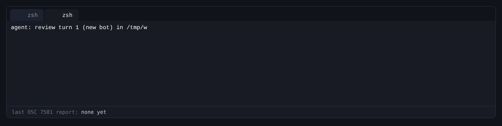

# CLI contract

Agent uses flat verbs: `run`, `follow`, `fork`, `interrupt`, `wait`, `ls`,
`inspect`, `turns`, `usage`, `rm`, `prune`, `approvals`, `answer`, `models`, `companion`, `start`, `stats`,
`rules`, `shutdown`, and `serve`. All named
bots use the same commands. There is no parent/child command hierarchy.

Use `agent --help`, `agent COMMAND --help`, or `agent help COMMAND` for help;
`-h` also works. `agent --help` gives each command in one line; a command's own
help lists its flags, and `run --help` lists a new bot's settings apart, after
the everyday flags. Help writes to stdout and exits successfully without
opening a store or connecting to a daemon.

Inside a bot's shell tool, `AGENT_BOT` and `AGENT_BOT_ID` identify that bot.
The client sends both as `created_by` and `created_by_id` when creating or
forking a child. The store rejects missing or stale creator identities before
creating the child, including after a daemon restart or name reuse;
`AGENT_PARENT` and `AGENT_PARENT_ID` identify the running bot's recorded creator
when its identity was known at creation. Address that creator with
`run --detach --bot "$AGENT_PARENT" --bot-id "$AGENT_PARENT_ID" -- TASK`.
The ID stays pinned after deletion, so a replacement with the same name rejects
the call instead of receiving the work.

A bot's shell gets the daemon's environment without the keys its providers
use, which are also redacted from what tools return. `serve --shell-exclude
PATTERN`, repeatable, leaves out more: every variable whose name matches, with
`*` for any run and `?` for any one character, in any case. A client that
starts a daemon passes it Codex's `[shell_environment_policy]` from
`~/.agent/config.toml`: each name in `exclude`, and `*KEY*`, `*SECRET*` and
`*TOKEN*` too with `ignore_default_excludes = false`. As in Codex, those three
are kept by default. It also leaves out the variables that name the
terminal it was started in (`TMUX`, `TMUX_PANE`, Rex's, Herdr's and cmux's
places, `agent_client::TERMINAL_PLACES`), so a bot's command never lands in
that terminal. A running daemon keeps the excludes it started with, and
a variable a bot or caller sets with `--env` is still set.
`serve --redact-field NAME` has the value printed after a field named like
NAME (its end, any case, `_` and `-` ignored) redacted from tool output, and
`serve --redact-block LABEL` the body of each PEM block whose header names
LABEL. A client that starts a daemon passes `agent_client::SECRET_FIELDS`
(`password`, `api_key`, `secret_access_key` and the like) and `PRIVATE KEY`.
Likewise `serve --protect NAME` keeps NAME at the top of a sandboxed bot's
writable folders read-only and from being made, and `--protect-existing NAME`
keeps it read-only where it exists; a client passes `.git`, `.agents` and
`.codex`, and `.aws` where it exists. `serve --rules DIR` reads the
[command rules](RUST_PROTOTYPE.md#command-rules) in DIR's `*.rules` files,
which a client passes as `~/.agent/rules`, and
`rules check [--rules DIR] -- COMMAND...` prints what they decide about a
command without a daemon: `{"decision", "matched"}`, with no `decision`
when no rule matches, or `rules_invalid` with the file and line.
`run` without `--bot` creates a fresh identity. `run --bot NAME` continues an
existing bot; add `--new` to create that name. A prompt of `-` reads stdin.

A command that lost its reply is resent unchanged. `run --request-id ID` keys
both the creation and the submission, so `run --new --bot NAME --request-id ID`
resent gets the bot and the turn it made, with `duplicate: true`, rather than
`bot_exists`; `fork --request-id ID` does the same for a fork, wherever its
source has moved since, even once the source is deleted. Once the bot a keyed
command made is deleted, any command with that name and key is `bot_deleted`
rather than a new bot. The same key with any other field changed is
`idempotency_conflict`, with the field named in `detail` and `field`, and a
name taken by any other request is still `bot_exists`. `rm --bot NAME --bot-id
N` deletes that identity: resent while it runs or once it is gone, it
succeeds as a duplicate and leaves a later bot of the same name alone. An
identity that name never held is `bot_not_found`.
`follow --bot NAME` replays and follows the selected current turn to its end;
an idle bot returns after replay. `follow --all` stays connected for future work.
`follow --since 1h` replays from the first event written an hour ago or later
instead of from a cursor; it conflicts with `--after`.
`inspect --bot NAME` prints one bot's whole record: the fields of its `ls`
row plus its instructions, settings and compaction. It changes nothing, so it
is safe to repeat; with `--bot-id N`, a bot that no longer holds that
identity is `bot_not_found`.

## Arguments and flags

- Put the command first. Options may appear before or after its operands.
- Long value flags accept both `--flag VALUE` and `--flag=VALUE`.
- `--` ends option parsing. For example, `agent run -- --help` sends the
  literal prompt `--help`. Use `--instructions=--example` for a flag-like value.
- Prompts and wait handles are positional operands. Every bot selector is
  `--bot NAME`; a fork uses `--source NAME` and `--bot DESTINATION`.
- `--all` selects all bots for `follow`; `--any` selects first-completion
  behavior for `wait`. `follow --all --bot NAME` is an error.
- `run --delivery MODE` is `reject`, `queue`, `steer`, or `attach`: what the
  submission does when the bot is busy. Without the flag, `AGENT_DELIVERY`
  applies, then `reject`. `--turn N` with `steer` makes it strict: for that
  running turn or `stale_turn`. The daemon has no default of its own: the client
  always sends the mode it resolved, so one person's preference never
  changes what a program's submission means. A blocking `run` with `queue`
  follows the turn from its queued state to its end; with `steer` it ends
  with exit 0 when the message is absorbed (`steered`, naming the turn it
  joined) or when the turn it started completes. A steer never waits behind
  a blocking call and never cancels one: a turn parked on `wait` resumes at
  once with its unresolved handles pending (still valid) and `steered: true`,
  and a foreground `shell` command still running 250 ms after the steer
  moves to the background and returns its `proc:` handle. `queue`
  deliveries leave both alone.
  A steer with an explicit workspace or model that differs from the running
  turn stays queued and runs separately with those choices.
  `attach` adds a message that needs no reply to the bot's next model call,
  mid-turn or in its next turn, without starting a turn; `run` prints the
  submission and returns at once.
- `run --turn-budget-tokens N` caps this turn's input plus output tokens,
  beside the bot's lifetime `--budget-tokens`. The turn fails with
  `turn_budget_exhausted` before a call once it has spent N; the cap is
  the turn's own, so the next turn starts from zero. A steer joins a turn
  that already has its cap, so `steer` with the flag is `invalid_delivery`.
- `run --image PATH` sends a PNG, JPEG, GIF or WebP with the prompt, after
  its words; repeat it for more (up to 20, 5 MiB together). It goes with a
  steer or a turn of its own alike.
- `run --workspace DIR` chooses the folder. A new bot starts in it, or in
  the directory `run` was invoked from. A bot keeps its folder: a later
  `run` without the flag runs there wherever it is invoked, and one with it
  runs in `DIR` and moves the bot there; a steer's folder never moves it.
  A `fork` starts in its source's folder unless it names one.
- Unknown flags, flags belonging to another command, unexpected operands,
  and repeated singleton flags are usage errors. `--provider` is repeatable.
- `--instructions` and `--instructions-file` are mutually exclusive.
  `--agents` composes the shared client policy instead: the harness preamble,
  every AGENTS.md and `.agents/AGENTS.md` from the workspace up to the root
  plus `~/.agents/AGENTS.md`, and indexes of the skills in
  `.agents/skills/NAME/SKILL.md` and the profiles in `.agents/agents/ROLE.md`,
  and the memory indexes in `~/.agents/memory` ([CLIENT.md](CLIENT.md)). It is
  opt-in on the CLI, what Sonny composes for its agents, and exclusive with
  `--instructions`. `--profile ROLE` composes the same text with that role
  last, and takes the role's `model` and `tools` unless `--model` or
  `--tools` names them; a missing role is `profile_not_found`. `fork` takes
  none of these: a fork is an exact copy of its source, instructions
  included.
  With `run`, instructions and token budget apply to new identities;
  passing them while continuing an existing named bot is an error.
- `run --new --approval MODE` chooses whether a
  new bot's tool calls wait for a verdict: `full` runs every allowed call (no
  gate), `manual` waits for an answer from any client, and `auto` has a
  judge model decide each call. The CLI judges nothing itself: an
  approver must serve the `auto` tag, such as `sonny approver`, which Sonny
  keeps as the daemon's companion. For `auto`, and whenever `run` continues
  or `fork` copies a bot an `auto` gate answers, the CLI refuses with
  `approver_not_serving` when none does, before any bot is made, and gives
  a call 105 s before its gate lapses (the approver's 90 s review budget,
  plus margin).
  Without the flag, `AGENT_APPROVAL` applies, then `full`. `--approve LIST`
  picks the gated tools and must name at least one; the default is every
  tool but `history`, `wait`, `note`, and `echo`, and in `auto` `read` too. A fork keeps its source's gates and a created bot its
  creator's ([APPROVALS.md](APPROVALS.md)); `fork` takes no approval flags, and a
  program that wants a fork gated further passes `approve` on the protocol's `fork`.
- `approvals [--bot NAME] [--tag TAG] [--full]` lists the calls waiting on a gate.
  Each previews its arguments; `--full` reads the whole arguments of a
  call whose preview was cut from the node that planned it.
  With `--pretty`, each call shows what it would do (every line of its
  command, or of what a `write` or `edit` puts in its file, terminal
  controls escaped) and, for each gate still
  open, two whole commands, one that allows and one that denies, so a
  pasted line never carries a verdict its reader did not pick. The call id
  is written `--call=ID`, so an id that starts with `--` stays the value. `answer --bot NAME --turn TURN --call ID --request N
  [--tag TAG] [--reason TEXT] allow|deny` records one gate's verdict; `--tag`
  may be left out when the call has one gate, and a denial's `--reason` is
  what the model sees (an allow takes none). `answer` refuses to run inside a bot's own tool shell
  (`answer_in_tool_shell`). `run --pretty` and `follow --pretty` print the
  same commands when a call waits. A printed command carries `--store` or
  `--socket`, as absolute paths, whenever the daemon it came from is not
  the default one, so it answers that daemon from any shell.
- Every time flag takes a duration with its unit: `500ms`, `30s`, `5m`,
  `1h`, or a bare `0`. A bare number is refused, so no flag guesses a unit:
  `--timeout`, `--approval-hold`, `--grace`, `--stall-timeout`,
  `--idle-exit` and `--keep-warm`. The last three count whole seconds. The
  protocol keeps its own units (`timeout_ms`, `grace_ms`, `approval_hold_ms`,
  `keep_warm` seconds). `--approval-hold` is how long a new bot's gated calls
  wait live for a verdict, and its terminal reads for output, before the turn
  parks (default `2s`; `0` parks at once). `--after` is an exclusive event cursor for `follow` and an exclusive
  turn ID for `turns`. `--checkpoint` is a history node ID.
- Listings read only what they print. `--limit N` stops `ls`, `turns` and
  `approvals` after N entries. `ls --name GLOB` keeps the bots whose name
  matches (`'project.*'`, `'*.lead'`; SQLite GLOB, case-sensitive) and
  `ls --active` those with a turn running; the daemon filters, so neither
  pages through every bot. `turns --newest` lists newest first, read from the
  end, so `turns --bot NAME --newest --limit 3` is a bot's last three turns.
- `usage` prints what the bots' turns spent as one JSON object: tokens in
  all, by bot (the `--limit` that spent most, 64 by default, the rest summed),
  and by model. `--name GLOB` keeps the bots `ls --name` would, `--since 7d`
  counts only turns started that long ago or since, and `--bucket 6h` adds a
  `series` of what was spent every six hours from then. Durations take `ms`,
  `s`, `m`, `h` or `d`.
- `--keep-turns N` means the same on `prune` and `run`: keep the newest N
  turns' records. `prune` applies it once; on `run --new` it is the bot's
  setting, applied after each of its turns.
- `run` sets a new bot's own settings with `--context-bytes`, `--context-items`,
  `--note-turns`, `--compact-at`, `--compact-keep`, `--compact-tokens`, `--keep-turns`,
  `--approval-hold`, `--max-output-tokens`, `--keep-warm`, `--cache-ttl`,
  `--sandbox`, `--writable` (repeatable, made absolute from the current
  folder), `--network`, `--hide-senders`, `--unix-socket` (repeatable: an
  absolute socket, or folder of them, its commands reach) and `--outputs` (made absolute; a new
  bot gets `outputs` beside the store without it); they are not daemon options,
  and an existing bot keeps its own (see [bot settings](RUST_PROTOTYPE.md#bot-settings)).

The lightweight command registry in `src/cli.rs` supplies help and option scope
for both client commands and `serve`. Keep that registry, the implementation,
and behavior tests aligned when adding an option. No CLI framework or runtime
dependency is required.

## Companions

A companion is a command the daemon keeps running for as long as it runs:
a client's helper that agents wait on, such as Sonny's lookout or the
approver, so it lives as long as the daemon whoever started either. The
daemon knows nothing of what one is.

```sh
agent companion add NAME [--cwd DIR] [--env KEY=VALUE]... -- COMMAND [ARGS]...
agent companion rm NAME
agent companion ls
```

`add` keeps the companion in the store under NAME (1 to 64 letters,
digits, `.`, `_` or `-`, not starting with `.`) and starts it now; every
later daemon on that store starts it once it listens. The same spec again
changes nothing (`changed: false`); another spec under the name replaces
the old one, which is stopped first. `rm` stops and forgets one
(`removed: false` when there was none); `ls` lists them, as `stats` does
under `companions`, each with its spec, `running`, `pid`, `started_ms`,
`restarts` and `last_exit` (`code` and `signal`, or `spawn_failed` with
why, and `at_ms`). Each runs in its own process group with the daemon's
environment, its `--env` over that, and `AGENT_STORE`, `AGENT_SOCKET`,
`AGENT_BIN` and `AGENT_COMPANION` (its name), never a bot shell's marks;
its stdin is empty and its output goes to `STORE.companions/NAME.log`. One
that exits starts again after 1 s, the wait doubling up to 60 s while it
keeps exiting within a minute of starting. The daemon's shutdown stops
each with SIGTERM to its group, then SIGKILL after 5 s. A companion's own
sessions keep no daemon from `--idle-exit`, and a daemon on stdio, with no
socket to reach it on, runs none. The request is `companions` with `add`
(`name`, `command`, `args`, `env`, `cwd`), `remove` (a name) or neither;
a sandboxed bot's commands may not make it, since a companion runs as the
daemon does.

## Output and status

Default output is machine-readable JSON. `run` and `follow` stream one JSON
object per line. Snapshot commands return compact JSON objects; `ls` and `turns`
return arrays. Every command prints its reply: `interrupt` the turn view,
`answer` what it answered, and `shutdown` `{"stopped":true,"pid":N}` once the
daemon is gone. Every client command takes `--pretty`; `serve` runs until
stopped and prints no reply to render.
`shutdown` returns once the daemon process has exited and its store is closed.
`shutdown --grace DURATION` first drains for up to that long: nothing starts,
and each running turn parks at its next boundary, once its model's answer and
the calls already running have committed, or finishes if that answer ends it.
Turns still running at exit, and every running turn without `--grace`, park
with their unanswered calls answered `daemon_shutdown`; the next start
continues them. A daemon whose ready line announces an older protocol than
this `agent`'s cannot be asked in this protocol, so `shutdown` sends SIGTERM to
the process that ready line names (a process already gone counts as stopped)
and waits for it the same way: the older daemon's running
turns end interrupted (from protocol 36 they park) and the store keeps every chat. That is how an upgrade on
a machine replaces the daemon an older `agent` started. A newer daemon is left
running and `shutdown` fails with `daemon_protocol_mismatch`.

`--pretty` is an explicit human view: rendered streams, tables for lists, and
indented JSON for other results, including detached submission handles. It is
rejected on commands with no output. Diagnostics and failures go to stderr. Rendered model
text and tool output keep their line breaks and tabs; any other character a
terminal would act on is printed escaped, so a stream cannot hide or restyle a
call waiting for approval.

On a terminal, `run --pretty` and `follow --pretty` also report program status
([OSC 7501](https://www.superlogical.com/rex/docs/build/program-status)), so a
terminal that supports it can mark the tab: `working` while the turn runs,
`blocked` (`kind=permission`) while a call waits for a person's approval (a
`manual` gate; a program's gate, like `auto`, is still `working`), then `done`,
`error`, or `idle` when the turn completes, fails, or is interrupted. `follow
--all --pretty` reports one record per bot, with the bot's name as its id, and
clears a deleted bot's record; only the bot's running turn moves it, not one
queued behind. History replayed before the stream goes live reports only turns
still running. Each report has `app=agent` and the bot's
name as its title, and is written once per change. Nothing is written when
stdout is not a terminal.



The recording is `run --pretty` against the offline playground, replayed in
xterm.js with a small OSC 7501 handler that draws the tab's mark.

A failure prints one JSON object on stderr, the shape the daemon answers with:
`error` is the code, `detail` states the rule that was broken, and any other
field is a fact about the current state, named as a request field (such as
`running_turn`, `bot_id`, `efforts`, `deliveries` or `field`). When the CLI can say how to get
past the refusal in its own flags, it adds `hint`. With `--pretty` the failure
is one line instead: `agent: CODE: DETAIL`, followed by `; HINT` when there is
one. Usage errors use the same object with `error` set to `usage`. A detail
that echoes what was sent is cut in its middle to about 4 KiB, so a refusal
always fits in one response. When `run` or `start` starts a daemon that fails,
the command fails with the daemon's own error, such as `invalid_provider_url`.
`serve` adds its `pid` to its error line, so a launcher reports its own
daemon's failure from the store's shared log even when several start at once;
a daemon that exits without one is `daemon_start_failed`, naming the log.

```json
{"error":"bot_busy","detail":"turn 4 is running","running_turn":4,"fork_point":9,
 "hint":"resend with --delivery steer --turn 4 to add this to it, or --delivery queue to run it afterwards; ..."}
```

| Exit | Meaning |
| --- | --- |
| 0 | Requested operation succeeded, including help/version |
| 1 | Operation failed, requested result is incomplete, or wait timed out |
| 2 | Invalid command-line usage |
| 75 | `serve` could not acquire store/socket ownership |

`wait --bot NAME` waits on that bot's running turn, else its newest, so a
caller can wait on work it did not submit; the result is keyed by the handle
it chose, as if that handle had been given. A turn queued behind the running
one is not it. A bot with no turns is `no_turn`, and `--bot-id` pins the
identity as on `inspect`. `--bot` and handles do not mix.
`wait` normally requires all handles to resolve without errors. With `--any`,
one resolved successful handle suffices and the remaining handles stay valid.
An errored first result or a timeout with no resolved result exits 1.
`--timeout 0` polls once and prints the same JSON result with unresolved
handles marked pending. Completed successful handles can still return exit 0.

## Connection and startup

Every client command accepts `--store` and `--socket`. Client store selection is explicit
`--store`, then `AGENT_STORE`, then `~/.agent/state.sqlite`. Explicit `--socket`
wins; otherwise `AGENT_SOCKET` applies unless `--store` was explicit. Without a
socket override, the socket is derived from the selected store.

`run` may start the daemon. `start` starts it if none is running, with the
same startup as `run`, and prints the running daemon's ready line with
`socket`, the absolute path it answered on, added; a caller that ran `start` over SSH
forwards that path. A socket path that is not UTF-8, which the ready line
cannot carry, is refused before anything starts (`socket_path_unsupported`). When the daemon holding the socket speaks another
protocol, `start` still prints its ready line and then fails with
`daemon_protocol_mismatch`, so a caller can tell an older daemon from a newer
one. An older one that names its pid is replaced instead, by every command
that may start the daemon (not with `--no-spawn`, and not from inside a bot's
turn, where `AGENT_BOT_ID` is set, since that turn is one it would wait on):
it is asked to shut down with a 2-minute grace, so running turns park at their
next boundary while none starts, or sent SIGTERM when it refuses that request, as daemons
before 0.6.0 do; once it exits, this `agent`'s daemon starts on the same
socket and upgrades the store. Sonny starts the daemon this way, so opening it
after an upgrade replaces the old daemon, and it says so first. `stats` starts it as `start` does, so it answers on a fresh install;
`turns`, `rm`, `prune`, `approvals`, and `answer` may restart it only for an
existing store (`store_not_found` otherwise). These commands accept the startup
provider/limit flags shown in help and `--no-spawn` to require an
already running daemon. Startup flags configure a newly started daemon. A
running daemon is never reconfigured: a stated startup flag it does not match
fails the command with `daemon_configuration_mismatch` naming the difference.
Comparison uses effective limits: `--idle-exit 0` means disabled, and positive
context limits are clamped to at least 1,024 bytes and two items.
With no `--provider`, a started daemon takes `AGENT_PROVIDER` (the same specs,
separated by whitespace), else `provider` in `~/.agent/config.toml` (the
same), else the providers whose key variable is set; a
running daemon is not checked against either. With none of them, starting
fails with `provider_required`.
`run --model` names a new bot's model or an existing bot's turn model; the
daemon has no model of its own, so a new bot needs `--model`, `AGENT_MODEL`,
or `model` in `~/.agent/config.toml`, in that order. Both are only creation
defaults. An existing bot uses its stored
model unless `--model` explicitly overrides it for this turn.
`run --effort LEVEL` sets a new bot's effort: `low`,
`medium`, `high` or `xhigh` on either family, and `max` on Anthropic's; any
other is refused with `invalid_effort`. Without it the request carries
no level and the model uses its own default. On an existing bot it sets this
turn's effort, as `--model` sets its model, and the bot's own is unchanged. A
turn with a level sees it in its shell as `AGENT_EFFORT`, and a new bot that takes its model
from `AGENT_MODEL` takes its level from `AGENT_EFFORT`, so a peer started
on its creator's model thinks as hard as its creator; a bot given
`--model` or a profile's model gets only its own `--effort`.
`run --quote BOT/TURN` copies that turn's prompt after this prompt, with a
line saying who wrote it; `BOT/TURN:reply` copies the reply the finished
turn ended with. It repeats, up to 64, the quotes a quoted prompt brings
counted. The daemon copies the words, so the model reads what was written
and by whom, never the sender's retelling; a turn without those words is
refused (`quote_not_found`, `quote_unfinished`, `quote_too_large`). Sonny's
approver takes a quote of the person's words as consent only when the
person sent the quoting prompt: an agent could otherwise quote an old
"yes" for a new ask.
`run --instructions` and `--instructions-file` set a new bot's instructions,
with the CLI's built-in text as the default; the daemon has none. `run
--tools LIST` chooses a new bot's tools from those the daemon registers,
default `shell,write_stdin,read,write,wait,history` with the file editor its model
family is trained on: `apply_patch` for a Responses model, else `edit`, and
`web_search` where the provider offers it and `web_fetch` for any, unless
`~/.agent/config.toml` sets `web_search = "disabled"`. An
existing bot keeps its own,
so `--tools` while continuing one is a usage error.
`run --fallback PROVIDER/MODEL` gives a new bot a model, in its family, that
answers a request a safety classifier declined, that request alone; the next
goes to the bot's own model. Without it the bot takes its model's entry in
`[fallbacks]` in `~/.agent/config.toml`, if any (Sonny's agents follow
that entry as it changes; a bot the CLI made keeps the one it took, and
`configure` with `fallback` changes it):

```toml
[fallbacks]
"anthropic/claude-opus-5-5" = "anthropic/claude-opus-4-8"
```
Other client commands require an already running daemon.

`models` prints `~/.agent/models`, the models clients offer, as JSON
`[{id, note?}]` (`--pretty`: one line each). The file holds one
`PROVIDER/MODEL` per line, with anything after `#` a note; no file is an
empty list, and a malformed line fails with `models_invalid` naming it.
Reading it needs no daemon, and the daemon never reads it: any model runs.
`models --discover` writes a first file from the listings of the providers
the daemon runs (starting one like `run`), with each model's name and
context size as its note and a comment for a provider that listed nothing.
When no usable model survives rendering within the file limit, it writes
nothing and fails with
`models_none_listed`, naming each refusal, so it can run again after a
login. It refuses with `models_file_exists` once the file exists: after
that it is the user's to edit. Bots see the same list by running `models`.

`serve` requires explicit `--store` and `--provider` options. It runs the daemon
directly, with Unix-socket service when `--socket` is
provided and the stdio protocol otherwise. Credentials and provider configuration
follow the [runtime documentation](RUST_PROTOTYPE.md).
