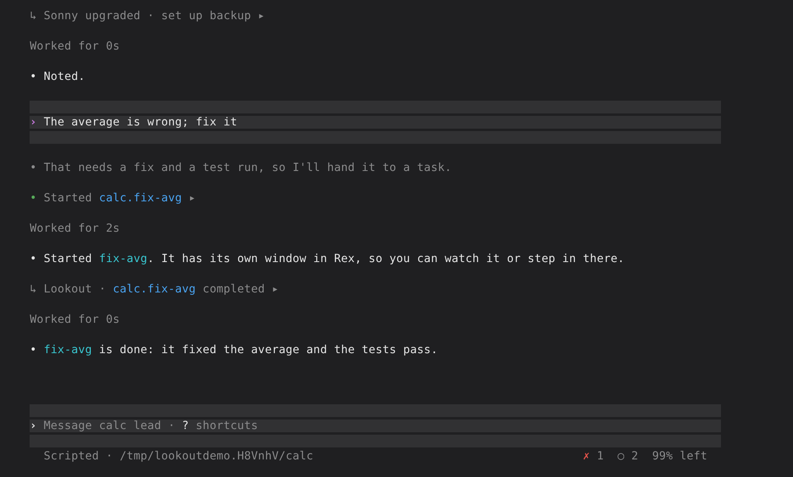

# Lookout

`sonny lookout` is Sonny's event pipe from **sources** to the **bots** that follow them, as SNS is from topics to subscribers. It delivers updates from tasks, external scripts (chat, CI, PRs, email), and Sonny's own built-in feeds (`commons`, `memory`, `links`) into subscribed bots as steered notes, with EventBridge-style filters, digests, and instant priority steers.

The lookout does **one job**: pass events on, fast and durably. Every source is the same to it, and every follower and every follow is the same too: each filters, digests, and steers alike. Each event is one envelope, `[source · topic · from · time]` and its text. The lookout makes no judgment calls on content and holds no per-source rules: what a source knows, it puts in its event fields, and the receiving bot decides what matters.

It is a Sonny feature and a client of the daemon like any other; neither the daemon nor the `agent` CLI knows of it. The lookout knows no leads either: Sonny has each lead follow its tasks when it opens the lead's project, and that follow is what makes a lead hear from them.

[Quick example](#quick-example) · [Follows](#follows) · [Sources](#sources) · [Filters](#filters) · [Tasks source](#the-tasks-source) · [Digests & steers](#digests) · [Delivered notes](#the-note) · [Runtime architecture](#one-lookout-a-daemon)

## Quick example

1. **Add an external source** in `~/.agent/config.toml`:

```toml
[sonny.sources.ci]
command = "~/bin/ci-poll"
every = "1m"
digest = "15m"
steer = { status = ["failed"] }
```

2. **Follow it** from an agent using its `follows` tool:

```json
{"add": {"name": "main-ci", "sources": ["ci:main"], "filter": {"status": ["failed"]}}}
```

3. **Receive steered notes** in the bot's conversation:

```text
[ci · main · 10:31]
deploy failed on prod
[lookout]
This note is news for you, unseen by the person. Reply when it bears on what the person is doing now or is urgent; otherwise end your turn with an empty reply.
```

In Sonny's window, lookout notes fold into one quiet line (`↳ Lookout · calc.fix completed · ▲ ci`) and stay silent if the agent decides there's nothing to report.

## Follows

Each follower has a lookout of its own while it has a follow, and manages its own subscriptions through the `follows` tool. A call changes only the calling bot's own follows. Each follower's follows are one file, `STORE.lookout/BOT.json`, which a running lookout reads again every 15 seconds, and at once after a `follows` or `commons` call ends.

When Sonny opens a project, it adds the lead's `tasks` follow, unless the lead's file already holds one by that name, which it keeps as it is:

```json
{"name": "tasks", "tasks_of": ["shop.lead"], "agents": ["shop.*"]}
```

That is the folder's first lead's. Another lead of the folder, `shop.lead.billing`, gets `tasks_of` alone, so it hears only of its own tasks; the first lead's `shop.*` skips the other leads and every bot they or theirs made. Another lead, which has follows of its own, is heard only by a follow that names it as it is, with no `*`, as the person asks a lead to watch another: then it is a task here in all but what it makes, which stays its own, and the turns its own lookout's notes start. Removing `tasks` stops a lead's lookout until Sonny next opens its project.

Every follow hears exactly what it names, nothing more or less: a lead and its task following the same topic both hear it. A lead tells a task in its brief which topics to follow, as `NAME:TOPIC`; a lead that wants to stop hearing a topic narrows its own follow, with a narrower `sources` or a filter.

### `follows` tool operations

| Action | Example | What it does |
| --- | --- | --- |
| **List** | `{}` (or `{"from": "..."}`) | One line per follow: its name, whom and what it hears (`tasks_of`, `agents`, `sources`), its `until` and `runs`, its 24h `lately` counts, and a source it names that is not there now (`problem`); then the configured sources, each by `name` with its shape's `events`, and the `lookout` sync status. A long list comes in pages: `next` says where the rest start, as `from`, and `of` how many there are. |
| **Add** | `{"add": {"name": "deploys", "agents": ["ops.*"]}}` | Adds a follow and answers with that change alone, with the same `test` a dry run gives when it hears sources. The same spec under a taken name is a no-op; a different one is refused, so remove it first. |
| **Dry run** | `{"add": {...}, "test": true}` | Tests against the last 24h of source history without adding ([dry runs](#dry-runs-and-reads)) |
| **Read one** | `{"read": "deploys"}` | The follow whole, as `add` would take it again, with its 24h counts and what its sources say now (`now`) through its filter |
| **Inspect source** | `{"source": "prs"}` or `{"source": "prs:12"}` | The source whole, with its shape (`fields`, `topics`) and its current retained state (`now`), without subscribing |
| **Remove** | `{"remove": "deploys"}` | Removes the follow (answered with `removed`); its counters go with it |

Listing one line each keeps the answer small: thirty follows over four sources listed about 8,000 characters when the listing gave every follow whole and every source's fields, and one line each lists about 2,300.

> `/background` in Sonny lists the project's agents' follows, with their automations; `x` there removes one.

### Follow fields

A follow must specify at least one target (`tasks_of`, `agents`, or `sources`), and may have several:

| Field | Meaning |
| --- | --- |
| `tasks_of` | Every bot one of the listed agents or one of its tasks made |
| `agents` | Bots whose name matches a glob (`*` matches any run of characters); a glob never names a side chat, nor a bot that deletes itself once idle |
| `sources` | Configured or built-in source names (`"slack"`) or specific topics (`"slack:deploys"`); naming a source the settings do not have is refused, with the ones they have |
| `filter` | Event pattern narrowing which events are heard ([Filters](#filters)) |
| `digest` | How often at most it tells what it hears (e.g. `"15m"`, `"1h"`, `"0"` for as they come); overrides the source's digest ([Digests](#digests)) |
| `steer` | Event pattern that cuts through any digest immediately ([Steers](#steers)) |
| `until` | Local timestamp (`"2026-11-08 18:00"`) when the follow ends, as an automation's `--until` |
| `runs` | Ends the follow after it was told in that many notes, as an automation's `--runs` (`"runs": 1` for a one-shot alert) |

A follow with no `filter`, `digest`, or `steer` is heard as it always was and costs the lookout nothing more: no event is built for the bots it watches.

Examples:

```json
{"add": {"name": "api", "agents": ["api.lead"],
         "filter": {"type": ["turn.ended"], "$or": [{"status": ["failed"]}, {"done": [true]}]}}}
{"add": {"name": "leads", "agents": ["*.lead"], "digest": "1h"}}
{"add": {"name": "migration", "tasks_of": ["shop.migrate"], "steer": {"status": ["failed"]}}}
{"add": {"name": "deploy", "agents": ["ops.deploy"], "steer": {"status": ["failed"]}, "runs": 1}}
{"add": {"name": "launch", "sources": ["slack:launch"], "until": "2026-11-08 18:00"}}
```

### Lifecycle and counters

- A follow is held by the bot that made it, by its ID: a later bot given the same name inherits none of it.
- Follows end as automations do, by one rule. A follow ends when `until` passes or `runs` is reached (a note counts once it lands, however many events it tells, and the count outlasts a lookout restart); when its owner is deleted; when it watched only bots by exact name, every one of them is deleted now, and it has no source; or when its owner is closed (`close_agent`, or the `close` request), except follows marked `outlives_close`, which Sonny writes on what posting in a commons thread subscribes, so a closed bot can still take part there. The daemon's `closed` event says when, and a lookout that was away reads it from the listing's `closed_ms`. A closed bot still is, and is sent work again by a message, so another's follow that watches it stays. Each end is a line in the lookout's log with why.
- Each follow says under `lately` what it told in the last 24 hours, once it has told anything: the events and tasks' news its notes carried (`heard`), those notes (`notes`), how many of them steered for it, by its `steer` or the source's mark (`steers`), and when it last told (`last`). The lookout counts them by the hour as each note lands, in `STORE.lookout/.counts/BOT.json`, so a flood shows as a follow with many notes, without reading the log.

## Sources

A source is news from outside the daemon: a chat, a mailbox, a feed. Agents never set a source up; the person configures one in `~/.agent/config.toml` as a command, which the lookout runs with `sh -c`, as the person and outside any sandbox:

```toml
[sonny.sources.slack]
command = "~/bin/slack-poll --channel eng"
every = "1m"                   # how long after it exits it runs again (30s, 5m, 1h; default 1m); a stream that never exits stays running
digest = "15m"                 # how often at most a follower hears it (30s, 15m, 1h; unset or 0, as events come)
steer = { from = ["boss"] }    # an event pattern, as a filter is written, that goes past any digest
watch = ["~/bin/slack-poll"]   # files (from / or ~/) whose change restarts the source within 15s
icon = "💬"                    # optional icon shown in Sonny's UI
```

A pattern that does not check keeps the source from starting, said in the lookout's log as a bad `every` is.

> **Security:** Keep a source's command and the files it watches where no agent can write: they run as the person, outside any sandbox.

### Source output protocol

Every line the command prints is one event. A line over 64 KiB is skipped, and an event's text is cut at 4,000 characters.

- **Plain text:** Delivered as the event `{"text": LINE}`.
- **JSON object:** `text` plus, if it has them, `id`, `topic` (what it is about: a channel, a thread), `from` (who wrote it there), `url`, and `steer: true`, and any other fields for filtering. `text` is what subscribers read; an object without it is delivered whole, the line as its text, as plain text is.
- **Clearing a topic:** An object whose `text` is empty, as `{"topic": "12", "text": ""}`, is no event: it clears what the source last said of that topic, or of the source itself with no topic, as an MQTT message with an empty payload clears a topic's retained one. No follow hears it, and a read no longer gives the topic.
- **Deduplication & state:** An event whose `id` the source printed lately (the last 1,024) is not news again. A poller keeps its own cursor in `$SONNY_SOURCE_DIR`, a folder of its own beside the store (`STORE.sources/NAME`), and `$SONNY_SOURCE` is its name. An event `from` the follower itself is not news to it.
- **Logs:** What it writes to stderr (its first 20 lines a run), a run that fails, and a source started or stopped go to the lookout's own log, `STORE.companions/sonny-lookout.log`.
- **Hot reload:** The lookout reads the settings again every 15 seconds: a source added or changed starts, one removed stops, and a lookout that stops stops its sources' commands. So does a source when a file its `watch` list names changed (its device, inode, size, or times, as Git's stat data), came, or went since it started, as a service manager restarts a unit on its new binary: an edited script then runs on its new code within 15 seconds, a stream that never exits included, and the log says `source_stopped` with why. Nothing is watched unless listed, so a cursor the command writes is no reason to start again.

### Source health

A source whose last 3 runs failed (exited other than 0, or did not start) is **down**. Every follow of it, whatever its topic or filter, hears so from the lookout itself, with why the last run failed and its last 5 lines of stderr, and again each day it stays down; once a run works, or the source prints an event, they hear it works again, before the event. A source that runs one long command never ends a run, so its first event is what says it is back; it also starts the count of failed runs again.

Its line in the note reads `- slack, said by the lookout (for your eng): "The source slack is down: …"`, and like any event from the source it waits for the source's digest. So a source needs no code of its own to say that its reads fail. The lookout keeps its last such word in `STORE.sources/.health/NAME.json` (down or not, since when, why, the stderr lines), so Sonny's `/background` marks each follow of a source that is down as failed by reading one small file per source.

### Dynamic fetch hints (`wants`)

A source that cannot read everything, a code-review system with thousands of changes, say, can let the follows say what to fetch. Its `wants` names a field of its events, as `id`, `meta.repo`, or `topic`:

```toml
[sonny.sources.cr]
command = "~/bin/cr-poll"
wants = "id"
```

The lookout writes, to the file `$SONNY_SOURCE_WANTS` names (in the source's folder), what the follows of it want of that field: the exact values their filters name for it, every branch of an `$or` included, and for `topic` the topics named as `NAME:TOPIC` too.

```json
{"field": "id", "all": false, "values": ["CR-12", "CR-14"]}
```

`all` is true while any follow of it names no exact values (a `prefix` or a bare follow, say), so the command fetches everything. The file is written before the command first runs, and again whenever the follows' wants change, which starts the command again on them, as an edited script does. So an agent that follows with `{"filter": {"id": ["CR-12"]}}` has the source fetch CR-12: the follow is the setup, with no setup step that drifts from it. The `follows` listing marks such a source with its `wants`, and says once what that means.

### Built-in sources

Sonny makes these sources of its own; a person's source may not take their names. `commons`, `memory`, and `links` each read every 10 seconds, keep their cursor in `STORE.sources/NAME/read.json`, and tell nothing of the past on their first look. Each is set under `[sonny.sources.NAME]` with `digest`, `steer`, and `icon` alone; the command and `every` are Sonny's.

| Source | Poll / trigger | What it emits |
| --- | --- | --- |
| **`tasks`** | Live daemon stream | Activity in watched bots ([The tasks source](#the-tasks-source)) |
| **`commons`** | Every 10s | New posts in `~/.agents/commons` (`topic` = thread, `from` = author, `id` = `THREAD/N`). Default digest: `15m` (`0` for as posts come). |
| **`memory`** | Every 10s (opt-in) | Facts saved to or removed from the person's memory or a project's under `~/.agents/memory`. The fact's name is the topic, `from` is the agent that saved it (`calc.fix saved`) or `removed`, and the text is the fact's description; fields: `project` (none for the person's own memory), `type`, `file` (the fact's file to read). |
| **`links`** | Every 10s (opt-in) | Linked machines (`sonny link`) connecting or going away; a machine that sleeps goes away once it has been silent 45 seconds. The machine is the topic and `state` is `up` or `down`. A machine linked for the first time tells only that it connected. |

- **Commons:** How far it read each thread, in `STORE.sources/commons/read.json`, moves only once every follower that hears the new posts holds them on disk, so a crash between reading and holding reads them again; a follower already holding one does not hold it twice. Posting in a thread subscribes the agent to `commons:THREAD` (a follow named `commons.THREAD`). This follow is the only way a thread's posts reach an agent: an invite starts one turn, and its later replies come here like any poster's. A turn that only sources woke sends no commons invites, as an invite's turn does not.
- **Memory and links:** No agent follows either unless it asks, with `sources: ["memory"]` or `["links"]`.

```text
[memory · release-steps · calc.fix saved]
Tags are pushed from the Mac; cloud can't push tags.
[links · laptop]
not connected, last heard 1 min ago
```

### Source shapes

So an agent knows what it may filter on, the lookout keeps each source's shape in `STORE.sources/.shapes/NAME.json`: the fields its last 200 events had (an object's own fields named with dots, as `meta.team`), their kinds, and its last 8 events cut short (strings at 120 characters, lists at 8 items). A thread of its own writes it, so a source whose fields keep changing never holds up the lookout.

A `follows` call with `source` NAME shows the source whole with its shape. A field shows an example only from the newest of those events one of the caller's follows hears, by source, topic, and filter (a filter is not trusted with an event that was cut), so no agent reads a post from a thread or filter it does not follow; when any example shows, `examples` says they come from outside. A source whose events name topics lists under `topics` the ones its last 200 events named, newest first, at most 32: what a follow may name after the colon, shown to every caller, since a topic is a name to follow, not a post.

```json
{"name": "cr", "events": 41, "fields": {"author": "string, as \"ana\"", "paths": "list of strings, as [\"src/billing/tax.rs\"]", "text": "string, as \"CR-12: tidy…\"", "topic": "string"}, "topics": ["billing", "search"]}
```

### Dry runs and reads

To try a follow before adding it, send it as `add` with `"test": true`. Nothing is added; the answer's `test` says what it would have heard of its sources' last 24 hours: how many events there were (`events`), how many it hears by source, topic, and filter (`heard`), how many of those steer, by the source's mark or the follow's `steer` (`steers`), and about how many notes they would have been with its digest or its sources' (`notes`), with the newest 3 it hears as examples, outside content as a source's are. What bots do is not kept, so a follow that watches bots says so under `untested`.

```json
{"add": {"name": "red", "sources": ["ci:main"], "filter": {"status": ["failed"]}}, "test": true}
→ {"test": {"since": "Fri 7 Nov 05:10", "events": 412, "heard": 9, "steers": 1, "notes": 9, "examples": […]}, "examples": "The fields' examples are…"}
```

To know what a source says now without following it, send `source` NAME, or `NAME:TOPIC` for one topic, as Kubernetes reads a resource with `get` and follows it with `watch`; `read` NAME says the same of what a follow of the caller's hears, through its filter. Nothing is added. Each source answers with the newest event of each topic it hears, and of the source itself, newest first, as data (`topic`, `from`, `at`, `text`, `id`, `url`, the other fields under `fields`, `cut` when it was kept cut), a cleared topic left out, under `now`; and `down`, the lookout's word, while the source is down. `outside` says the text comes from outside. An answer holds what a tool's answer shows, 60 KiB, and `more` counts the topics past it. The commons and what agents do keep nothing here (`unread`): the `commons` and `history` tools read them. A read costs one read of one file per source, whatever the number of agents: about 2 ms for one topic.

```json
{"source": "prs:12"}
→ {"source": {"name": "prs", "events": 41, "fields": {…}, "topics": ["12", "9"], "now": [{"topic": "12", "from": "ci", "at": "Sat 14 Nov 22:10", "text": "#12 red", "id": "prs/88", "fields": {"state": "red"}}]}, "outside": "What a read gives is…"}
{"read": "leads"}
→ {"follow": {"name": "leads", "agents": ["web.lead"], "sources": ["prs"], "lately": {…}}, "now": [{"source": "prs", "topics": […]}], "lookout": {…}}
```

Both come from `STORE.sources/.recent/NAME.jsonl`, an event a line, kept for every source but the commons and tasks (a command's and Sonny's own `memory` and `links` alike):

- A day of events, at most 2,000 events and 4 MiB, an event's fields cut as a shape's examples are past 16 KiB (`cut` then counts them, since a filter may misjudge a cut event).
- Past the day, the newest event of each topic, of the source itself (its events with no topic), and the lookout's newest word on it, however old, as an MQTT broker retains each topic's last message: at most 1,000 of them in 512 KiB. Live margin templates read it too.
- A clear is kept as a line with no text while it is within the day, and past it goes with all before it, as Kafka compacts a tombstone away. The same writer thread appends to the file and cuts it back once an hour or when it grows past its bytes.

### Filters

An event's line may carry any other fields beside `text`, and a follow's `filter` hears only the events whose fields match it. The bots it watches have events too ([The tasks source](#the-tasks-source)), so one filter reads both. Event patterns follow AWS EventBridge / SNS filter policy syntax. Every listed field must match; a field maps to a list of allowed values (OR) or to a pattern of its own for a field that is an object; a list field matches if any element matches.

| Matcher | Example |
| --- | --- |
| Exact value | `{"status": ["failed", "stopped"]}` (string, number, boolean, or `null`) |
| Prefix / suffix | `{"paths": [{"prefix": "src/billing/"}]}` · `{"file": [{"suffix": ".rs"}]}` |
| Wildcard (`*`) | `{"branch": [{"wildcard": "release/*"}]}` |
| Case-insensitive | `{"env": [{"equals-ignore-case": "prod"}]}` |
| Negation | `{"author": [{"anything-but": "me"}]}` (a value, a list of them, or a string matcher) |
| Numeric range | `{"seq": [{"numeric": [">", 0, "<=", 100]}]}` (whole numbers compared exactly past 2^53, as sequence IDs and nanosecond times run) |
| Existence | `{"url": [{"exists": true}]}` or `{"exists": false}` |
| Logical OR | `{"$or": [{"status": ["failed"]}, {"done": [true]}]}` |

A plain-text line is the event `{"text": LINE}`; an object without `text` is matched by the fields it printed. A filter is at most 4 KiB, 256 values, and 6 levels deep; nothing in it runs, and it only ever narrows what is heard. The lookout checks a filter as each event comes, before the event waits for the follower, so an event no follow hears wakes no one. A filter naming a field no recent event of its sources had is added, and the answer says so under `unseen`: it hears nothing until one does.

For example, a CR poller that prints

```json
{"text": "CR-12: tidy the billing tax rules", "id": "CR-12", "url": "https://cr.example/12", "author": "ana", "paths": ["src/billing/tax.rs", "docs/billing.md"]}
```

can be filtered to the changes an agent's work touches:

```json
{"add": {"name": "billing-changes", "sources": ["cr"],
         "filter": {"paths": [{"prefix": "src/billing/"}], "author": [{"anything-but": "me"}]}}}
```

## The tasks source

The built-in `tasks` source tells a follower what happens in the bots its follows watch, less those with follows of their own, each bot its topic:

| `type` | When it fires | `from` in header | Text |
| --- | --- | --- | --- |
| `wrote` | Someone other than the follower writes in a watched bot | `the person`, or the agent or program that wrote | The person's words, quoted by the daemon under the note; anyone else's as they wrote them |
| `turn.ended` | A turn ends | `TASK replied to WHO, STATUS`, or `ended` when it said nothing, then `: error` and `, marked done` where so; no `to WHO` when the follower asked | What the task replied |
| `question` | A task asked the person with the `ask` tool, once the call ran | `TASK asked the person` | The question and its numbered options, or the line it asked them to run |
| `approval` | A call only the person can approve starts to wait, once a turn | `TASK waits for the person's approval` | The command, or the call and its arguments |
| `margin` | A task put or took away a margin note | `TASK put the margin note "ID"`, or `took … away` | `TASK/ID`, which the margin tool shows |

Filterable fields: `type`, `bot` (where), `maker` (who made that bot), `from`, `turn`, `text`, and as the kind has them `status` (`completed`, `failed`, `stopped`, `interrupted`), `done`, `asked_by` (`you`, `the person`, an agent's name, `automation`), `options`, `command`, `call`, `id`, `removed`.

- The person's words, a question to them, and an approval are marked as steers.
- **Loop prevention:** Two rules live in the source, as any source keeps its own: a turn a lookout note started tells nothing, so follows on each other cannot wake each other in a loop, and an automation's run that completed with nothing to say tells nothing.
- **No timers:** An event is made from what the stream says happened, and a turn left running long tells nothing until it ends.
- **Reads:** Words and replies are read on connections of their own beside the one the stream and notes go on, one per logical CPU, as a database client keeps a pool, so a busy fleet's replies are read side by side (#576). A turn that completed ended on its reply, so that is one read; another turn's nodes are looked through for its last words. A read gets 60 seconds, as Codex gives a tool call: one the daemon never answers lets the event go without the words (#388). A task's events are told in the order they happened, though their reads end in another.

### What it tells

Because the lookout reports task completions, questions, approvals, and failures automatically, a lead no longer sets itself automations to check on running work; automations stay for what the person schedules.

The lookout makes one choice: when. It used to ask a judge model whether an event could not wait and whether a task was drifting from what the person means; George dropped that on 2026-10-28 as too ad hoc to scale. On the eval of how leads act on their notes (`gpt-6-sol`, 3-run means), the note without the judge's picks handled 41.0 cases against 44.3 with them, caught 11.0 of 24 drifting tasks against 13.3, and sent 23.3 needless messages against 26.0.

### Bounced messages

The lookout also hands back what a turn never carried out, as mail returns a letter it could not deliver. It notes which bots sent each message (an `accepted`, `queued`, or `steered` event's `from`), and when that turn ends `failed` or `interrupted` it steers a note to each sender, waking it when idle, timed like any message:

```text
[your message to BOT was not carried out: turn N ended CODE]
```

The sender knows what the message was for, so it decides whether to send again, wait, or tell the person. A sender that already hears the bot, such as a lead with its own task, gets the turn's end from the tasks source instead, and a bot's own messages never bounce. Fixable causes (like expired logins) are [held](RUST_PROTOTYPE.md#held-turns) for the bot's `hold_ms` (default 5 days) rather than failing immediately, so what bounces is final, or was held that long.

## Digests and steers

Every note goes as a steer, joining the running turn at its next round or starting one, with everything waiting then that no digest holds. It never holds news for the follower to rest, so one kept busy still hears it.

### Digests

- A follower's notes are one group, as Prometheus Alertmanager groups alerts, with `group_wait` 0 and `group_interval` 2 seconds: an event goes at once when no note went in the last 2 seconds, and what comes within 2 seconds of a note goes together once they pass, so a burst from many agents is a note every 2 seconds, not one each.
- A source's `digest` says how often at most a follower hears it, as Slack's "at most once every 15 minutes or hour": the first event after a quiet spell is told as it comes, and what comes after waits until the digest has passed since the note that last told that source, then all of it goes, in one note or in notes one after another when it is more than a note holds. The digest counts again from the last of them.
- A follow's own `digest` takes its sources' place for what it hears, counted from the note that last told what it held; `"0"` says it waits for none, though its source digests. Heard by several follows, an event goes when the first of them allows.
- What waits to be told, and when each source and each follow's digest last told a follower, is kept in `STORE.sources/.held/BOT.json` until it is, so a restart loses none.

### Steers

- An event the source marks `"steer": true`, one the source's `steer` pattern matches, or one a follow's `steer` matches goes at once, as the person's words do, and waits for no digest; the follow counts it as its steer.
- Who sets which: an agent adds `steer` itself for what it owns, as a pull request it opened; a `filter` or a `digest` only when the person asks for one, since what a filter leaves out it never hears and a digest makes it late. The `follows` tool says so. The person sets a source's own `digest` and `steer` in the settings. `/background` lists each follow with its filter, digest, and `steer`.

## The note

A note is one message, steered, with `origin: "lookout"`: each event's header and text, in the order they came, then the trailer. The reviewer reads its words as asking for nothing. The person's words in a task are not retyped: the note quotes their turns (`quotes`), and the daemon copies each in after the note with a line naming the turn and who wrote it, so the lead reads the person's own words, never a retelling. The reviewer reads them as the person's but not as their word on the lead's calls: the lookout picked them, and only words the person sends, or quotes themselves, consent. A quote the daemon refuses (its task deleted meanwhile, or too long) sends the note again naming those turns by their handles alone.

```text
[tasks · calc.docs · the person]
(their words are quoted below, from calc.docs/3)
[tasks · calc.api · calc.fix]
Look at the schema before you change the route.
[tasks · calc.fix · calc.fix replied, completed]
Fixed avg: it skips empty lists now, with a test.
[ci · main · 10:31]
deploy failed on prod
[slack · eng · ana · 10:39]
lunch?
https://example.slack.com/archives/C1/p2
[lookout]
This note is news for you, unseen by the person. Reply when it bears on what the person is doing now or is urgent; otherwise end your turn with an empty reply.

[Message calc.lead/41, sent by lookout.]

[Quoted from message calc.docs/3, written by a person:]

Use tabs.
```

- **Events:** Each event is its header, `[source · topic · from · time]`, then its text as the source printed it, then its link and its other fields as compact JSON. The time is when the lookout heard it, as an Alertmanager notification carries each alert's `startsAt`: the time of day on the 24-hour clock, after the day when it is not today and the year when not this one (`10:39`, `Sat 14 Nov 10:39`); the note's own stamp names the zone. An event says at most 32,000 characters of its text and as many of its other fields, one limit for both, each cut with its two ends kept, the text at 80 KB too.
- **Size limits:** A note holds at most 192 KiB and 64 quotes, and always one event; the rest wait for the next, which it says under a `[lookout]` header with how many wait and when the lookout heard the first of them (`12 more events wait for the next note, the first heard 10:31`).
- **One at a time:** What comes while a note is under way waits for its answer, then goes. A note the daemon refuses goes again after 2 minutes; one lost with the connection goes again at once.
- **Queue cap:** Up to 1,024 events wait per follower (`[sonny] lookout_waiting`, `0` for no limit), on disk with the rest of what the follower is to be told, so a restart loses none. Past that, a newer event is not kept; one that steers takes the place of the newest waiting event that does not. The next note says how many were not kept, from which sources and when, under `[lookout]`, for example `40 more events from chat and ci came between 9 minutes ago and 1 minute ago, and they were not kept: 1024 were waiting for you already`, and its row shows `40 not kept`. Until a note with that line lands, the count is kept and told again. The log names each event that was not kept, with its source and ID, and `/status` shows how many wait and how many were not kept today. George chose this over dropping the oldest (11-02): keeping every ask is what "nothing fell through" needs, and a source's own history cannot bring back an event dropped from a script source.
- **Trailer:** Every note ends with the trailer, under a `[lookout]` header: one setting, `[sonny] lookout_trailer`, the same for every follower and every source, read as each note goes, and `""` for none. By default it says when to reply: when the news bears on what the person is doing now or is urgent, and otherwise with an empty reply, so the person sees nothing. Agents forget what their role says when news comes in a turn of its own (George, 11-17), so it comes with every note. The lookout adds nothing else: the events stay as their sources said them. What the lead tells the person is its role's call (lead.md).
- **Display:** Sonny shows a note folded, one quiet row named by what it tells: `↳ Lookout · calc.fix completed · you wrote in calc.docs · ▲ ci`, each task's event in a few words and each other source's counted, marked by its icon. A turn it started that ends with an empty reply stays there: no line under it and no sound. Anything the lead does write shows as any reply.



![The same note opened: its [tasks · calc.fix-avg · calc.fix-avg replied, completed] header and the task's reply under it](sonny/lookout-note-open.png)

## One lookout a daemon

- **Daemon companion:** `sonny lookout --store STORE --socket SOCKET` runs as the daemon's companion `sonny-lookout` ([CLI companions](CLI.md#companions)): Sonny adds it when it opens a project, and the daemon keeps it running for as long as it runs, starts it again if it exits, and starts it with every later daemon on that store, whether or not a window is open. It watches every bot with follows on the daemon, whichever Sonny opened it, so a lead hears from its tasks even while no window shows that project. It exits once the daemon has been unreachable for 30 seconds, and the daemon stops it as it stops.
- **Single owner & upgrades:** A lookout holds `STORE.lookout.lock` while it runs, so a second one prints `{"event":"already_watching"}` and exits, unless another build of Sonny started the one running, as an upgrade leaves it: that one is stopped, and the new one takes its place. The daemon's companion takes the place of one a window started detached, of any build. `STORE.lookout.sonny` says which build runs.
- **Separated from tools:** The lookout only watches and tells. Sonny's agent tools (`start_task`, `exec`, `memory`, and the rest) are answered by another companion, `sonny-tool-host` ([tool host](SONNY.md#tool-host)), so a tool that runs long, crashes, or holds memory, as an MCP server can, never holds up a lead's news. The lookout follows those calls' starts and ends: when a `follows` or `commons` call ends, it reads its files again before the next event, which the stream puts after that end, rather than at its next reread.
- **File sync state:** Which revision of each follower's file it took (the file's device, inode, size, and times, as Git's stat data, so two writes within one tick of the file clock are two; or none for a file it saw go) and when is kept in `STORE.lookout.taken.json`, written only as one changes. The `follows` tool lists it as `lookout`: whether a lookout runs, when it took the file (`took_ms`), whether what it took is the file as it is now (`current`), and how often it reads the files again (`rereads_every_s`). A follower whose rewritten filter, or removed last follow, is not live yet sees `current: false`.
- **Durable recovery:** `STORE.lookout.cursor` keeps the newest event it saw, or just before the oldest one whose news it has not told yet. A lookout that starts again, after a crash or a lost connection, takes what happened after that cursor as news, so a task that finished while no lookout ran, or whose news waited on a busy lead, still reaches its lead. One lead's news held back, as by a digest, holds no other lead back: the file also keeps each lead's own mark past that cursor, up to which that lead was told, and what comes at or before a lead's mark is history to it. An event waiting for a follower is kept on disk as soon as it is made, so the cursor moves past it without losing it. Beside it, the file keeps where the stream starts again: just before the oldest turn still under way among the bots its followers watch, as a consumer commits its offset only up to its oldest record still in work. What came between is replayed as history, so who asked for a turn, what a follower waits on, and a task's resolving are known when the turn ends. It never reads the whole log again; only a lookout with no cursor yet reads it all, once, as history rather than news. When the daemon lets go of it (`disconnected` in its log), it connects again from its cursor.
- **Fleet scale:** It is built to stay light with thousands of bots, as a Kubernetes controller is with a large cluster. It follows only the event kinds it reads, so the text models stream never reaches it. Each event reaches only the followers that watch its bot, or every one for a bot made or deleted, and each checks that one bot alone. Each follower keeps only the bots it watches, worked out from one index of each bot's makings, kept as bots are made and deleted, so a follower's start walks its own tasks rather than every bot listed (10,000 bots: 1.9 s of CPU to start before, 0.8 s after). Notes and status checks go to the daemon beside the stream, so no call holds the events up. `bench/lookout_scale.py` measures it with up to thousands of streaming bots.
- **Logs:** Its own lines go to `STORE.companions/sonny-lookout.log`; each follower it watches (`seated`), each follower whose file it read again after a change (`reloaded`), and each note it sends (`woke`) go to `STORE.lookout.jsonl`.
