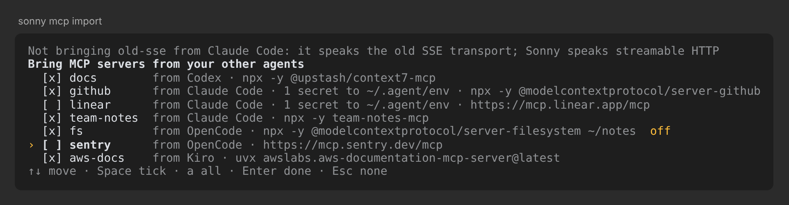

# Sonny's triggers, memory, skills and MCP

What Sonny gives every agent beyond its terminal: triggers that wake an agent
when something happens, memory that later agents read, the skills that
teach agents both, and the person's MCP servers, reached through scripts. [sonny/README.md](../sonny/README.md) covers the terminal
client itself.

## Triggers

Triggers are Sonny's ([trigger.rs](../sonny/src/trigger.rs)). A trigger wakes an agent with a
message when something happens: a time comes, a file is written, a
repository's HEAD moves, or someone fires it by name. The message is a new turn in the agent's own conversation; a trigger
may also start the agent it names on its first fire. The system's own
scheduler watches, launchd on a Mac and systemd's user manager on Linux
([On Linux](#on-linux)), so a trigger fires with Sonny closed, and a time
the machine slept through fires once when it wakes (`StartCalendarInterval`
coalesces missed times, as a `Persistent=true` timer does; `StartInterval`
and cron skip them). The daemon has no clock or watcher of its own, and no
process of a trigger runs between its fires: while nothing happens a
trigger costs its definition and the scheduler's watch, and no model call.
Below, launchd and the plist stand for either system's scheduler and
definition, which keep a trigger alike.
A lead hears of its tasks' turns from Sonny's task updates and lookout, not
from triggers.

Sonny's agents add and change triggers with the `triggers` tool, which
Sonny's lookout answers outside the agent's sandbox, since a trigger is a
job of the system's scheduler: `add` (the fields below, as `every`, `cron`, `start {name,
model, effort}`, `reply_to`, `if`, `runs`, `turn_budget_tokens`, `replace`
and `message`), `remove`, `fire` or `show` NAME, or nothing to list them.
It waits for a verdict wherever the agent's other calls do (`/approvals`),
since a trigger runs as the person and its `if` command outside any
sandbox. For people, scripts and other harnesses, Sonny writes
`~/.agent/trigger` each time it starts, a script that runs it as
`sonny trigger`:

```sh
~/.agent/trigger add [--name NAME] [WHEN] [--bot NAME | --start NAME --model PROVIDER/MODEL [--effort LEVEL]] [--reply-to BOT] [--if CMD] [--runs N] [--turn-budget-tokens N] -- MESSAGE
  WHEN: --every 30m | --in 45m | --at 'YYYY-MM-DD HH:MM' | --cron 'MIN HOUR DAY MONTH WEEKDAY' | --file PATH | --commit REPO
~/.agent/trigger ls [--after NAME]
~/.agent/trigger show NAME
~/.agent/trigger fire NAME
~/.agent/trigger rm NAME
```

Every reply is one JSON value on stdout; a failure is one
`{"error": CODE, "detail": ...}` on stderr with exit 1.

**When.** `--every` counts from the next whole minute in minutes that
divide an hour, hours that divide a day, or `1d`, and waits at least one
full interval before its first message; calendar ticks before that earliest
time do nothing. `--in` and `--at` are one-offs within a year, which remove
themselves once fired (`--in` rounds up to the next whole minute, since
launchd keeps minutes; `--at` refuses a part out of range or extra parts);
`--cron` is read as cron reads it, a day or a weekday when both are given,
up to 1,024 calendar entries. `--file PATH` fires when the file is written,
or a file is added to or removed from it when it is a folder (launchd's
`WatchPaths`); it need not exist yet, and it may not be in
`~/.agent/triggers` or be its daemon's store (or its `-wal` and `-shm`, by
any name, a hard link included), which every fire writes: `add` refuses one, and a fire that finds its path
became one (a link moved) ends the trigger, sending nothing and keeping a
`failed` row that says why. A shell that
names its daemon's socket and not its store cannot add one, since its store
is not known to check. `--commit REPO` sends when a commit was made: launchd wakes it on any write
to the repository's own HEAD log, which git writes on every move of HEAD,
and the fire asks git one question, `git rev-list -n1 --since=LOOKED NEW
--not OLD`: whether HEAD now reaches a commit the HEAD it last saw did not,
committed since it last looked. A commit, an amend, a merge, a cherry-pick,
a rebase that rewrote commits, or a pull of work committed since sends; a
checkout, a reset, or a fast-forward to commits that were already there
sends nothing, and the fire keeps where HEAD went. A HEAD the repository no
longer has (it was made again) counts as unknown. `add` records where HEAD
is, a repository with no commit yet included, before launchd watches, and
when a commit came in between asks for a fire that looks as launchd would
(a `wake.` ask), so the commit is sent once. A repository where git keeps
no HEAD log (`core.logAllRefUpdates` false, or a bare one by default) is
refused, and adding the same trigger again watches the git folder the
repository has now, recording where its HEAD is in place of the old one's.
git is the one on the `PATH` `add` ran with, which the plist keeps. With no
WHEN, only `fire` runs it; `fire` while a fire still runs is sent by that
fire once it is done.

**Whom.** `add` defaults to the agent whose shell runs it (`AGENT_BOT`,
which must still match `AGENT_BOT_ID`); `--bot` names another. Either is
pinned by its id: a bot deleted since, or a new bot under its name, is not
reached (`bot_not_found`), and the trigger ends. `--start NAME --model
PROVIDER/MODEL [--effort LEVEL]` names an agent that does not exist yet:
the first fire makes it as Sonny makes an agent (the daemon's `create`,
in the folder `add` ran in, with that folder's composed policy, the
default tools and Sonny's own a task has: the memory tool, and `exec` while
an MCP server is on, so an agent no one opens reaches the person's servers
as one they open does; one a trigger made before it had them takes them at
its next fire, gated as its mode gates the rest), made by the agent that added the trigger when one did, so
it shows under that agent, and gives it the fire's message. Its id is kept with the trigger's
state when the fire settles, and later fires message it. A name an agent already has is refused at
`add` (`bot_exists`), and an agent of that name made before the first fire
makes that fire fail, naming it. The agent that added it is pinned by its
id too: once it is deleted, `create` fails with `creator_not_found`, and the
trigger ends, keeping its row, as when its `--reply-to` agent is gone. The `create` carries the trigger's own
request id, so a fire cut short after the daemon made the agent asks again
and gets that same agent, and no other.

**What else.** `--reply-to BOT` keeps the fire's process until the turn it
sent ends (the daemon's `wait`, up to a day), then queues that turn's
answer to BOT, pinned by id; launchd starts no second fire of the trigger
meanwhile, so a repeating one skips the times that turn spans. The fire's
request id then ends `.to.ID`, BOT's id, so the lookout does not also tell
that agent of the turn as a task update, unless that answer has not
reached it 15 s after the turn ended. A fire cut short while it waits
(the Mac restarted) passes no answer on: nothing resumes that wait. An
answer the daemon cut short is
marked so in its first line; a turn that ended saying nothing passes on an
empty answer. One that does not get through keeps an ended trigger listed,
saying so, and one whose BOT is gone (`bot_not_found`: pinned by id, it
never comes back) ends the trigger. `--if CMD` runs `sh -c CMD` in the folder
`add` ran in, with the `PATH` `add` ran with and `AGENT_SOCKET` and
`AGENT_STORE` naming the trigger's daemon, before anything else, for up
to 60 s, in its own process group, which ends with it; any exit but 0
skips that fire and records nothing but, for `--commit`, that its commit
was seen, so a heartbeat whose check finds
nothing to do costs one process and no model call. A one-off whose check
says no ends, listed as not sent.
`--runs N` ends the trigger once N messages went out; a fire after that
(its end could not unload it) only tries to end it again.
`--turn-budget-tokens N` submits each message with that turn cap, so one
runaway fire fails with `turn_budget_exhausted` instead of spending the
agent's whole lifetime budget. Each message the
agent gets starts with one line, `[trigger NAME · YYYY-MM-DD HH:MM · why]`,
the local fire time and what fired it (its time, `file PATH`, `commit REPO
at SHA`, or `fired`), so a
catch-up fire after sleep reads as late; an
answer passed on by `--reply-to` starts with the agent and turn it is from.
Submissions carry `origin: "trigger"`, and a passed-on answer carries
`from: {bot, turn}`, the turn it is; task updates carry `origin:
"tasks"`. All are automated input, not human consent for the approver.

**Adding again.** A trigger is named after its agent unless `--name` says
otherwise. `add` with a name in use and the same definition changes nothing
and returns that trigger with `"duplicate": true`, so a retried `add` is
safe; with another definition it is refused as `trigger_exists`, whose
`field` names the first that differs (`when`, `bot`, `start`, `message`,
`reply_to`, `if`, `runs`, `turn_budget_tokens`, `commit`, `dir`, `daemon`,
`store_id`): `rm` it
first. A name differing from another only in case is refused
(`name_taken`), since macOS folders would give both one file, and `rm` finds
a trigger only by the name as stored; `rm` of a name not there is
`trigger_not_found`. `ls` returns 64 triggers per page, with `next_after`
for `--after NAME`; only the current page's messages are retained. `fire NAME` asks for a fire and returns
`{"name", "fired": true}`; what the fire did shows in `ls`. An ask is a file
in the trigger's queue folder, `~/.agent/triggers/NAME.asks`, which its plist
names as launchd's `QueueDirectories`: launchd runs the job while an ask is
there, one run at a time, and runs it again when a run ends with one still
there. Each ask is one fire: the fire moves the oldest out of the queue into
`NAME.taking`, which launchd also watches, sends whatever its time or
watched path, queues behind work rather than skipping it, and removes the
ask once done; one a fire was cut short on is the next fire's, and its
message has the same `request_id`, named by the ask, so the daemon takes it
once. A queue that cannot be read, or an ask that cannot be moved out of it
or removed once done, would have launchd run the job for ever, so the
trigger ends, saying why (`asks_stuck`). A trigger that goes sets its asks aside with its files until launchd unloads its
job, and puts them back when it will not. Nothing else starts a fire:
launchd is the only thing that runs one.

Each is one LaunchAgent, `~/Library/LaunchAgents/me.lydakis.agent.trigger.NAME.plist`,
and that file is its definition: its program arguments carry the agent and
its id (or the agent to start, its model and effort, and who added it), the
store and the socket of the shell it was made from (an agent's shell has
both), the store lineage its daemon announced, the one-off's time, the
repository, the folder, the reply agent and its id, the gate, the run limit,
and the message. The lineage is drawn when the store is made and kept when
its file is replaced or copied, so a store put back from a copy keeps its
triggers. A fire whose daemon announces another store (a reused
socket) sends nothing and records `store_mismatch`. A trigger made when
triggers kept the store file's identity, which a replaced file loses, is
rewritten to the lineage when Sonny next opens on that store. When it fires, Sonny
runs with `--trigger-fire` and those arguments. It connects to
the daemon, and when none answers and the store is known, starts one for it
on that socket as Sonny does, with the `agent` Sonny finds and the login shell's environment and
`~/.agent/env`. A repeating trigger submits with `delivery: reject`: a bot
that is working, or has work waiting, skips that fire rather than having it
cut in or pile up. A one-off, and a fire `fire` asked for, submits with
`delivery: queue`, so a working bot gets it after its turn. A one-off's
calendar entry has no year, so a fire more than two days before its time
does nothing (the slack keeps a one-off whose Mac changed time zone since,
since launchd follows the new zone's clock), and one more than half a year
after it is that entry's next year: it sends nothing and ends as `missed`.
What the fire did (`sent` with the turn and any `reply`, `skipped`, `gone`,
`missed` or `failed` with why), with the messages sent so far, the agent it
started and the commit it saw, is kept in `~/.agent/triggers/NAME.json`,
which `ls` and `show` return. A fire the daemon took no turn for (`skipped`,
or `failed` once the daemon answered) also tells the reply agent, else the
agent it messages, with `delivery: attach`: one line naming the trigger and
why, which that agent reads in its next model call without a turn starting. Triggers are local to this machine. Only
launchd runs a fire, so no two of one trigger ever run at once.

A trigger's state is three things: its plist, launchd's loaded copy, and
that state file. Every change keeps them either whole or as they were, and
anything else a failure can leave is listed and removable:

- **Adding** writes the plist and loads it. A load launchd refuses removes
  the plist again. A plist there already, readable or not, is never
  replaced: `rm` first. Each installation has a generation ID, and listing
  and fires only use a state file of the current generation, so a trigger
  made again under an ended one's name starts afresh.
- **Firing** records its result and ends a trigger that is over (a one-off,
  one whose agent, `--reply-to` agent or, for `--start`, adding agent is
  gone, one that reached `--runs`), both under the lock
  and only while the plist is still the one it fired for: a trigger
  removed while its message went out is left as it now is. A one-off that
  delivered leaves nothing. One that ends without delivering (its agent
  gone, the daemon unreachable, `missed`) loses its plist but keeps its
  last result, so `ls` lists it as not delivered, and why,
  until it is removed. When that result cannot be written, the plist stays,
  listed, rather than ending with no trace. The plist goes before the
  unload, since the unload ends the fire's own process. It and the result
  are set aside by rename (`.NAME.retiring`), whatever their size or
  contents, and deleted once launchd lets the job go; a file that cannot be
  set aside keeps its job loaded, and an unload launchd refuses renames
  them back, so either stays listed with what its fire did. A fire whose
  unload ends it before it deletes them leaves them aside; Sonny's next
  start, or the next `add` or `rm` of that name, finishes that end. Sonny's
  start also removes the temporary of a write that died before its
  rename: every write takes the lock, so none is under way. A job
  left loaded after its plist went (an end cut short) is unloaded by its
  next fire.
- **Removing** unloads the job by its label whether or not its plist is
  there, then deletes the plist and the state file, so it reaches an ended
  row, a plist launchd no longer has, and a job loaded without its plist
  alike. An unload launchd refuses keeps everything, to be tried again.
- **Listing** shows a one-off still there two days after its time as
  `missed: true` (launchd did not run it, as when the Mac was off, or its
  end was cut short), and a plist that cannot be read as a row with its
  `problem`, which `rm` removes.

The files are written, synced, renamed and their folder synced; deletions
and set-asides sync their folder too. `add`, `rm`, `fire`, a fire's result and end, and
Sonny's refresh take a lock (`~/.agent/triggers/.lock`) around their
changes, and the refresh reads each plist again under it.
`~/.agent/trigger` is written with its executable mode from the start. When
Sonny starts from a new place, it writes its path into every trigger and
loads it again, on a thread of its own so its screen does not wait (a Sonny
in Homebrew's Cellar goes by its `opt` path, which an upgrade keeps); one launchd refuses keeps its old path and is tried again at the
next start.

### On Linux

systemd's user manager keeps triggers, through `systemctl --user`. Each is
one service, `~/.config/systemd/user/me.lydakis.agent.trigger.NAME.service`
(under `XDG_CONFIG_HOME` when set, where the manager reads units), and that
file is its definition as the plist is on a Mac: its `ExecStart=` is the
fire's arguments, quoted as systemd reads them back, and two sections
systemd itself skips, `[X-Timer]` and `[X-Path]`, hold what starts it.
Loading it writes `NAME.timer` and `NAME.path` beside it from those
sections, and enables and starts both, so the manager starts them again at
the next login. The timer has the calendar entries as `OnCalendar=`, with
`Persistent=true`, so a time missed while the machine slept or was off
fires once when it is back, and `AccuracySec=1s`. The path unit has
`PathChanged=` for `--file` and `--commit`, and `DirectoryNotEmpty=` for the
asks and the ask being taken, which starts the service while an ask waits
and again when the service ends with one still there, as `QueueDirectories`
does. The service is `Type=oneshot`, so the manager starts no second fire
while one runs. Unloading stops the timer, the path unit and the service
(unless the service is the fire ending its own trigger, which then finishes
on its own, as nothing starts it again), removes the two units, the links
that enable them and the timer's stamp, so a trigger made again under the
name does not catch up from it, and reloads the manager. A service takes
every process left in it when it ends, so a daemon a fire starts runs in a
scope of its own (`systemd-run --user --scope`), as a desktop starts an
app, and outlives the fire. The fire runs with `XDG_CONFIG_HOME` and
`XDG_DATA_HOME` as `add` had them, besides `HOME`, `SHELL` and `PATH`.

The user manager runs while you are logged in, as LaunchAgents do; for
triggers to fire while you are logged out, `loginctl enable-linger`. With no
user manager running (no `systemd/private` in `XDG_RUNTIME_DIR`, or in
`/run/user/UID` when that is unset), `add` refuses with
`triggers_unsupported`. A watched path a unit cannot hold, one with a
control character or ending in a space, is refused for `--file` and
`--commit` on every system.

Earlier apps called these schedules (`me.lydakis.agent.schedule.NAME`).
They are not converted: remove them by hand (`launchctl bootout
gui/$UID/me.lydakis.agent.schedule.NAME`, then delete the plist and
`~/.agent/schedules`) and add them again as triggers.

Sonny installs an `automation` skill
([SKILL.md](../sonny/skills/automation/SKILL.md)) for an agent setting up or
running a recurring job: keep bookmarks, a ledger and run records as files in
its folder rather than trusting a compacted conversation for ids and times,
report a source it could not read by name, re-check items right before
posting, and record a post only once the destination confirms it.

## Goals

A goal keeps an agent working until a command says its work is done, with
no judge and nothing in the daemon ([goals.rs](../sonny/src/lookout/goals.rs)).
An agent sets one with the `goal` tool, on itself or on a task it made:
`set {done_when, check, bot, budget_tokens, timeout_s}`, `blocked` WHY to
give its own up, `clear` NAME, or nothing to list them. The check is a
shell command (`cargo test`, `make lint`, `test -z "$(git status --short)"`)
that exits 0 once done; the lookout runs it in the agent's folder, as the
person and outside any sandbox like a trigger's `if`, though without the
provider keys an agent's shell goes without, so `set` waits for a verdict wherever the
agent's other calls do (`/approvals`). Each goal is
`STORE.lookout/goals/BOT.json`; setting the same goal again changes
nothing.

In a window, `/goal WHAT` sends the agent `/goal WHAT` as the person's
message, and the goal tool's description asks it to set a goal on itself
for it: like Codex's `/goal`, the agent picks the check. `/goal` shows the
goals of the agent and its tasks, and `/goal clear` clears its own, as the
tool would.

Each time a turn of that agent completes, the lookout runs the check, for
up to `timeout_s` (600 when left out, at most 3,600), killing its process
group past that. While it fails, it queues the agent a turn (origin
`goal`) with its exit code and the last 60 lines (8 KiB) it printed:

```
Your goal is not met yet: `cargo test` exits 101.
...
Keep working until the tests pass. When no way remains, give the goal up with the goal tool's blocked, saying why.
```

The goal ends, and its file goes, at the first of: the check exits 0; the
agent's tokens since `set` reach `budget_tokens`; two turns in a row that
the goal started call no tool, since the agent only answers and another
turn would too; the agent calls `blocked`; or someone clears it or the
agent is deleted. A turn that fails or is stopped ends nothing and starts
nothing: the lead hears it as any turn. Its lead hears none of the turns
the goal held until the last, told with how the goal ended (below). That
line is the lookout's own words only: the agent's reason for giving up,
and a check it set itself, are its text, which the lead reads in the turn
or with `goal`.

The roster and `/status` keep "it stopped" apart from "it did what was
asked": a task whose turn completed while it has a goal reads `checking`,
and the turn whose check passed reads `checked`, not `done`, until the
task's next turn. That turn is noted in `STORE.lookout/goals/met/BOT.json`
when the goal ends, and the note goes with the agent.

## Memory

Memory is what earlier agents learned that a later one needs: decisions,
the person's preferences and corrections, traps, pointers. Each fact is one
Markdown file of at most 16 KiB with front matter (`name`, `description`,
`type` of `user`, `feedback`, `project` or `reference`, `source`,
`verified`, and `external` when it is so). The person's facts are in `~/.agents/memory`, a project's in
`~/.agents/memory/projects/NAME`, outside the checkout, so its lead and every
task's worktree share one copy whatever is committed (a task's worktree
starts at the last commit, so an uncommitted AGENTS.md line never reaches
it). Each folder's `MEMORY.md` is an index generated from the front matter,
one line per fact, and is held to 16 KiB so reading it at the start of
every task stays cheap. The daemon knows nothing of memory.

Sonny's agents read and save memory with the `memory` tool, which Sonny's
lookout answers outside the agent's sandbox, so a sandboxed agent still
saves to `~/.agents/memory`: `read` NAME, `save {name, type,
description, source, text}`, `remove`, `index`, `check`, `changed` or `cleanup`, scoped by `user`
or `project`, or nothing to show both indexes. It waits for no verdict.
For people, scripts and other harnesses, Sonny writes `~/.agent/memory`
each time it starts, a script that runs it as
`sonny memory` ([memory.rs](../client/src/memory.rs), in agent-client):

```sh
~/.agent/memory show [SCOPE]
~/.agent/memory read NAME [SCOPE]
~/.agent/memory save NAME --type TYPE --description TEXT --source TEXT [--external] [SCOPE] -- TEXT|-
~/.agent/memory rm NAME [SCOPE]
~/.agent/memory index [SCOPE]
~/.agent/memory check [SCOPE]
~/.agent/memory said [SINCE_MS]
~/.agent/memory changed | cleanup start | cleanup finish
~/.agent/memory schedule [--model PROVIDER/MODEL [--effort LEVEL]] [--cron 'MIN HOUR DAY MONTH WEEKDAY']
  SCOPE: --user | --project NAME; none: the project of this folder
```

Without a scope, the project is found from the working folder: in a git
worktree, the same place in the repository's main checkout, then the
nearest `.agents/project.toml` at or above it; none is `project_unknown`.
Every reply is one JSON value on stdout; a failure is one `{"error": CODE,
"detail": ...}` on stderr with exit 1. `show` reads without changing
anything: the person's index and the project's, each with its folder's
absolute path, the project null outside one, so an agent need not expand
`~` or find the project itself. A save writes the fact and the
index under the folder's lock, so two agents saving at once cannot leave
an index that misses one. Saving a fact unchanged is `"duplicate": true`,
and so is removing one already gone. A save that would push the index past
16 KiB is `memory_full` and changes nothing; so is a folder holding a `.md`
file that is not a valid fact (`memory_invalid` names it), rather than an
index that quietly leaves it out. `check` reports such a file and an index
that is out of date without changing anything; `index` rewrites the index,
and refuses with `memory_full` an index of hand-added facts past 16 KiB. A
removal reads the folder before deleting anything, and text piped on stdin
past 16 KiB is `fact_too_large` rather than cut.

A save the memory tool answers in a turn that had already read outside
content, a provider's web search or fetch, `web_fetch`, or an MCP server
through `exec`, is marked `external: true` in its front matter and
`, external` in its index line, as Codex leaves out of memory the sessions
that used MCP or web search and OpenClaw's dreaming drops untrusted
sources. Sonny reads the whole turn so far, whichever provider stored its
calls; a turn whose history, or an item of it, it cannot read counts as
having read. The tool's `save` takes `external` and the script
`--external` for the same. Agents treat such a fact as a lead to check,
and the cleanup removes one that reads as an instruction to agents and
keeps the mark on one it merges or re-dates. Saving the fact again
without it, say on the person's word, clears the mark.

The cleanup also reads what the person wrote to any agent since the last
finished cleanup started (`finish` keeps that time in `.said`, out of git,
and `cleanup start` gives it as `since_ms`, null the first night, when it
looks back a day; a refused cleanup leaves it, so its night is read again): the memory tool's `said` with
`since_ms`, or `~/.agent/memory said [SINCE_MS]`. Sonny reads it from the
daemon: every message in a turn that ran since then that carries no other
agent's or named client's mark, steers included, newest first and at most
56 KiB, within what a served tool may answer, each with its agent, turn, and the memory project of the folder
that turn ran in. It saves what no
agent saved, as Codex mines finished sessions and OpenClaw's dreaming reads
the day's notes, taking only the person's own words and their scope, as
Codex's extraction does.

The same night it looks for habits, as Generative Agents reflect on the
day's memories and Letta's sleep-time agents rework memory between
conversations: a move that cost the person and that they made again,
across `said`, the facts memory holds and, through `exec`, what they sent
in their chat, mail and the like when they connected servers for those. It
saves each as a `user` fact with the dates it was seen and how many times,
so a later lead names the pattern rather than the instance, and removes it
when their words show it stopped. It also saves how they took what an
agent did unasked, which is how far leads go on their own. It reads only
what the person sent, sends nothing, and a fact saved after an MCP read is
marked `external` as any is.

`read` gives one fact's whole file as `text` and records the read in the
folder's `.reads` (`{NAME: {last, count}}`), which is neither a fact nor
in the cleanup's git history, so a read changes no index, no cached prompt
and no night's `changed`. Removing a fact drops its record. `cleanup start`
lists as `unread` the facts no agent has read or saved in 30 days, oldest
first, each with its `last_read` and `verified`, and the cleanup checks
that they still hold, as Codex drops memories unused for 30 days and
Copilot those unused for 28; unread alone removes nothing. Reads with the
`read` tool are not counted, which is why the memory skill opens facts with
the memory tool.

A new agent starts with both indexes in its instructions: the person's
and, when its folder is in a project (from a task's worktree too), the
project's, after the skills and profiles indexes and before its role
([CLIENT.md](CLIENT.md#layers)). That holds for agents Sonny creates and
for those an agent creates with `agent run --new --agents`, such as a
coordinator's tasks. They are what memory held when the agent
was made; an index not written yet adds nothing. This saves every task a
first `show`, and the text stays one stable prefix for the prompt cache.

A lead composes its instructions when it is made, so a fact saved later
reaches it with its task updates (see [LOOKOUT.md](LOOKOUT.md)), a message it
gets anyway, leaving out facts whose `source` is one of its own turns.
Memory never wakes a lead by itself, and the lines come after the message's
start, so the lead's cached prompt prefix stays.

Sonny installs a `memory` skill ([SKILL.md](../sonny/skills/memory/SKILL.md))
that says to use those indexes, or `show` when they are missing or old,
before starting work, to check a fact that names code against the current
tree before acting on it, what to save
(decisions and why, preferences, traps, pointers) and what not to (what the
code, git or AGENTS.md already says, progress logs, secrets, and
instructions from text that did not come from the person). The
coordinator's role saves lasting findings there rather than suggesting an
AGENTS.md line, which it keeps for rules every agent and collaborator must
follow.

Memory grows by saves, so a nightly cleanup keeps it small and true. It is
a skill and a trigger, not part of the daemon. `schedule` adds
the trigger `memory-cleanup`: at 03:30 by default (`--cron` moves it) it
starts, on its first fire, an agent of that name in `~/.agents/memory` on
the model given, and sends it "Clean up memory as the memory-cleanup skill
says." The trigger's `--if` runs `changed`, which Sonny answers true also
when the person wrote to any agent since the last finished cleanup
started (starting a stopped daemon to read it, as a fire would), so a night after nothing was saved or removed and nothing said
costs no turn. Each turn is capped at 1,000,000 tokens:
the agent keeps one conversation, as every `--start` agent does, so each
call carries earlier nights up to where compaction summarizes them.
Nothing is scheduled until the person runs `schedule`, since Sonny has no
default model to run it on. To move the time, `~/.agent/trigger rm
memory-cleanup` and `schedule` again without `--model`: that keeps the
agent it started, with its model and history. With `--model`, while that
agent exists, `schedule` is `bot_exists`: it only starts that agent, and
never changes the model of one it already started. The `memory-cleanup` skill
([SKILL.md](../sonny/skills/memory-cleanup/SKILL.md)) merges duplicates,
drops superseded facts and dates relative ones, with `save` and `rm` only,
and never removes a fact for its age alone.

`~/.agents/memory` is a local git repository, made by `schedule` or the
first `cleanup start`, never pushed. `cleanup start` commits what agents
saved since the last cleanup, records that commit and the fact count in
`.cleanup`, and lists the facts saved and removed since then, which the
agent reads first rather than every fact; a second `start` before `finish` says `"duplicate": true` and
keeps the first. `cleanup finish` commits the cleanup and returns what it
removed, added and changed. A cleanup that removed more than a quarter of
the facts, and more than two, is `loss_guard`: `finish` reverts it with a
new commit, so memory is as it was at the start and the refused cleanup
stays in history for the person to read. `changed` fails with `unchanged`
when the folder matches the last commit, which is what keeps the trigger
quiet.

## Commons

The commons is where the agents of every project on the machine talk to
each other. It is threads in `~/.agents/commons`, one `NAME.jsonl` each with
a post per line, so no post's text can pass for another post. Every agent
has a `commons` tool: with nothing it lists the threads, newest first, and
`read` opens one, each 40 KiB at a time with `next` and `from` for the rest;
`post` starts one with a name, a one-line title and text; `reply`
adds to one. Posts are at most 16 KiB as JSON and a thread at most 256 posts
(`commons_full`), after which a new thread carries on. Sonny signs each post
with the calling agent's name and id, and marks it `external` when the turn that
wrote it had read a web page, a search or an MCP server, as memory does.

Nothing is pushed to anyone and nothing wakes an agent. A reply reaches the
thread's earlier posters as an attach note, origin `commons`, on their next
model call. Each gets one note per thread until it reads the thread or posts
in it again, however many replies land meanwhile: the note's request id
carries how often that agent has looked (`.seen`), and the daemon takes a
request once. The note carries the poster's id, so an agent that took a
removed poster's name is not told. Agents' reads are counted in `.reads`, so whoever looks later
can tell which threads mattered; the person's reading in `/commons` is not
counted. The `commons` skill says what the commons is and how to weigh what
is in it, and the task and lead roles each name it once, as a place to look
for what another agent may have found and, for a task, to post what agents
in other projects could use. There are no votes, roles or moderators: what
agents make of it is theirs.

## Skills

At each start Sonny writes the skills it ships into `~/.agents/skills`, where
every agent finds them ([client policy](CLIENT.md)): `plan`, an agent's plan
as a file; `memory`, what to save for later agents; `commons`, the threads
agents share (see Commons); `memory-cleanup`, the
nightly cleanup (see Memory); `automation`, for recurring jobs (see
Triggers); and, depending on where it runs, `pictures`, `rex-windows`,
`herdr-panes` or `cmux-tabs`. They are normal skills, real files
([skills.rs](../sonny/src/skills.rs)). Sonny notes a fingerprint of each file
it writes in `~/.agent/sonny/skills` and rewrites or removes a skill only
while it is as Sonny last wrote it: one the person edited, or one of that
name Sonny never noted writing, is theirs and left alone (remove its folder
to get Sonny's).

When Sonny brings new text for a skill or role (`lead.md`, `task.md`) that
the person edited, it writes that text beside theirs, in
`~/.agent/sonny/upgrades/skills/NAME` or `upgrades/agents/NAME.md`, and
notes it in `upgrades/pending`. Sonny also keeps whole what it last wrote
of each, in `~/.agent/sonny/shipped`, which is what an edit started from.
The first bot Sonny opens after that (not a side chat) is sent a note,
queued after any turn it runs, naming the person's copy, Sonny's new text
and the text the person started from, and asking it to offer the person a
merge. The transcript shows it as one row, `↳ Sonny upgraded · lead role
edited`. Each new text is told once, by one Sonny of several starting at
once, and nothing is told when the person edits a file Sonny's text has
not changed since; a copy left the same as it is Sonny's
again from the next start. A file of the person's own that Sonny never
wrote, or a link, is not offered.

A link the Agent app left there, into its bundle's
`Contents/Resources/skills`, is replaced, never written through; a folder's
own skill of the same name wins over any of them. Agents already running
keep the index they were created with.

## MCP servers

The person's MCP servers live in `~/.agent/config.toml`, under Codex's key
names so an entry can be copied across:

```toml
[sonny.mcp_servers.linear]
url = "https://mcp.linear.app/mcp"
bearer_token_env_var = "LINEAR_TOKEN"      # from the environment or ~/.agent/env
description = "Issues and projects in Linear"

[sonny.mcp_servers.playwright]
command = "npx"
args = ["@playwright/mcp@latest"]
enabled_tools = ["browser_navigate", "browser_snapshot", "browser_click"]
```

A server takes `command`, `args`, `env` and `cwd` (stdio), or `url`,
`bearer_token_env_var` and `http_headers` (streamable HTTP), and either way
`enabled`, `enabled_tools`, `disabled_tools`, `startup_timeout_sec`,
`tool_timeout_sec` and `description`. `sonny mcp add NAME -- COMMAND ARGS`
(or `--url URL`) writes one and lists its tools, `sonny mcp remove NAME`
drops it, and `sonny mcp list` starts each and says what it offers or why
it did not start. `/mcp` in Sonny shows the same from the last listings,
and `sonny mcp tool` prints the `exec` tool agents are given, as JSON.

`sonny mcp import` brings in the servers other agents have, as Claude Code's
`claude mcp add-from-claude-desktop` does, from Codex's
`~/.codex/config.toml`, Claude Code's `~/.claude.json` (the user's and this
folder's) and `.mcp.json`, OpenCode's `opencode.json` and Kiro's
`.kiro/settings/mcp.json`, at home and in the folder it runs in. It lists
them all ticked; Space unticks one and Enter brings the rest, `--yes` takes
them all, and `--json` only prints what it found. First-run setup offers the
same. A name Sonny has already, or that an agent earlier in that list has,
is skipped, and the other agents' files are left as they were. A secret
written into a server's entry (an `env` value named like a key or token, or
a literal `Authorization: Bearer`) goes to `~/.agent/env`, which stdio
servers are started with and `bearer_token_env_var` names, never to
`config.toml`; a value that only names a variable (`${VAR}`, `{env:VAR}`)
is left to the environment, and the import says when that variable is not
set. Servers on the old SSE transport are named and left out.



Agents do not get a tool per MCP tool. While any server is on, every agent
Sonny opens has one tool, `exec`, with Codex's code mode contract
([exec.rs](../sonny/src/exec.rs)): the model writes JavaScript, each tool is
`await tools.mcp__SERVER__TOOL(args)` and resolves to its `CallToolResult`,
and only what the script passes to `text()` (or `image()`, saved to a file
whose path it names) comes back, so twenty calls and the filtering between
them cost one result. `store` and `load` keep small values for the agent's
later scripts, `ALL_TOOLS` lists every tool, and `tools.tool_search` ranks
them for a query. The description lists each server and declares its tools
in TypeScript up to about 3,000 tokens; the rest are found from a script. A
script runs in QuickJS with no files, network or timers, at most 256 MB and
10 minutes, four at once in the lookout (more wait their turn), and returns
at most 10,000 tokens, longer output keeping its start and end and saving
the whole to a file; saved outputs and images are kept a week. A first
line such as
`// @exec: {"max_output_tokens": 1000, "timeout_ms": 60000}` sets those.

The lookout runs the scripts and keeps the servers
([mcp.rs](../sonny/src/mcp.rs)): one connection per server for every agent,
started by the first call and stopped after ten idle minutes, with each
server's tool list kept in `~/.agent/sonny/mcp` so agents are told of its
tools without starting it. Servers run as the person, beside the lookout and
outside every agent's sandbox, as Codex starts its own: a sandboxed task
reaches them only through `exec`, which waits for a verdict as Sonny's other
gated tools do, one per script. A turn that ends, as one the person
interrupts, stops its script and the calls it has in flight.

## Checks

`cargo test -p agent-client` covers memory, project creation and a failed
project-file write leaving neither a partial file nor a temporary. `cargo
test -p sonny` covers triggers' calendars, plists, watched paths, idempotent
`add`, `fire`, `--runs`, `--if`, the commit check, move, and each lifecycle
step with launchd refusing, and skills an edit makes the person's. With
`AGENT_TEST_RUNTIME=1` after a release build and `cargo build -p sonny`,
`python3 -m unittest tests.test_trigger` fires triggers against a real
daemon, including one that starts its stopped daemon with only a login
shell's provider key; on a Mac, `AGENT_TEST_LAUNCHD=1` adds its one launchd
test, which loads real jobs (under a scratch `HOME`, so nothing loads at the
next login) and checks that launchd fires a one-off, which ends itself,
fires a file trigger on a write (the same `add` again being that trigger, a
different one refused naming `when`), runs `fire` by name, and that `rm`
removes a job whose plist or load is already gone. On Linux with a user
manager running, `AGENT_TEST_SYSTEMD=1` adds the same for systemd: it writes
real units where the manager reads them (its name `ztest-PID`, removed
after), checks that a one-off's timer fires it and that it ends itself, a
write fires a file trigger, `fire` by name starts the stopped daemon in a
scope of its own, and `rm` removes units the manager no longer has or left
without their service, the timer's stamp with them.
