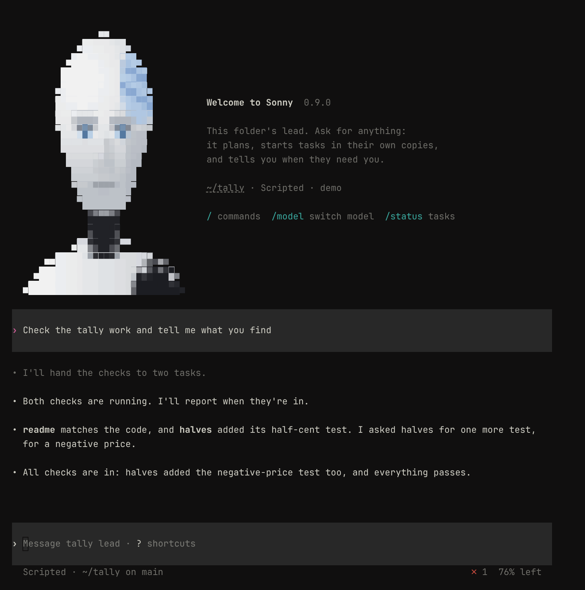
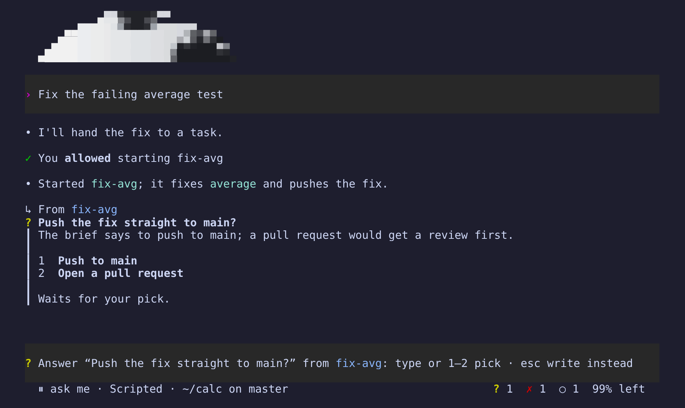

# Sonny

Sonny is a terminal workspace built on [Agent](../README.md) for supervising **several tasks in parallel**. Open it in a project folder and talk to that project's **lead**: it spins up isolated tasks in their own git worktrees, tracks their progress, and surfaces only the questions, decisions, and approvals that need your attention.

[Install](#install) · [First run](#first-run) · [How it works](#how-it-works) · [Controls](#everyday-controls) · [Permissions](#permissions) · [Full reference](REFERENCE.md)

## Why Sonny

- **Delegate to a lead, supervise in parallel.** Hand off multiple tasks at once. Each task gets its own git worktree and durable conversation; questions and approvals bubble up to your lead window. Scale across folders with `/projects` or the `superlead` profile.
- **Calm, uncluttered terminal UI.** The default **words-only** view hides noisy tool churn (toggle `/verbose` whenever you want details). Structured **decision cards** show options, recommendations, and optional deadlines; `/zen` focuses on one topic; `/side` forks a quick side question mid-turn without interrupting work.
- **Safe autonomy out of the box.** Leads and tasks start in **Auto** mode: sandboxed to their folder, with a model reviewer evaluating escalations and handing uncertain calls to you. `/pause` stops every agent across every project immediately.
- **Event-driven, not polled.** The [Lookout](../docs/LOOKOUT.md) streams task updates and external sources (CI, PRs, chat, commons, memory) into leads via filters, digests, and instant steers—zero polling loops.
- **Compounds across sessions and machines.** Built-in [shared memory, skills, commons & boards agents take work from, OS-scheduled automations, code-mode MCP (`exec`), JS workflows, browser/desktop tools, and `sonny link`](../docs/SONNY.md) to borrow your laptop's signed-in browser or MCP servers from a remote devbox.
- **Works where you work.** Standalone terminal, multiplexer layouts (Rex, Herdr, cmux), or inside T3 Code and any ACP client (`sonny acp`).

<p align="center">
  
</p>

## Install

### Homebrew (macOS and Linux)

```sh
brew install lydakis/agent/sonny
```

Builds Sonny from source and installs the matching `agent` daemon and `ripgrep`. (If Homebrew flags the tap as untrusted, run `brew trust lydakis/agent` first.) Running `sonny setup` installs Sonny's pinned `agent-browser` and `agent-desktop` binaries automatically.

### Static installer (Linux x86_64 / aarch64)

Downloads the latest static release, verifies its SHA-256 checksum (and GitHub build attestation if `gh` is signed in), links `sonny` into `~/.local/bin`, and installs missing `bubblewrap` and `ripgrep` packages:

```sh
curl -fsSL https://raw.githubusercontent.com/lydakis/agent/main/install.sh | sh
```

Ensure `~/.local/bin` is on your `PATH`. Options: `PREFIX=...` (install path), `SONNY_VERSION=...` (pin a release), `SONNY_PACKAGES=0` (skip system packages). Inspect [install.sh](../install.sh) before running.

### Upgrading

```sh
sonny upgrade
```

Updates Homebrew, static, or nightly installs, seamlessly swaps the running daemon (running turns park and continue), updates companions, and reopens open Sonny windows in place with your unsent draft intact. See [upgrading](../docs/SONNY.md#upgrading).

### Nightly builds

Build Sonny and its matching daemon directly from `main`:

```sh
brew unlink sonny  # if stable Sonny is installed
brew install lydakis/agent/sonny-nightly
```

Update anytime with `brew update && brew reinstall lydakis/agent/sonny-nightly`: reinstall fetches current `main` even when the formula's version has not changed, so no `--HEAD` is needed. Check built commits with `sonny --version` and `sonny agent --version`.

### Build from source

With the [pinned Rust toolchain](../rust-toolchain.toml):

```sh
cargo install --locked --path .
cargo install --locked --path sonny
export AGENT_BIN="$HOME/.cargo/bin/agent"
```

Cargo builds require `AGENT_BIN` so Sonny never picks up an unrelated `agent` on `PATH`. Use `sonny agent ARGS` to invoke the exact daemon CLI Sonny uses.

## First run

Open Sonny inside your project directory:

```sh
sonny
```

On first run, setup detects existing credentials (ChatGPT/Codex logins, AWS profiles, or API keys), ranks available models, and offers to import MCP servers from Claude Code, Codex, OpenCode, or Kiro. Revisit setup anytime with `sonny setup` or adjust settings with `/config`. See [provider setup](REFERENCE.md#provider-setup) for non-interactive flags.

Give your lead parallel work right away:

> Fix the failing tests and have another agent check the README examples.

Closing the window leaves the daemon and every running turn alive. Reopen `sonny` in the same folder anytime to return to the lead you last messaged.

<p align="center">
  
</p>

## How it works

### Leads, tasks, and projects

- **One lead per folder (or several):** Opening `sonny` connects to `<project>.lead` (or, with `[sonny] opens = "NAME"`, to that agent from any folder; `sonny .` is always the folder's lead). Start extra peer leads with `sonny --new-lead [NAME]`, switch agents with `/switch`, or jump across all projects with `/projects` (`←` on an empty composer).
- **Isolated worktrees:** Each task runs in its own git worktree (`agent/NAME` branch) so parallel tasks never collide. Inside Rex, Herdr, or cmux, Sonny can also lay tasks out in tabs ([terminal layout](REFERENCE.md#terminal-layout)).
- **At-a-glance status:** The side pane shows active tasks, plans, and live notes beside your chat. Press `/status` for the full grouped view (`Needs you`, `Failed`, `Working`, `Idle`, `Done`), or `/sky` for a live constellation map and replay of your entire fleet.

### Decisions, side chats, and focus

- **Structured decisions (`ask`):** When an agent hits a fork in the road, it presents a numbered decision card with trade-offs, a recommendation, and clear behavior (reversible choices can proceed after a deadline; irreversible ones wait for you). Click an option, type a number, or reply in your own words.
- **Mid-turn forks (`/side`):** Ask a copy of the current agent a quick question beside the main chat without interrupting its running turn.
- **Focus mode (`/zen FOCUS`):** Quiet everything except one topic; the lead holds unrelated updates until you exit `/zen`.
- **Live margin notes:** Agents pin state (open PRs, CI status, checklists, live Jinja templates reading sources or files) in the margin beside the chat.

### Beyond one conversation

Sonny extends Agent with background companions and shared tools—read [docs/SONNY.md](../docs/SONNY.md) and [docs/LOOKOUT.md](../docs/LOOKOUT.md) for the full guides:

- **Lookout:** Event-driven pipe delivering task updates and external sources (chat, CI, PRs, email pollers, commons, memory, linked machines) with EventBridge-style filters, digests, and instant steers.
- **Shared memory & skills:** Facts saved in `~/.agents/memory` are shared across worktrees and maintained by nightly cleanup; shipped skills live in `~/.agents/skills` and preserve your edits across upgrades.
- **Commons & boards:** Cross-project discussion threads (`/commons`) and boards in the commons where a task's agents take work, and are told when they still hold it at a turn's end.
- **Automations:** Cron, interval, file-watch, and git-commit triggers run by one OS scheduler (`launchd` / `systemd`), costing zero model calls when idle or skipped by an `--if` gate.
- **Code-mode MCP (`exec`) & workflows:** Agents call your MCP servers (and built-in tools) inside a sandboxed QuickJS script (`exec`) with per-call approvals, or orchestrate multi-agent JS pipelines (`workflow`).
- **Browser, desktop, and remote links:** Pinned `agent-browser` and `agent-desktop` tools, plus `sonny link HOST` so remote devbox agents can use your laptop's signed-in browser, desktop, or local MCP servers over SSH.

## Everyday controls

| Action | Control |
| --- | --- |
| Send a message, or steer a running turn | `Enter` |
| Queue a message behind the running turn | `Tab` while running |
| Insert a newline | `Alt-Enter` or `Ctrl-J` (`Shift-Enter` in supported terminals) |
| Interrupt the running turn | `Esc` |
| Boost effort for the next message | `Alt-T` (or `Ctrl-X`) |
| Run a local shell command and share output | `!COMMAND` |
| List agents and open their conversations | `/status` |
| Browse and jump across all projects | `/projects`, or `←` on an empty composer |
| Step to the previous / next agent in this project | `Alt-←` / `Alt-→` on an empty composer |
| Jump to the next agent needing you (any project) | `Alt-N`, or click `← ? N` in the footer |
| Switch this window to any agent | `/switch` |
| Start a new agent with a profile and workspace | `/new [NAME]` |
| Open a mid-turn side fork beside the chat | `/side [QUESTION]` |
| Focus on one topic and hold other updates | `/zen FOCUS` |
| Switch model, effort, or speed tier | `/model` |
| Change settings | `/config` |
| Inspect automations, follows, and running commands | `/background` |
| Browse or delete saved memory | `/memory` |
| View token usage, context fill, or audit trail | `/usage`, `/context`, `/audit` |
| Watch the live fleet constellation & replay | `/sky` |
| Pause or resume every agent across all projects | `/pause REASON`, `/resume` |
| List commands or keyboard shortcuts | `/`, or `?` on an empty composer |

Side chats inherit the agent's tools by default; set `[sonny] side_chat = "answer"` in `~/.agent/config.toml` for read-only Q&A. See [all commands](REFERENCE.md#commands).

## Permissions

New leads start in **Auto**. Run `/permissions` to switch modes for the current agent, its descendants, and future agents it creates (busy agents switch after their current turn finishes).

| Mode | Commands, writes, and edits | Calls outside the sandbox |
| --- | --- | --- |
| **Auto** *(default)* | Confined to workspace and allowed folders | Reviewed by a model; uncertain calls ask you |
| **Ask me** | Confined to workspace and allowed folders | Ask you |
| **Read only** | No writes or network from commands | Ask you |
| **Full access** | Unconfined | Run without asking |

### What the sandbox closes

The sandbox restricts writes and command execution, not reads of files your user can read (except `~/.agent/keys`, Sonny's pinned programs, and folders you list in `[sandbox] unreadable`). Workspace modes allow network access by default. Read the [full sandbox boundaries](REFERENCE.md#what-the-sandbox-closes) before exposing an agent to untrusted content, and see [how Auto review works](REVIEWER.md).

## Configuration

- **Global settings:** `~/.agent/config.toml` (edit interactively with `/config`)
- **Credentials:** `~/.agent/keys/env` (`0600`, readable only by you)
- **Project overrides:** `.agents/project.toml`

### Profiles for leads and tasks

Customize the shipped `lead` and `task` profiles in `~/.agents/agents` (or `.agents/agents` per project), or create your own using `extends: lead` (like the shipped `superlead` profile). Sonny preserves your edits and offers merges on upgrade. See [profiles and project overrides](REFERENCE.md#profiles-for-leads-and-tasks).

### Effort for leads and tasks

Configure default models, effort levels, speed tiers, display preferences, and terminal layouts globally or per project in the [settings table](REFERENCE.md#effort-for-leads-and-tasks).

## Integrations and further reading

- **[Sonny reference](REFERENCE.md):** complete guide to controls, views, margin templates, settings, and layouts.
- **[Automations, memory, commons, MCP & links](../docs/SONNY.md):** deep dive into Sonny's background capabilities.
- **[Lookout](../docs/LOOKOUT.md):** event routing, external sources, filters, and digests.
- **[Terminal layout](REFERENCE.md#terminal-layout):** Rex, Herdr, and cmux integration.
- **[Feature history](FEATURES.md):** what shipped, changed, or retired and why.
- **[Documentation index](../docs/README.md):** Agent runtime, CLI, design, and benchmarks.

### T3 Code

Run `sonny acp` as a local ACP provider in T3 Code to open project leads and nested task threads directly inside T3 Code. See [T3 Code setup](REFERENCE.md#t3-code).

### Other ACP clients

`sonny acp` speaks the Agent Client Protocol, version 2 only, for any compatible editor or chat bridge: tasks show as the lead's subagents, a session comes back with its history, and it carries multi-user attribution and reactions. See [ACP client details](REFERENCE.md#other-acp-clients).
