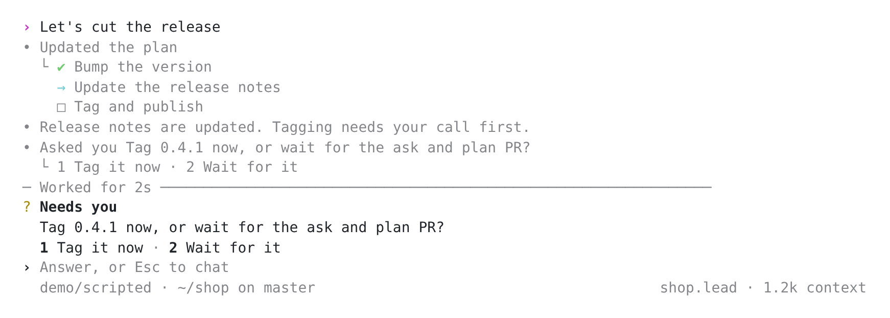

# Sonny (prototype)

A terminal client for the daemon that lays its work out in Rex or Herdr. It
speaks the daemon's socket protocol through `agent-client`; nothing in the
daemon or CLI knows it exists.

    brew install lydakis/agent/sonny         # Sonny, and the daemon's `agent` formula with it
    brew install lydakis/agent/agent         # just the daemon
    sonny agent ls --pretty                  # the daemon's CLI, as Sonny runs it

Both formulas build from the release's source on your machine (macOS or
Linux), so nothing is signed; Sonny starts the `agent` formula's daemon by its
`opt` path. On Linux, each release also has
`sonny-VERSION-linux-ARCH.tar.gz` (x86_64 and aarch64): static builds of
Sonny in `bin/` and its daemon in `libexec/`. Unpack it anywhere and run
`bin/sonny`. With `cargo install`, build both (`--path .` for `agent` and
`--path sonny`) and set `AGENT_BIN` to that `agent`; Sonny never takes an
`agent` from `PATH`, which may be another program. `sonny agent ARGS` runs
the one Sonny uses, with the keys in `~/.agent/env`, whatever else is called
`agent` on your `PATH`. It is also the one way in agents are told about:
Sonny sets `AGENT_CLI` to its own `sonny agent`, so the instructions it
composes, those the CLI composes for agents started through it, and the
skills it writes name `"…/sonny" agent` wherever they would say
`"$AGENT_BIN"`.

    sonny                                    # this folder's coordinator, <project>.lead
    sonny --model PROVIDER/MODEL             # the same, making the project the first time
    sonny --bot NAME                         # any one bot

Opened in a folder, Sonny is that project's lead, `<project>.lead`, made by
Sonny in its `lead` role, with the folder's
`.agents/project.toml` written when it had none. Every folder can have a
lead: outside git, the folder Sonny opens in is its own project, whatever
project holds the folder above it. In a git repository, Sonny opens the
nearest project in that repository, else makes the repository's top one,
so `src` reaches the repository's lead and a task's worktree its main
checkout's; a subfolder of a repository is its own project once it has a
file (`sonny project add DIR`). A project whose file says
`subfolders = "project"` keeps the folders below it: Sonny opened in any of
them that has no project file of its own, a repository among them, opens
that project's lead (the nearest project above decides; the home folder's
file never does). A lead made below another project's folder says which
lead holds the folder above. Sonny refuses to make a lead in a task's own
folder under `~/.agent`.

Sonny's two roles are normal profiles the person can read and edit in
`~/.agents/agents`, beside their own: `lead.md`
([agents/lead.md](agents/lead.md)), the lead's role, and `task.md`
([agents/task.md](agents/task.md)), what every other agent Sonny starts
is told after its instructions and any role (`--profile`) it starts in:
tasks, a trigger's agents and `sonny --new` bots. Sonny writes both at
each start, as it writes its skills: it rewrites a file when its text
changes, and writes it again once it is deleted, but never over an edit,
since it notes a fingerprint of what it wrote in `~/.agent/sonny/agents`,
and a file that no longer matches, or one Sonny never wrote, is the
person's. A folder's own `.agents/agents/lead.md` or `task.md` comes
first. How the lead starts a task with `sonny task`, which names this
Sonny, and where the project's tasks work are composed after the lead's
role, not kept in the file.

#### Effort for leads and tasks

Each agent's effort is the daemon's to keep; Sonny only picks what a new
one starts with, and imposes nothing. With nothing set, a new lead starts
at its model's own effort (`AGENT_EFFORT` when its model is
`AGENT_MODEL`'s), and each task at its lead's. Defaults go in
`~/.agent/config.toml` (`agent_client::config`), and a project's
`.agents/project.toml` overrides them for that project:

| What | `~/.agent/config.toml` | `.agents/project.toml` |
| --- | --- | --- |
| A new lead's effort | `[sonny] lead_effort` | `effort` |
| Each new task's model | (the lead's) | `threads_model` |
| Each new task's effort | `[sonny] task_effort` | `threads_effort` |
| The approver's and lookout's judge | `[judge] model`, `effort` | |

`sonny task` applies them in code, so the lead's prompt says nothing about
effort; the lead names `--model` or `--effort` only for one the person asks
for. A task on its lead's model with neither set takes the lead's effort,
as before; one on another model takes that model's own. `/model` changes a
lead's effort after it is made.

A lead moved to another
folder (`--workspace`) comes back with the next message Sonny sends it from
its own, history and all. When Sonny runs in a Rex block (`rex` found as
`$REX`, on the PATH, or in the Mac app) or a Herdr pane (`herdr` found as
`$HERDR` or on the PATH), the project gets one home there: in Rex a session
(the one Sonny was opened in, else the one the lead is in, else one labelled
with the project's name), in Herdr a workspace, chosen the same way. Each task
the lead (or one of its tasks) starts gets a window (a Herdr tab) there
running Sonny on that task, without taking focus, its block (pane) labelled
with the task's name. In Rex, each window reports OSC 7501 status, so Rex
shows which task is working, waiting on an approval or done. In Herdr, Sonny
supports Herdr the way its own agents do: each Sonny reports its bot through
`herdr pane report-agent`, so the agent panel lists it as `Sonny: NAME`
(working, idle, or blocked on an approval), the workspace rolls that up and
notifies, `herdr agent wait` and `herdr agent prompt` reach it by name
(`shop-fix-cart` for `shop.fix-cart`), and after a Herdr restart the pane runs
`sonny` on the same bot again (when `sonny` is on the PATH; Herdr before
0.9.2 lists Sonny but takes no command to restart it). Sonny reports from a
pane of the Herdr server on its own machine: one reached by plain `ssh` from a
Herdr pane is not listed, one in a remote machine Herdr itself connects to is.
The daemon, lookout and approver Sonny starts run in a session of their own,
so closing their pane or stopping Herdr leaves them and their turns running.
The place a
project was laid out in is kept in `~/.agent/sonny/places`, so an agent's
`sonny run` and `sonny show` go to that Herdr workspace or Rex session, in
that multiplexer, rather than one guessed from the agent's shell, which runs
in the daemon and is in neither. A task's window
closes once its work is taken: its turn completed and the lead (or the task
that started it) waited on it. One that failed, stopped or waits on you stays
open, and a task given more work opens again; ask the lead to show one, or
run `sonny --bot NAME`. `--rex-host HOST` puts the session on another Rex
server; `--no-layout` turns the layout off. Sonny writes the skill for the
multiplexer it runs in to `~/.agents/skills` (`rex-windows` or
`herdr-panes`, from `skills/`), so any agent can run a long command where
the person can watch it, and read it back: `sonny run NAME [--split
right|left|above|below] -- COMMAND...` opens a block labelled `AGENT/NAME`
in a tab of its own (or on that side of the agent's own block) and prints
its ID. `sonny show TASK [--split SIDE [--beside BOT] | --window]` moves a
task's window. Tabs are the default; the skills tell agents to split only
to show the person something now, such as a server's or a tool's output, or
an agent to watch beside them. Sessions are for leads, tabs and splits for
their tasks: `sonny show PROJECT.lead`, from another project's lead (one
that leads the projects in its folder), opens that lead's Sonny in its own
project's session or workspace, made when needed in the same multiplexer,
and leaves one already open alone. Sonny never lays another project's lead,
or its tasks, out in this one's home. `sonny --bot PROJECT.lead` anywhere is
that lead's Sonny too, laying out its tasks where it runs. Opened in a
session that already holds other work, Sonny takes that session as the
project's home and leaves the rest alone: tasks get tabs of their own, and a
tab that holds the person's own panes keeps its name. Herdr has no exit status to wait
for, so its skill has agents end such a command with a line to wait for.
The skill tells agents to close what they opened once read; whatever a task
left open closes with its window.

Enter sends (and steers a running turn), Esc interrupts, `y`/`n` answer a
pending approval, Ctrl-C clears the composer or quits. Shift-Enter or
Alt-Enter (or Ctrl-J) starts a new line. The composer takes a shell's editing
keys, as Codex's does: Ctrl-A/E and Ctrl-B/F move, Alt-B/F (or Alt- or
Ctrl-arrows) move a word, Ctrl-P/N move a row, Ctrl-H and Ctrl-D delete a
character, Ctrl-W (or Alt-Backspace) and Alt-D (or Alt-Delete) a word,
Ctrl-U and Ctrl-K to the line's start and end, and Ctrl-Y puts back what the
last of those took.

Pictures go with a message: Ctrl-V takes the one on the clipboard, as in
Codex and Claude Code (terminals paste only text), and an image file
dropped on the terminal, or its path pasted, is attached rather than typed.
Each shows as `[Image #N]` where it goes in the message; a PNG longer than
1568 pixels on a side is scaled down first. Web addresses, a link's text and
paths of files that are there open on a click (Cmd-click in most terminals,
Ctrl-click in Herdr).

`!COMMAND` runs a command of your own with your shell, in the agent's
folder, in any agent's window: the lead's or a task's. You see what it
printed at once, and as soon as it ends the agent is given it too, in
Codex's `<user_shell_command>` record (the command, its exit code and its
output, a long output's start and end), and answers it as Claude Code's
does: an idle agent in a turn of its own, a busy one in its running turn,
as a steer. What it printed is not your words, so it approves nothing the
agent then does. Esc stops a command still running.

An emoji sent alone is a reaction, not a message: it goes under the
agent's last reply and is attached to the agent's next call, so it starts
no turn. `/react` picks an older reply, and sending an emoji already on a
reply takes it off. The agent reacts too, with a `react` tool Sonny
declares on it: 👍 or 🎉 under
your message when that is all it needs, or 👀 while it looks, taken off
once it answers. Its reactions are drawn when its turn ends, so one taken
off again never shows.

`/` lists the commands:

- `/side [QUESTION]` opens a side chat with a copy of the agent in this
  window, taken where it is now, mid-turn included: in the pane beside
  the conversation on the full screen, on the alternate screen inline.
  The copy answers from the agent's history and may call no tool;
  follow-ups stay with it, and Esc goes back. In the pane, every key goes
  to the side chat but Shift+Tab, which goes back to the main composer
  while the side chat stays open. The agent carries on meanwhile, in
  view on the full screen, waiting on the main screen inline. The daemon
  deletes the copy once it has been idle 15 minutes (`fork --expires`), and
  no copy shows among the project's agents, in `/status`, or to the
  lookout.
- `/model` picks the lead's model, from every model its provider family
  lists, and its effort (←/→), and writes them to the project's
  `.agents/project.toml` when the folder has one. A pick made while a turn
  runs shows in the footer and applies when the lead is idle; one that
  another client overtakes is dropped.
- `/compact` summarizes the lead's conversation before its next model
  call: at the running turn's next step, or before an idle lead's next
  reply. The daemon also compacts on its own once a call's input reaches
  the bot's `compact_tokens`, which follows the model's context window
  unless set (900,000 tokens on a 1M window).
- `/instructions` gives the lead its folder's instructions again: its
  role, `AGENTS.md`, skills and memory. Sonny does this on its own when
  it opens a lead whose instructions it saw composed from the folder, and
  leaves ones set any other way alone.
- `/approvals` picks whether calls wait for a verdict: `auto`, a judge
  model (a new lead starts here, and Sonny starts `agent approver` when
  nothing serves it), `ask`, you, or `full`, none. Tasks the lead makes take
  the gate it had; a pick reaches every agent the lead made too, one busy
  now once it is idle.
- `/status` shows the project's agents, and its running Errand jobs, in
  the pane beside the conversation on the full screen. The
  lead comes first; its tasks follow grouped by where they stand: **Needs
  you** (waiting on your approval, asking you a question, or failed),
  **Working** (a turn running, queued, rate limited or waiting on other
  tasks), **Ready for review** (finished, its last reply linking a pull
  request), **Idle** (finished or stopped with nothing open), and
  **Resolved**, only counted until `r` shows them. The lead marks a task
  resolved with its `resolve_task` tool once nothing is left to do in it,
  such as when its pull request merged or you dropped the work, and the
  task's window closes. New work sent to the task reopens it. Each agent's
  time is how long its running turn has been at it, or how long its last
  turn took. An agent with triggers or lookout subscriptions of its own
  shows `↻ 2 triggers` beside its model.
- `/background` (or `/triggers`, `/lookout`) lists what runs for the
  project's agents with no one typing: the triggers that wake them, with
  when each fires, its message and what its last fire did, and the
  lookout's subscriptions, with how many checks each asked for in the last
  day. `↑`/`↓` picks one, `f` fires a trigger now, and `d` pressed twice
  removes it; the subscription Sonny keeps for a lead's tasks stays. The
  footer says `↻ 2 in background` while the window's agent has any.
- `/copies` (or `--copies worktree|sandfs`) picks how the lead's tasks get
  their own copy of the folder: git worktrees (the default), or
  [sandfs](https://github.com/lydakis/sandfs) copies (experimental), which
  take the folder's uncommitted changes along, cost no disk until written,
  and work outside git too. Every task gets one; only the lead works in the
  folder. The lead starts each task with `sonny task NAME [--setup] [run
  flags] -- BRIEF`, which makes its folder that way, runs `.agents/setup`
  there with `--setup`, starts the task with `agent run`, and leaves no
  folder behind when that fails. Every agent Sonny starts, leads and tasks
  alike, is told that the person it works for may be under pressure, and
  to care whether they succeed: take work off their plate, do or offer
  what they will need next, and say once when a better way of working
  would help them (in `lead.md`, and in `task.md` for the rest); so
  `sonny task` gives what `--agents` or `--profile` would compose as the
  task's instructions, with `task.md` after it. Paths in the lead's folder
  that a brief names (through a link too) are turned into the same paths
  in the task's copy, so the task never writes the lead's folder by its
  full path. `sonny task changes NAME [--all] [--apply [--force]
  [--only PATH...]]` lists, or writes back, what a sandfs copy of a plain
  folder changed: never git's own files, and files git ignores (such as
  `__pycache__`) only with `--all`. Commits a task makes in a repository
  inside a plain folder stay in its copy, and in the copy of a linked
  worktree, whose `.git` names its repository outside the copy, git is
  turned off, so it can't change that repository while the files stay
  behind. A plain folder on another disk than sandfs's home
  (`~/.local/share/sandfs`), such as an external volume, can't be copied,
  so its task gets a sandfs workspace over the folder itself: the task's
  changes still stay in the workspace, but a file it has looked at stays
  as it first saw it, and `--apply` writes over what changed in the folder
  meanwhile without asking. `sonny task rm NAME [--discard]` removes a
  task that is done and the folder Sonny made it, refusing while its work
  isn't back yet: changes not applied, uncommitted or not pushed. A
  worktree's branch is kept unless it is merged. `sonny task` also works
  from a plain terminal, with the `agent` installed beside Sonny. sandfs is
  built into Sonny, so it needs no install, only what a mount needs (FUSE 3
  on Linux, nothing on macOS). Its mounts are served by Sonny run again in
  the background, which outlives Sonny; Sonny mounts task copies a restart
  unmounted again when it opens the lead, but not those whose task is gone,
  which it names instead.
- **Needs you:** when the lead needs the person to decide something, it
  calls its `ask` tool with the question and up to nine choices. Sonny
  pins the open questions above the composer, oldest first, until each is
  answered: what you type next answers the first (a choice's number picks
  it), and goes to the lead as `You asked: QUESTION` and your answer. Esc
  sets the questions aside for a message of your own, and Esc again goes
  back to them. The open questions are read from the lead's history (its
  `ask` calls not yet answered), so one asked while Sonny was closed is
  pinned when it opens; Sonny keeps them in `~/.agent/sonny/asks` too, so
  one asked before the history it replays still comes back.
- `/copy` puts the last reply on the clipboard; `/open` opens the last
  HTML page in a browser; `/sound` turns the chime off or on; `/verbose`
  switches between the clean view and every tool call; `/quit`
  leaves the agents working.

Sonny declares three tools on the agents it opens and the leads it makes,
which agents they make inherit: `react`, `ask` and `plan` (the plan the
person sees, as a checklist), and on a lead `resolve_task` too. The daemon
shows them to the model and records each call without running anything;
Sonny draws the calls, live and from history. The lead's Sonny keeps each
task the lead resolved beside the store (`state.sqlite.resolved/`), with
the task's newest turn finished by then: a turn of the task numbered after
that one reopens it.

Settings Sonny keeps for every folder are in `~/.agent/sonny/settings.json`.
At each start Sonny writes what every agent leans on: the
`memory`, `memory-cleanup`, `plan` and `automation` skills, as normal skills
in `~/.agents/skills` (replacing links the Agent app left there), and
`~/.agent/memory`, `~/.agent/project` and `~/.agent/trigger`, scripts that
run this Sonny as `sonny memory ...` (facts saved for later agents, in
`~/.agents/memory`), `sonny project add DIR ...` (a project and its lead, as
a lead makes one when the person asks) and `sonny trigger ...` (launchd jobs
that wake an agent, on a Mac). A skill Sonny wrote is rewritten when Sonny's
text changes, until you edit it: from then on it is yours, and Sonny leaves
it alone. Sonny notes what it last wrote of each in `~/.agent/sonny/skills`;
a skill of the same name it has no note of writing (yours, or one an
earlier Sonny wrote) is left alone too. Remove its folder to get Sonny's.
[docs/SONNY.md](../docs/SONNY.md) has the details of triggers, memory and
skills.
When `errand` is installed, Sonny writes an `errand` skill so any agent can
run a command on another machine, draws those runs as `Ran COMMAND on
PEER`, and in Rex opens a window following each detached job.

Sonny starts its lookout, `sonny lookout`, when it opens a project: one
for the daemon, watching for every bot that subscribed, and Sonny
subscribes each lead to its tasks. As soon as the lead rests, it tells it
every message someone else wrote in its tasks and how each turn ended, in
one "Task updates" note, by the handles its wait tool reads them with; the
lead decides what matters. While the lead is mid-turn, a judge asks of each
event only whether it cannot wait, and steers the lead at once if so. A
turn a note started that ends with nothing to say stays folded under the
note, with no sound. It judges with the config's `[judge] model`, the
approver's setting, else the lead's own model, at `[judge] effort` when
set, and with the judge `off` sends the task updates alone. Any agent can
subscribe to more with `sonny lookout add` (other agents' tasks, bots by
name, questions of its own), and `/background` lists what it watches; see
[docs/LOOKOUT.md](../docs/LOOKOUT.md).

The look follows Codex's TUI (openai/codex, `codex-rs/tui`): finished history
goes into the terminal's own scrollback above a small inline viewport,
replies stream a line at a time, a tool call is one `• Ran …` line with a
short `└` look at its result, edits show as a diff, and a status row says
`Working (12s • esc to interrupt)`. The steps on the way, calls and what
the bot said before each, are dim; the reply stays bright, under the
turn's `Worked for …` line.

The view is clean by default: the bot's words, and only the calls that
move the work on, said as what they did (a task started, messaged or
waited for, a question to you, the plan, memory, a trigger, a window
opened). Commands, reads and edits are left out. `/verbose` draws every
call, the conversation so far included, and is kept with the other
settings; `/verbose` again goes back to clean.

Sonny owns the whole screen, as Codex does. The conversation and the
composer keep to a column 100 wide, however wide the window, so a reply
reads as a column rather than a band across the screen. The conversation is Sonny's
to draw, so it rewraps when the window changes size and the wheel scrolls
it, older messages loading as you go past the first; rows that arrive
while you have scrolled back leave the view still, and PgDn or Enter
takes you back to the latest. Copying needs no key held:
a drag selects and copies when you let go, a double click takes a word and
a triple click its line, Ctrl+C copies a selection instead of
interrupting, and Esc clears it. The copy is the text as written: a line
wrapped over rows comes back as one line, without the bullets and indents
Sonny drew around it. A click on a web link opens it in the browser, and
a click on a file opens it in a pane beside the conversation: code in
syntax colors with its line numbers, at the line the link names
(`src/main.rs:120`), and Markdown as replies read. The pane scrolls,
selects and copies as the conversation does; a click on its name opens
the file in the app the system opens it with, and Esc closes it. Links
are the terminal's own links too, so its link click (Cmd+click, or
Shift+Cmd+click in Ghostty) opens a file outside Sonny from the
conversation. Keys go
to the pane after a click in it; Tab takes them back to the composer, and
Tab with nothing typed puts them in the pane again. A window too narrow for
both shows the one the keys are in. Ctrl+F finds text in
the conversation, from the newest place back: ↑ or Enter steps older, ↓
newer, and Esc stops where you are. `/fullscreen` switches
to inline, where Sonny writes into the terminal's own scrollback, and back;
the choice is kept with the other settings.

`demo/` has the scripted model and folder the recordings use.
