# Sonny reference

For installation and your first task, start with the [Sonny quickstart](README.md).
This reference covers everyday controls, views, settings, live margin templates, terminal layouts, and ACP integration.

For background capabilities (automations, memory, commons & boards, workflows, MCP, remote links), see [docs/SONNY.md](../docs/SONNY.md). For event routing and external sources, see [docs/LOOKOUT.md](../docs/LOOKOUT.md). For feature history, see [FEATURES.md](FEATURES.md).

[Installation](#installation) · [Projects & leads](#projects-and-leads) · [Setup & backup](#provider-setup) · [Profiles & settings](#profiles-for-leads-and-tasks) · [Terminal layout](#terminal-layout) · [ACP clients](#acp-clients) · [Writing messages](#writing-messages) · [Commands](#commands) · [Agent tools](#agent-tools) · [Display & margin](#conversation-display)

---

## Installation

See [README.md#install](README.md#install) for full install instructions and [docs/SONNY.md#upgrading](../docs/SONNY.md#upgrading) for zero-downtime upgrades.

```sh
brew install lydakis/agent/sonny             # Sonny + matching agent daemon (macOS / Linux)
brew install lydakis/agent/sonny-nightly     # Track main directly (brew unlink sonny first)
curl -fsSL https://raw.githubusercontent.com/lydakis/agent/main/install.sh | sh  # Static Linux release
sonny upgrade                                # Upgrade Sonny, daemon, companions, and open windows
sonny agent ls --pretty                      # Run the exact daemon CLI Sonny uses
```

- **Cargo source installs:** Build both `agent` (`--path .`) and `sonny` (`--path sonny`) and set `AGENT_BIN="$HOME/.cargo/bin/agent"`. Sonny never resolves `agent` from `PATH` to avoid colliding with unrelated binaries.
- **No CLI taught to agents:** Sonny's agents coordinate through built-in and Sonny-served tools (`send_message`, `wait`, `history`, `list_agents`, `pause_agents`, `start_task`, etc.), never by shelling out to `agent`.

---

## Projects and leads

```sh
sonny                              # Open this folder's last-messaged lead (creates one if needed)
sonny --model PROVIDER/MODEL       # Same, choosing the model on first creation
sonny --lead NAME                  # Open a specific peer lead in this folder
sonny --new-lead [NAME]            # Create a new peer lead (auto-numbered as lead.2 if omitted)
sonny --agent NAME                 # Open any specific agent directly
```

**How folders map to projects:**

- **Git repositories:** Sonny resolves the nearest `.agents/project.toml` in the repo (or creates one at the repo root), so running inside `src/` or a task worktree reaches the main checkout's lead. Subfolders become separate projects once they have their own `.agents/project.toml` (created by `new_project`).
- **Outside git:** The current directory is its own project.
- **Umbrella folders:** Setting `subfolders = "project"` in `.agents/project.toml` routes subfolders without their own project file (including nested git repos) to that parent lead.
- Sonny refuses to create a lead inside `~/.agent` task folders.

### Switching agents

A folder can host multiple peer leads (`<project>.lead`, `<project>.lead.NAME`) sharing the same checkout, rules, skills, and memory; each lead tracks only its own tasks and leaves other leads' edits and branches alone.

- `/switch` opens a fuzzy picker over the composer (this folder's leads → this project's agents → other leads → remaining agents; agents waiting on you show `? TITLE  NAME  needs you`).
- `/switch NAME` jumps directly (you can omit the current project prefix).
- Typing `/switch` inside a task open in the side pane switches only the pane. Click `↗` or press `Ctrl+G` to promote the pane's agent into the main window.

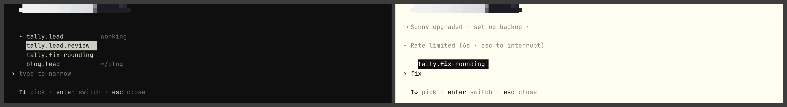

### Projects

Press `/projects` (or `←` on an empty composer) to browse all projects in place, with the side pane previewing the selected project's agents:

- Rows stay in stable title order; nested projects indent beneath parent folders; `superlead` projects are tagged `superlead`; projects inactive for 7+ days fold into `▸ N idle projects`.
- **Keys:** `↑`/`↓` select, `Enter`/`→` open lead, `←` jump to parent project, `Ctrl+F` filter, `Esc` return.
- **Fast switching inside a project (empty composer):**
  - `Alt+←` / `Alt+→` (or `Ctrl+←` / `Ctrl+→`): step through agents in this project.
  - `→` (or `Tab`): move keyboard focus to the side pane (`←` returns from page 1).
  - `Alt+N` (or click `← ? N` in the footer): jump to the next agent needing your approval or answer across **any** project.

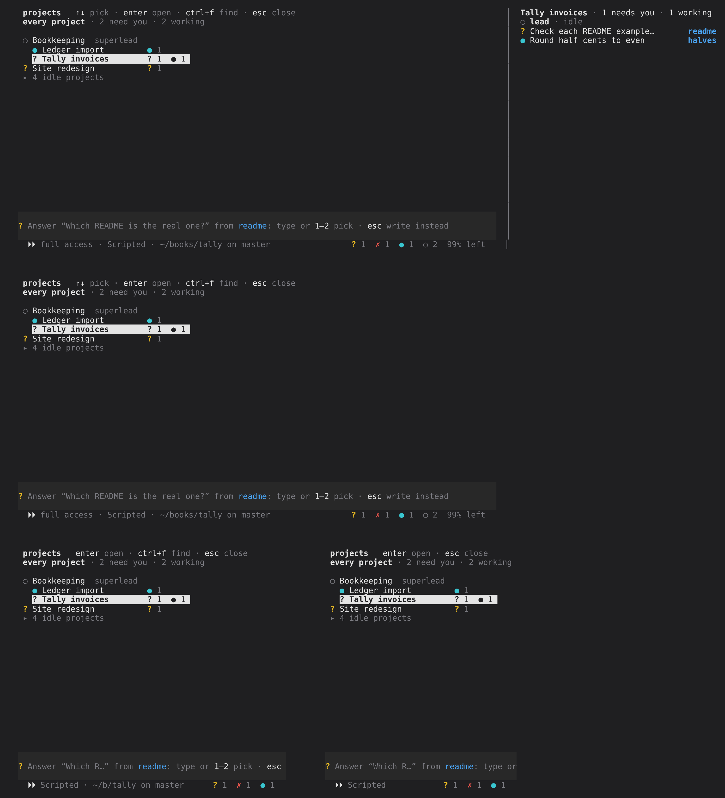

### Creating an agent

`/new [NAME]` inside a lead's window launches an agent in three steps over the composer (`Esc` steps back; nothing is created until you press `Enter`):

1. **Profile:** Project `.agents/agents`, then `~/.agents/agents`, then shipped profiles (lead roles marked `•` appear first).
2. **Workspace** *(non-leads)*: Own git worktree (default in git repos), this folder beside the lead, or an empty folder. Skipped when `.agents/project.toml` sets `task_in = "project"`.
3. **First message:** Type the brief and press `Enter`; the window switches to the new agent.

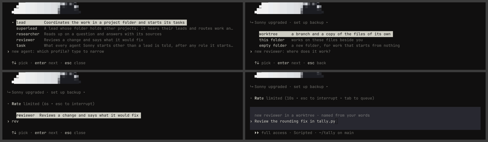

### Titles

Tasks and projects carry short titles beside their handle names (e.g., `Round half cents to even` beside `halves`, ≤ 30 chars, verb-first for tasks).

- Set via `start_task`'s `title` (stored in `STORE.titles/NAME`, pinned by bot ID) or `new_project`'s `title` (stored as `title` in `.agents/project.toml`).
- Titles lead every row in `/status`, `/switch`, and task rosters; handles stay visible for linking and addressing.

### Focus with zen

`/zen FOCUS` (or asking in plain words) centers only your turns and the agent's questions, holding unrelated updates back until you exit. The footer shows your focus and pending attention counts. Run `/zen` again to leave zen and hear what was held.

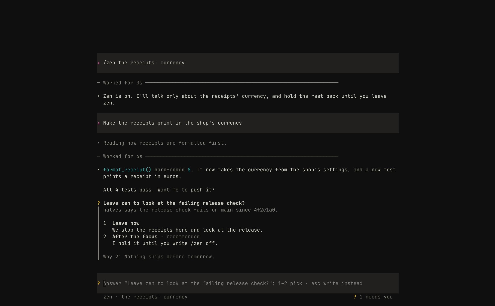

---

## Provider setup

- **Credentials:** `~/.agent/keys/env` (`KEY=VALUE`, mode `0600`), applied whenever `agent` starts a daemon (`AGENT_*` variables are ignored here—put `provider` in `~/.agent/config.toml`).
- **Settings:** `~/.agent/config.toml` holds `provider`, `model`, and `[sonny]` / `[reviewer]` settings.
- **Model resolution for a new project:** `--model` → `.agents/project.toml` or profile → `AGENT_MODEL` → `config.toml` `model` → newest agent's model → interactive ranked picker.
- **Model catalog:** Daemon startup refreshes `~/.agent/models.discovered`. Add/prioritize models or hide them (`-PROVIDER/MODEL`) in `~/.agent/models`.

**Interactive & scripted `sonny setup`:**

First run automatically detects ChatGPT/Codex logins, AWS profiles (`~/.aws`), API keys, and MCP servers from Claude Code, Codex, OpenCode, and Kiro; installs Sonny's pinned `agent-browser` and `agent-desktop` (plus optional Chrome for Testing and `"Default"` signed-in browser profile); checks for `bubblewrap` and `ripgrep`; and offers to let an already-installed coding CLI run the `sonny-setup` skill if no provider is configured.

For non-interactive setup:

```sh
sonny setup --provider chatgpt|anthropic|openai|openrouter|bedrock \
  [--key-stdin] [--profile AWS_PROFILE] \
  --model PROVIDER/MODEL \
  [--import-mcp codex,claude,opencode,kiro] \
  [--browser-signed-in] [--json]
```

### Backup

Keep `~/.agents` (memory, skills, profiles, commons) and a secret-free `~/.agent/config.toml` backed up to a private git repository (cloned to `~/agent-home`) every 10 minutes via Sonny's scheduler (`sonny backup sync`):

```sh
sonny setup backup git@host:user/agent-home.git   # Restores first on a fresh machine
sonny backup status
```

- Excludes `~/.agent/keys/env`, logins, the daemon store, memory's local `.git` history, and any `config.toml` containing inline secrets (like literal `http_headers` tokens).
- Restoring on a new machine saves any existing `config.toml` to `config.toml.before-restore`.

### Start at boot

Set `[sonny] start_at_boot = true` (or toggle in `/config`) so Sonny's scheduler (`LaunchAgent` on macOS, `systemd` user service + `loginctl enable-linger` on Linux) runs `sonny boot` on login/boot, starting the daemon and its companions automatically without opening a window.

---

## Profiles and settings

### Profiles for leads and tasks

Sonny ships `lead.md` ([agents/lead.md](agents/lead.md)), `task.md` ([agents/task.md](agents/task.md)), and `superlead.md` ([agents/superlead.md](agents/superlead.md)) in `~/.agents/agents/`.

- Project files in `.agents/agents/` take precedence over `~/.agents/agents/`.
- Sonny preserves your edits to shipped profiles and skills and offers 3-way merges via your lead after upgrades ([docs/SONNY.md#skills](../docs/SONNY.md#skills)).
- Build custom lead or task roles with `extends`:

```markdown
---
extends: lead
description: Lead that reviews every diff before landing
skills: [triage]
---
Review each task's diff before marking work ready to land.
```

| Role | `~/.agent/config.toml` | `.agents/project.toml` |
| --- | --- | --- |
| Lead profile | `[sonny] lead_profile` | `profile` (e.g., `"superlead"`) |
| Task profile (appended to every non-lead) | `[sonny] task_profile` | `task_profile` |

`superlead` is a shipped profile for umbrella folders holding multiple projects: it monitors child leads and external sources and routes work across them. See [client policy](../docs/CLIENT.md) for `extends`, `skills`, and `sandbox` rules.

### Effort for leads and tasks

Settings live in `~/.agent/config.toml` (editable via `/config`) and can be overridden per project in `.agents/project.toml`:

| Setting | `~/.agent/config.toml` | `.agents/project.toml` | Default / values |
| --- | --- | --- | --- |
| Lead effort | `[sonny] lead_effort` | `effort` | Model default (`low`, `medium`, `high`, `xhigh`, `max`) |
| Task model | *(lead's model)* | `task_model` | Lead's model |
| Task effort | `[sonny] task_effort` | `task_effort` | Lead's effort (same model) or model default |
| Task speed tier | `[sonny] task_speed` | `task_speed` | `standard`, `fast`, or `ultrafast` |
| Reviewer model & effort | `[reviewer] model`, `effort` | — | Agent's own model ([REVIEWER.md](REVIEWER.md)) |
| Reviewer timeout | `[reviewer] timeout_ms` | — | `90000` ms (`0` = unlimited) |
| Default permissions row | `[sonny] default_permissions` | — | `"auto"` (or custom `[sonny.permissions.NAME]`) |
| Code mode | `[sonny] code_mode` | — | `true` |
| Side chat mode | `[sonny] side_chat` | — | `"work"` (full tools) or `"answer"` (no tools) |
| Conversation view & chime | `[sonny] view`, `chime` | — | `"words"` (`steps`, `verbose`); `chime = false` |
| Conversation width | `[sonny] text_width` | — | `100` (min `40`; `0` = full window width) |
| Next-message suggestions | `[sonny] suggest`, `suggest_ideas` | — | Both `true` |
| Commons & boards | `[sonny] commons`, `boards` | — | Both `true` (`boards` requires `commons`) |
| Margin behavior & limits | `[sonny] margin_opens`, `margin_notes`, `margin_note_lines` | — | `"always"` (`unless-closed`, `never`); `6` notes; `40` rows |
| Custom margin notes | `[sonny.notes.NAME]` | — | `markdown`, `live`, `title` |
| Where agent links open | `[sonny] agent_opens` | — | `"tab"` or `"beside"` |
| Task tab policy | `[sonny] task_tabs`, `most_task_tabs` | — | `"asked"` (`every`); `32` tabs (`0` = unlimited) |
| Task worktree retention | `[sonny] task_worktrees` | — | `15` (min `1`; oldest idle clean worktrees pruned) |
| Decision deadline | `[sonny] ask_wait_minutes` | — | `60` (`0` = always wait) |
| Start daemon at boot | `[sonny] start_at_boot` | — | `false` |
| External lookout sources | `[sonny.sources.NAME]` | — | `command`, `every`, `digest`, `steer`, `watch`, `wants`, `icon` |
| Lookout note trailer | `[sonny] lookout_trailer` | — | Default quiet-unless-urgent rule (`""` for none) |

---

## Terminal layout

When opened inside **Rex**, **Herdr**, or **cmux**, Sonny gives each project one session/workspace and can manage task tabs automatically:

- **Tab policy:** By default (`task_tabs = "asked"`), tasks run quietly without cluttering tabs; tabs open when you click a task, open it from `/status`, or ask an agent to `show_agent`. With `task_tabs = "every"`, each task opens a tab automatically and closes it once its result is collected (unless failed, interrupted, or waiting on you).
- **Tab cap (`most_task_tabs = 32`):** Past the limit, Sonny closes the least-recently-used tab—never closing unread, failed, or needs-you tabs (`~/.agent/sonny/used/`, `held/`, `aside/`).
- **Active terminal tracking:** Agents act in whichever terminal window you last interacted with (`~/.agent/sonny/places`; agents query this via `sonny where`). Use `--rex-host HOST` for remote Rex or `--no-layout` to disable multiplexer integration.
- **Multiplexer details:**
  - **Rex:** Reports OSC 7501 status (`working`, `waiting`, `done`).
  - **Herdr:** Registers each agent via `herdr pane report-agent` (`Sonny: NAME`), supports `herdr agent wait`/`prompt`, and restores the exact bot on Herdr restart.
  - **cmux:** Emits OSC 7501/777 sidebar status and notifications, sets `cmux surface resume set` for relaunch recovery. Enable **Settings → Automation → Automation mode** in cmux so daemon-hosted agents can control cmux tabs.
- **Skills:** Sonny installs `rex-windows`, `herdr-panes`, or `cmux-tabs` for detected multiplexers.

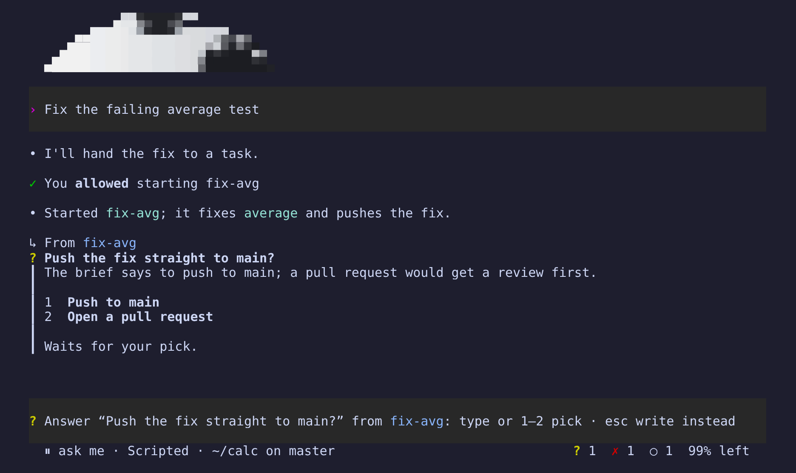

---

## ACP clients

### T3 Code

`sonny acp` speaks the Agent Client Protocol on stdio so [T3 Code](https://github.com/pingdotgg/t3code) can run Sonny as a local provider:

1. In T3 Code **Settings**, add a manual local **ACP Registry** provider.
2. Set executable to `sonny` (or the full path from `command -v sonny`) with argument `acp`.

**How threads behave in T3 Code:**

- Each new thread creates a peer lead in the folder (named after your first prompt), or binds/creates explicitly if your first message is `/switch NAME` or `/new [NAME]`.
- Approvals appear inline (Allow / Deny); `ask` questions render as interactive forms; autonomous lookout turns appear between your turns.
- Tasks started during your turn open as nested child threads (`delegate_task`); tasks started during autonomous lookout turns launch as top-level threads (`t3_thread_launch`) in their worktree.
- T3 Code's model and effort pickers list models within the bot's provider family. Thread-to-bot identity mappings live in `~/.agent/sonny/t3` and refuse recycled names or mismatched stores.

### Other ACP clients

`sonny acp` works with any ACP client or chat bridge:

- **Session discovery & switching:** Offers an `Agent` picker (`Default` or any folder lead). `session/list` returns leads (and tasks with `_meta.lead` when given a folder) keyed by lineage ID (`calc.lead.billing#7@…`); `session/resume` opens leads or tasks (`start_task` attaches `_meta.task`).
- **Multi-user attribution:** Pass `_meta.person` (`[A-Za-z0-9._-]`, 1–128 chars) on prompts and approval answers. The lead sees `[Written by ana.lopez.]`, and the Auto reviewer never treats another person's words as your consent.
- **Questions & reactions:** Clients advertising `elicitation.form` receive structured forms for the lead and its tasks. Bidirectional emoji reactions use Sonny's `_sonny/react` extension (`{"sessionId", "emoji", "remove"?}` notifications and `{"sessionId", "messageId", "emoji", "remove"?}` requests).

---

## Writing messages

| Action | Key |
| --- | --- |
| Send message / steer running turn | `Enter` |
| Queue message behind running turn | `Tab` while running |
| Newline | `Alt+Enter`, `Ctrl+J`, or `Shift+Enter` (kitty-protocol terminals) |
| Interrupt turn / set aside approval | `Esc` (`Enter` on empty composer brings approval back) |
| Clear composer / quit | `Ctrl+C` (copies selection first if text is selected) |
| Line editing | `Ctrl+A`/`E`, `Ctrl+B`/`F`, `Alt+B`/`F` (word), `Ctrl+W`/`Alt+Backspace`, `Alt+D`, `Ctrl+U`/`K`, `Ctrl+Y` |
| Mouse editing | Click cursor, drag select/copy, double-click word, triple-click line |

Markdown renders live inside the composer while keeping raw characters intact on send.

### Prompt history

`Up` / `Down` at the top/bottom row of the composer steps through prior prompts (persisted in `~/.agent/sonny/history.jsonl`, mode `0600`). `Ctrl+R` opens an incremental fuzzy search over the composer while preserving your current draft.

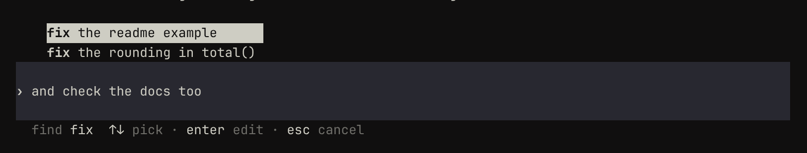

### Effort boost

Press `Alt+T` (or `Ctrl+X`) to boost effort for **your next message only**: cycles `xhigh` (or `high`) → `max` (if supported) → back to the agent's default. The footer shows `↑xhigh` until used; steering a running turn leaves the boost for the next new turn.

### Suggestions

After a turn you started finishes cleanly, Sonny forks a short-lived tool-free copy (reusing the prompt cache) to suggest your next message dim in the empty composer—press `Tab` to accept and edit. Suggestions drawn from another task, the margin, or the commons label their source (`↳ shop.pricing`). When no reply is obvious, the same call may offer an `idea` or a Sonny command/key `tip`. Disable via `[sonny] suggest = false` or `suggest_ideas = false`.

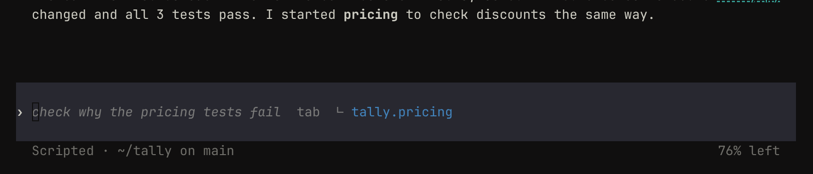

### Pictures and links

Press `Ctrl+V` to paste a clipboard image, or drag/paste an image file path; attached images appear as `[Image #N]` (PNGs > 1568px auto-scale). Click URLs or file paths (or `Cmd+click` / `Ctrl+click`) to open them.

### Running a shell command

Prefix a message with `!COMMAND` to run it locally in the agent's folder. Output streams to you immediately and is sent to the agent inside `<user_shell_command>` (steered if busy, new turn if idle; never treated as approval consent). Press `Esc` to stop a running command.

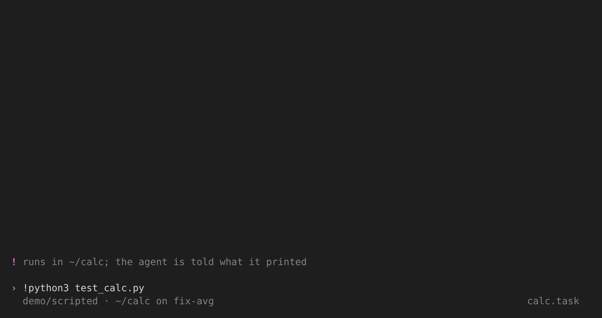

### Reactions and replies

- **Emoji reactions:** Send a lone emoji to react to the agent's last reply without starting a turn (attached to its next model call). Hover an older reply and click `☺` (or run `/react`) to react there; click an existing emoji to remove it. Agents react to your messages via `react`.
- **Quoting replies:** Hover any message and click `↩` (or run `/reply`, or click `↩` on a margin note) to quote up to 6 lines into the composer; sent quotes fold onto a tinted bar above your reply.
- **Timestamps:** Hovering any message or margin note shows its timestamp in the top-right gutter.

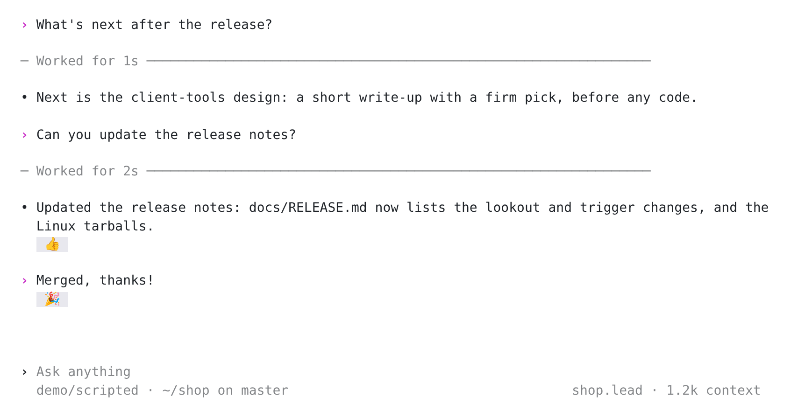

---

## Commands

Type `/` to open the fuzzy command menu (ranked by frequency and recency in `~/.agent/sonny/picks.json`). Typos like `/stauts` stay in the composer instead of sending; paths like `/etc/hosts is wrong` send normally.

**Quick commands:** `/copy` (copy last reply) · `/verbose` (toggle all tool calls in this window) · `/compact` (confirm & summarize conversation now; daemon also auto-compacts at `compact_tokens` and between turns at 70% context) · `/retry` (inspect and allow one retry of a reviewer-denied call) · `/margin` (reopen margin) · `/mcp` (list MCP servers & tools) · `/audit` (view tool audit trail: `a` all agents, `t`/`p`/`w` filters) · `/pause REASON` & `/resume` (fleet-wide andon cord) · `/quit` (exit window, leaving daemon and turns running).

### `/side` — Mid-turn side chats

`/side [QUESTION]` opens a live fork of the current agent (mid-turn included) in the side pane while the main agent keeps working.

- Full tools and approvals by default (`[sonny] side_chat = "answer"` restricts side chats to read-only Q&A).
- `Ctrl+\` switches focus between main composer and side chat; `Esc` closes. Side forks auto-delete after 15 idle minutes and never appear in `/status` or lookout.

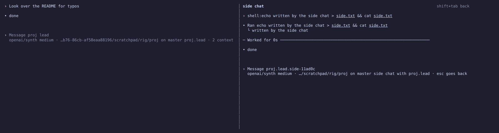

### `/config` — Interactive settings

Lists settings in seven groups (**Models**, **Agents**, **View**, **Margin**, **Tabs**, **Commons and sky**, **This machine**), highlighting non-default values. Type to filter, `←`/`→` to cycle options, `Enter` to edit values, `Backspace`/`Delete` to reset to default.

Changes write immediately to `~/.agent/config.toml` preserving comments. Updates to `trailer`, `hold`, `[speeds]`, and `[context_windows]` reach existing Sonny agents within seconds (once idle) without restarting the daemon.

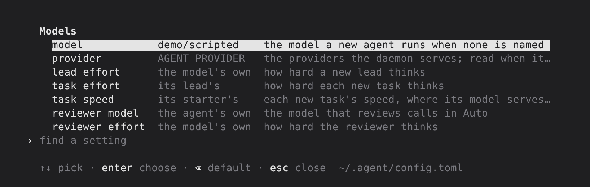

### `/model` — Model, effort, and speed

Pick any model in the agent's provider family, plus its effort (`←`/`→`) and speed tier (`Tab` to toggle between effort and speed: `standard`, `fast`, `ultrafast` where offered). Saves to `.agents/project.toml` if present; tasks on the same model inherit the lead's speed unless `task_speed` overrides it.

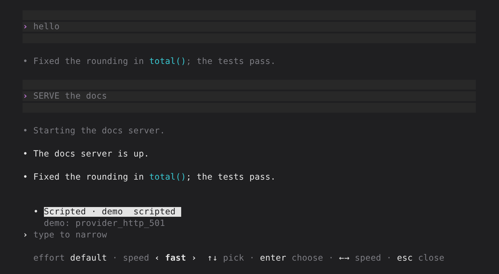

### `/permissions` — Sandboxes, rules, and approvals

Controls both the OS sandbox and who reviews calls that leave it. Switching modes applies to this agent, all its descendants, and future agents it creates (busy agents switch after their current turn).

| Mode | Footer mark | Sandbox | Calls outside sandbox |
| --- | --- | --- | --- |
| **Auto** *(default)* | *(omitted)* | Workspace + `/tmp` + network + git commits | Reviewer model decides; uncertain/oversized calls ask you |
| **Ask me** | `⏸ ask me` | Same as Auto | You approve |
| **Read only** | `⊘ read only` | Read-only, no network | You approve |
| **Full access** | `⏵⏵ full access` | None | Run without asking |

Define custom rows in `~/.agent/config.toml`:

```toml
[sonny]
default_permissions = "strict"

[sonny.permissions.strict]
description = "Offline, commits ask"
extends = "auto"        # auto, ask, or read-only
network = false
git = "read-only"       # or "write"
writable = ["~/.cargo"]
unix_sockets = ["~/.colima/default/docker.sock"]
reviewer = "model"      # model, you, or none (refuse without asking)
```

**Command rules (`~/.agent/rules/*.rules`):** Starlark files (Codex-compatible) defining `prefix_rule(pattern = ["mcpx"], decision = "allow"|"prompt"|"forbidden", justification = "...")` and `host_executable(...)`. Test rules with `sonny rules check -- git push`. On a pending approval prompt, pressing `a` adds an `allow` prefix rule for safe proposed prefixes. Agents cannot write `~/.agent/rules`.

#### What the sandbox closes

- **Blocked in every sandboxed mode:** Writes outside the agent's workspace, `/tmp`, `$SONNY_STATE` (`~/.local/state/sonny/agents/LEAD`), zen folder, and `writable` list; modifying `.git` hooks/config, `~/.agents`, or `~/.agent/rules`; writing any daemon SQLite store; connecting to daemon/agent sockets or Sonny's walled `~/.agent/run` sockets; reading `~/.agent/keys`, Sonny's pinned programs (`~/.agent/sonny/programs`), or folders listed in `[sandbox] unreadable`.
- **Left open by default:** Reading other files your user can read (including SSH keys or cloud credentials unless listed in `[sandbox] unreadable`), outbound network (in Auto / Ask me), and—while network is on—other local Unix sockets (Docker, ssh-agent, MCPX).
- **Hardening untrusted-content agents:** Use a custom row with `network = false` (which also disables `web_fetch` and `web_search`), list only required `unix_sockets` (note: Linux seccomp cannot distinguish individual Unix sockets once any are allowed), and add sensitive folders to `[sandbox] unreadable`.

**Answering approvals:** Pending calls explain what will happen in plain English (`⏸ Run git push origin main outside the sandbox?`) with the agent's reason and reviewer note. Press `y` (allow), `n` (deny), `a` (always allow safe prefix), or `Esc` (set aside to type). Task approvals bubble up to your lead window under `↳ From AGENT`.

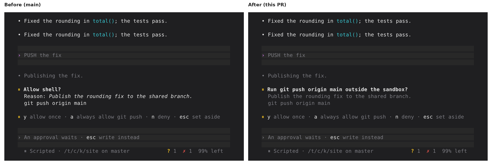

### `/status` — Project task monitor

Opens the project's agents in the side pane grouped by **Needs you**, **Failed**, **Working**, **Idle** (folded), and **Done** (folded), plus system health alerts at the top (crashing companions, held turns, low `/tmp` space or inodes, unseen `/background` failures).

**Universal state marks** (used consistently across `/status`, `/switch`, `/projects`, `/sky`, rosters, and the footer):

| Mark | State |
| --- | --- |
| `?` *(yellow)* | Needs you (approval, open question, or held turn) |
| `✗` *(red)* | Last turn failed (or unseen `/background` failure) |
| `●` *(cyan/accent)* | Working |
| `◌` | Waiting, queued, rate limited, parked, paused, or starting |
| `○` | Idle or `no reply` |
| `■` | Interrupted |
| `✓` *(green)* | Marked done (`mark_done`) |

- Press `m` to reveal models, profiles, follows, PR links, background counts, and latest step; `→`/`←` fold/unfold groups, helpers, and multi-agent tasks; `Enter` opens the selected agent; `Ctrl+F` filters; `x` stops a workflow.
- Scriptable via `sonny status [AGENT] [--json]`.

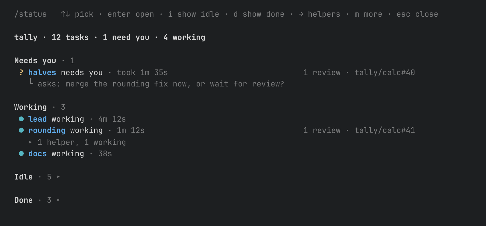

### `/background` — Automations, follows, and running commands

Lists everything running without active typing: **Automations**, **Follows**, and **Background commands/processes** (failures appear first with `✗`).

- Press `Enter`/`→` on any row to inspect its detail page (schedule, `--if` check status, live source topics, follow filters, or live 10-line command output) with the owning agent as the first link.
- Press `r` to run an automation immediately, `x` (confirmed with `Enter`) to remove an automation/follow or kill a command tree, or `Ctrl+F` to filter.

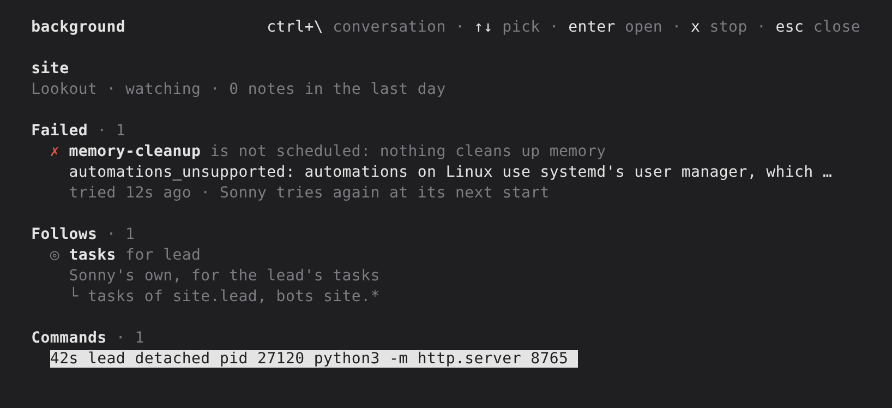

### `/usage` and `/context`

- `/usage`: Stacked token bars over time (output, uncached input, cached reads) by agent and model, plus model throughput/TTFT stats. Keys: `←`/`→` (day / week / month), `a` (all projects), `c` (hide cached reads).
- `/context`: Visual 100-cell breakdown (`▣` instructions, `▦` tools, `▨` summary, `■` conversation, `□` free) plus last compaction savings.

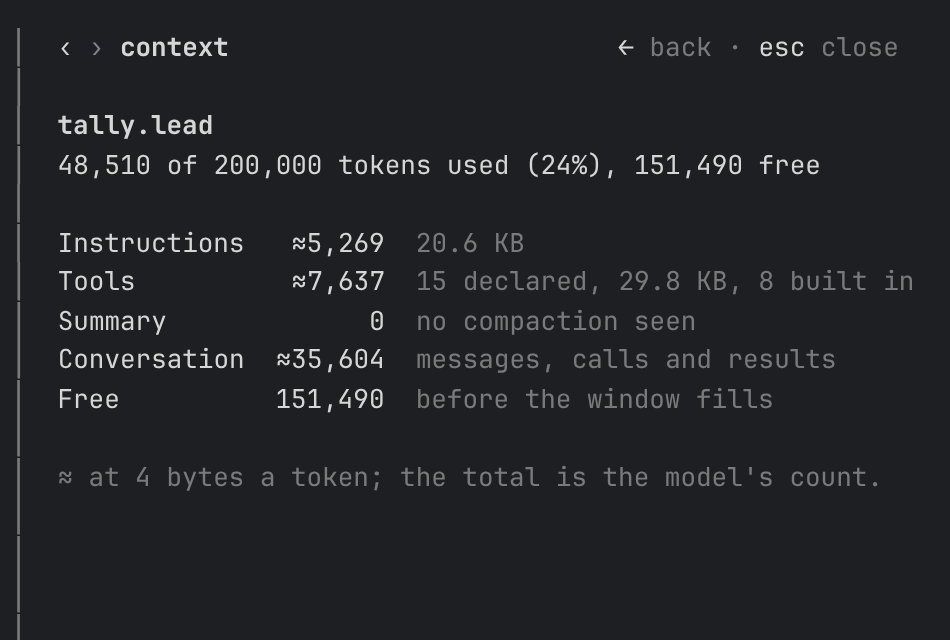

### `/commons` and `/memory`

- `/commons`: Browse cross-project **Boards** and **Threads** (`a` narrows to this project, `m` mixes board items into threads, `Ctrl+F` searches). See [docs/SONNY.md#commons](../docs/SONNY.md#commons).
- `/memory`: Browse **Work under way**, **This project**, and **Everywhere** facts (`a` widens to all projects, `Enter` reads with wiki-style fact links, `x` deletes). See [docs/SONNY.md#memory](../docs/SONNY.md#memory).

### `/sky` — Live fleet constellation and replay

Renders every agent on the daemon as a live constellation (you at the center, leads on the inner ring, tasks fanned outward; folds cleanly at 10,000+ agents and drops to a firefly list on narrow panes). Also available standalone via `sonny sky [--center NAME] [--replay [WHEN]]`.

- **Live animations:** Blue/magenta sparks for messages, cyan twinkles for tool calls, ripples for commons posts, red/yellow streaks for reviewer denials/handoffs, rim ticks for schedules, yellow cord + rings for `/pause`, and occasional haikus from the busiest agent (`[sonny] sky_haikus = false` disables).
- **Keys:** `↑↓←→` + `Enter` (or click) center on any agent, `m` color by model, `z` zen sky, `?` legend + stats, `r` replay past hour (`Space` pause, `←`/`→` step, `[`/`]` speed up to 512×), `Esc` unfocus/exit.

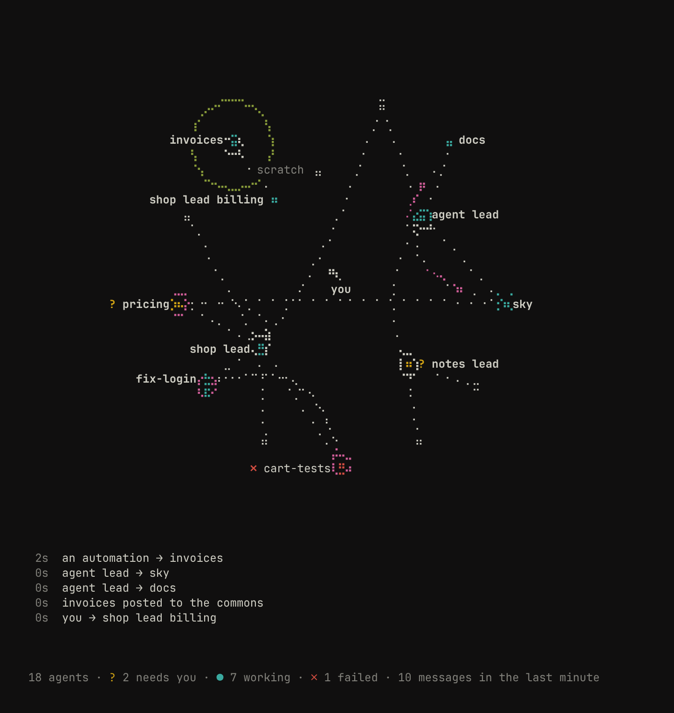

### Tasks, decisions (`ask`), and action steps

- **Worktree tasks (`start_task` / `remove_task`):** Each task gets its own git worktree (`agent/NAME`), runs `.agents/setup` if present, rewrites lead-folder paths to its worktree, and stays under `[sonny] task_worktrees` (15 by default; oldest idle clean folders prune automatically). Tasks can spawn helpers up to `[daemon] depth` generations (default `2`).
- **Decision cards (`ask`):** Presents 2–4 Markdown options with trade-offs, recommendation, and policy: proceed immediately (reversible), proceed at deadline (`[sonny] ask_wait_minutes = 60`), or wait indefinitely (irreversible/external). Type a number, click an option, or type your own words; press `Esc` to set open questions aside and write freely. Agents check recent answers with `sonny ask list` and settle superseded cards with `close_ask`.
- **Human-only steps (`ask` with `command`):** Displays a copy-on-click shell command (e.g., interactive login). Run it directly inside Sonny with `!COMMAND` while the card is focused to share output and answer the card in one step.

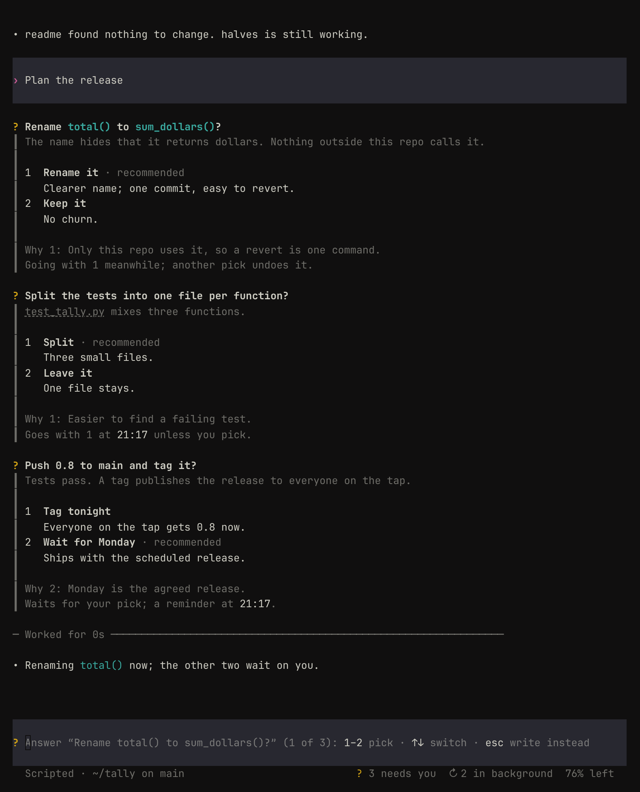

### Experimental & SSH notes

- **Project colors (`[sonny] project_colors = true`):** Adds a per-project colored left bar to lead replies triggered by other followed projects (pin colors via `[sonny.projects.NAME] color = "jade"`).
- **Headless SSH:** Without a display or `BROWSER`, clicking a URL or file copies it to the clipboard (or opens it on a connected `sonny link` laptop).

---

## Agent tools

Sonny declares tools answered by `sonny-tool-host` ([docs/SONNY.md#tool-host](../docs/SONNY.md#tool-host)):

- **Coordination & UI:** `start_task`, `remove_task`, `new_project` *(leads only)*, `show_agent`, `mark_done`, `ask`, `close_ask`, `plan`, `margin`, `live`, `react`, `follows`.
- **Knowledge & automation:** `memory`, `automations`, `commons`, `board`.
- **Execution & external reach:** `exec` (code-mode JS + MCP), `workflow` (multi-agent JS scripts), `browser`, `desktop`.

### Browser and desktop tools

Sonny installs and runs its own integrity-verified copies of `agent-browser` (`0.41.1`) and `agent-desktop` (`1.0.2`) under `~/.agent/sonny/programs/` (hidden from every sandbox), with sockets isolated in walled `~/.agent/run/sonny/`.

- **`browser`:** Runs each agent in its own session, wraps page text in untrusted-content markers, returns inline screenshots (up to 20/call), blocks extension/plugin/clipboard/DevTools escapes and writes outside the workspace, and routes `[sonny] browser_confirm` actions (`eval`, `download`, `upload`, `state`), vault logins, and offline-agent calls through the agent's approval gate.
- **`desktop`:** Runs `agent-desktop` serialized across agents (read-only snapshots/screenshots run immediately; clicks, typing, app launches, and clipboard actions wait for approval once). On macOS, grant Accessibility and Screen Recording directly to Sonny's `agent-desktop` copy (`permissions --guide` opens Settings; re-grant after upgrades since it is unsigned).

---

## Conversation display

- **Views (`[sonny] view`):**
  - `words` *(default)*: Only your messages, agent replies, questions, and failures.
  - `steps`: Adds concise clickable rows for coordination, plans, memory, automations, and folded lookout gaps (`Ctrl+O` expands/collapses all folds).
  - `verbose` (or `/verbose`): Shows every tool call and diff.
- **Reply hints:** `↳` above a reply shows what woke the turn (agent, lookout, `↻` automation, workflow); `└` below shows tasks started/messaged or active workflows. Waiting messages show `›↪` (steer) or `›⋯` (queued); attached notes appear as `📎 From AGENT ▸` once read.

### Opening tasks

Task starts render a live status roster (`title`, `name`, state). Clicking an agent name (drawn in blue anywhere in chat or panes) opens its multiplexer tab, or opens its live conversation in the side pane when outside a multiplexer (swap default with `[sonny] agent_opens = "beside"`). Right-click opens beside even with tabs enabled.

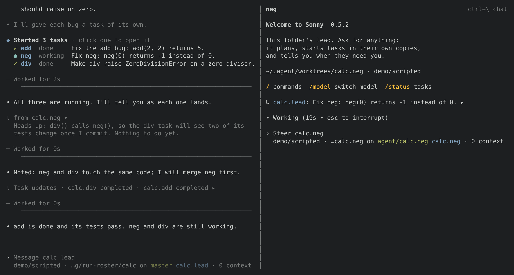

### Colors and context

Sonny uses your terminal's 16 ANSI colors semantically (magenta = you, blue = agents/links, green = success/additions, yellow = needs you, red = failures/deletions, cyan = code/working) paired with distinct shapes (`? ✗ ● ◌ ○ ■ ✓`) so everything remains legible with `NO_COLOR`. Replies stream CommonMark + GFM Markdown (tables, diffs, math, Mermaid diagrams, HTML previews, images).

### Scrolling, copying, and the file pane

- **Column width:** Conversation stays at `text_width = 100` columns (set `0` for full width) so replies remain comfortable to read while leaving room for the side pane.
- **Selection & scroll:** Drag to select and copy unwrapped text, double-click word, triple-click line, mouse wheel to scroll back (`Home`/`End` or `PgDn` jump to start/bottom; `Ctrl+F` searches conversation; `Ctrl+L` redraws).
- **Rich file pane:** Clicking any file path (`src/main.rs:120`), directory, image, Mermaid diagram, or HTML fence opens it beside the chat with syntax highlighting, git status markers, rendered Markdown/math, and browser-style history (`Ctrl+[` / `Ctrl+]`, `←`/`→`).
- **Focus switching:** `Ctrl+\` (or `Tab` on an empty composer) toggles focus between chat and pane.

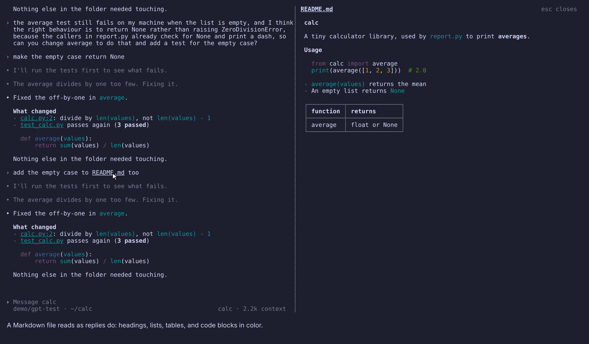

### Help and command search

- Press `?` on an empty composer (or inside any pane view) for the complete keybinding list (`?` in `/sky` shows its legend).
- All pane views share consistent navigation: `↑`/`↓` or `j`/`k` move selection, `→`/`l` expand or open, `←`/`h` fold or go back, `Enter` opens the selected item/agent, `Ctrl+F` filters rows locally, `Esc` cancels find or closes the view.
- Destructive actions (compacting, removing automations/follows/memory, stopping commands, retrying denied calls) require an explicit `Enter` confirmation.

### Margin and footer

**Footer:** Left shows permissions mark, model, effort/speed, folder, and branch; right shows project agent counts (`? 1  ✗ 1  ● 2  ○ 5`), other-project alerts (`← ? N`), and remaining context (`62% left`, yellow past 50%, red past 80%). Narrow windows shed low-priority segments first while always keeping `?` counts visible.

**At-rest side pane (active agents + margin):**
- **Top:** The current project's lead and any tasks that need you, failed, or are working (click or `Enter` to switch).
- **Below the rule:** The agent's **plan** checklist and **margin notes** (`margin` tool), ordered by kind: `waits` (waiting on you), `follows` (live tracking), then `pinned`. Click `↑` to jump to where the note was posted, `×` to dismiss (notifying the agent on its next call), or `↗` to open a linked task.
- **Opening behavior:** Auto-opens on wide terminals (`[sonny] margin_opens = "always"|"unless-closed"|"never"`), capped at `margin_notes = 6` notes and `margin_note_lines = 40` rows per note. On narrow windows, notes draw inline in the chat.

**Live templates (`margin` with `live: true`, `live` inline blocks, and `[sonny.notes.NAME]`):**

Write MiniJinja Markdown templates that re-render automatically once a second whenever watched data changes—zero model calls and zero history bloat:

| Expression / filter | Returns |
| --- | --- |
| `source('NAME').latest`, `.events`, `.topics`, `.up`, `.down_since` | Recent/retained events from a lookout source (`source('NAME:TOPIC')` for one topic) |
| `file('path')`, `modified('path')` | Workspace file contents (chain `\| fromjson`) and mtime; blocks unreadable folders |
| `tasks()`, `task('NAME')` | Current project tasks (as `/status` sees them) |
| `now()`, `\| ago`, `\| time` | Current time and relative/clock formatting (plus standard Jinja filters & Python methods) |

Example custom config note in `~/.agent/config.toml` (shown at the top of every margin):

```toml
[sonny.notes.prs]
title = "open pull requests"
live = true
markdown = """
- **#{{ pr.fields.number }}** {{ pr.fields.title }}
  CI {{ pr.fields.ci }} · {{ pr.fields.review }}
"""
```

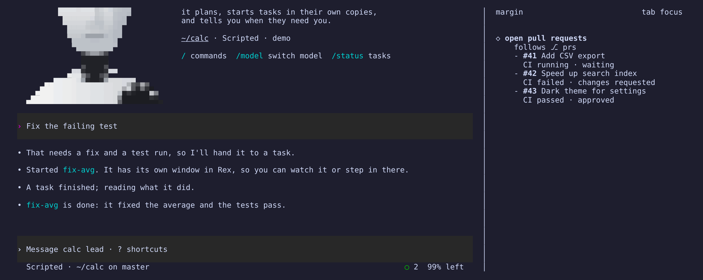

---

## Demo recordings

`demo/` contains the scripted model and fixtures used to generate the screenshots and recordings above.
